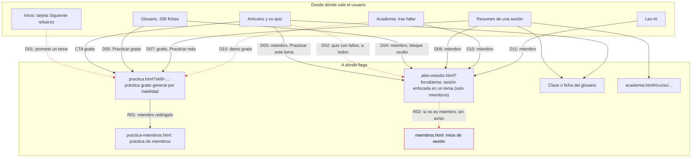

# Mapa Maestro de Conexiones

Documento vivo. Responde tres preguntas: qué recursos tenemos para cada tema, cómo se conectan entre sí y desde dónde se llega a ellos según el tipo de usuario. Se creó el 14 de noviembre de 2026 como auditoría de solo lectura: no cambia ni el funcionamiento de la práctica ni los motores, pagos o límites.

Archivos relacionados:

- `INVENTARIO_CONEXIONES.csv`: cada enlace, botón y redirección (origen, texto, tema, destino real, destino esperado, acceso, estado, cómo se verificó).
- `INVENTARIO_TEMAS.csv`: una fila por tema de `temas.js` (clase, ficha, curso, quiz, ejercicios gratis y de miembros por nivel, estado).
- `PLAN_CONEXIONES.md`: problemas, prioridades, contenidos por crear y fases.
- `tools/conexiones/auditar.js`: el escáner que regenera lo de arriba. `tools/conexiones/destinos-dinamicos.json`: los destinos que construye JavaScript.

Los bloques marcados como GENERADO se reescriben solos con `node tools/conexiones/auditar.js --write`. No se editan a mano.

## 1. Cómo leer los estados

| Estado | Significa |
|---|---|
| verificado | El destino existe y hace lo que el botón dice. |
| parcial | Correcto en el caso normal, pero en casos límite (por ejemplo otro nivel) cae en algo más general sin avisar. |
| enlace_incorrecto | Promete algo que no entrega, o lleva a un lugar que el usuario no puede usar, o está roto. |
| recurso_sin_conectar | El recurso existe (por ejemplo ejercicios gratis de un tema) pero ningún botón lleva a él. |
| por_construir | Falta el contenido. |
| solo_miembros | Disponible solo para miembros y bien protegido. No es un fallo. |
| general_intencional | Lleva a la práctica general y el texto no promete un tema ("Practicar gratis"). No es un fallo. |

## 2. Resumen actual

<!-- GENERADO:resumen -->
| Estado | Enlaces y destinos (INVENTARIO_CONEXIONES.csv) | Temas: practica de miembros | Temas: practica gratis |
|---|---|---|---|
| verificado | 117 | 74 | 0 |
| parcial | 3 | 0 | 0 |
| enlace_incorrecto | 1 | 4 | 0 |
| recurso_sin_conectar | 0 | 0 | 65 |
| por_construir | 0 | 1 | 1 |
| solo_miembros | 35 | 0 | 13 |
| general_intencional | 55 | 0 | 0 |

79 temas en temas.js. 211 filas de enlaces: 191 agrupadas desde 446 paginas HTML y 20 destinos dinamicos o redirecciones curados.
<!-- /GENERADO:resumen -->

Cifras clave:

<!-- GENERADO:cifras -->
- Temas de temas.js: 79. Con ejercicios gratis: 65. Solo con ejercicios de Miembros: 13. Sin ejercicios: 1.
- Temas cuya practica de miembros existe solo en algunos niveles (en los demas el Plan usa el nivel mas cercano y lo avisa, sin cambiar el nivel guardado): 74 de 79.
- Tarjetas del inicio (mini-lecciones.js): 95. Con ejercicios gratis del mismo tema (nivel tema): 84; del mismo tema exacto (mismo nombre de la tarjeta): 65. Sin ningun ejercicio gratis del tema exacto: 30.
- Que abre el boton de cada tarjeta del inicio: tema 76, clase 17, general 2 (tema = practica gratis de ese tema; clase = su explicacion; general = practica de gramatica en general, y el texto del boton lo dice).
- Enlaces HTML con destino o ancla inexistente: 0. Enlaces HTML que prometen un tema y abren la practica general: 0. Paginas publicas que enlazan a paginas de miembros sin explicarlo: 0.
- Temas con 6 ejercicios gratis o menos (una sesion gratis normal es de 6 a 8): 34. Temas con ejercicios gratis en un solo nivel: 39.
- Temas sin clase ni ficha del glosario (no hay explicacion que ofrecer): 21. Temas con clase: 32. Con ficha: 30.
<!-- /GENERADO:cifras -->

## 3. Cómo se conecta hoy todo (vista general)

Las flechas continuas son recorridos que funcionan. Las punteadas rojas son los huecos encontrados en la auditoría (identificadores D y R del inventario).

Reglas del código que explican el diagrama (para no romperlas):

- Un solo lugar decide el destino de práctica de un tema para un miembro: `contentForTema()` en `app.js`, que usa `temas.js` y `temaHasItemsAt()` (solo ofrece el Plan con foco si el tema tiene ejercicios en el nivel).
- La práctica gratis (`practica.html`) entiende `?skill=`, `?level=` y, para gramática, `?tema=<id>` (piloto): solo ejercicios gratis de ese tema, mismos bancos y mismos límites; sin ejercicios gratis del tema lo dice y sigue con la práctica general. `freeMemoryBoost()` sigue cambiando hasta 4 ejercicios de la sesión de una cuenta gratis por otros del tema que le costó.
- Un miembro que abre `practica.html?tema=` pasa a su Plan de ese tema (o a `practica-miembros.html` si el tema no tiene Plan), conservando la URL (R01).
- Todas las páginas con `guardMemberPage()` mandan a `miembros.html`, sin mensaje, a quien no es miembro (R02).
- Volver al tema después de crear cuenta o entrar: `?volver=` lleva un destino interno validado por `leoSafeVolver()` (`app.js`). Solo páginas simples del sitio; en `practica.html` únicamente `skill` (lista cerrada), `level` (lista cerrada) y `tema` (identificador en minúsculas); todo lo demás se descarta, y nunca URLs externas, `//`, `javascript:` ni `miembros.html`. Lo genera `leoVolverActual()` (enlaces "Crear cuenta gratis", "Ya tengo cuenta", el aviso de Leo AI y el enlace "Crea una cuenta gratis" al pie de `practica.html`) y lo consume `miembros.html` (registro por correo, entrada por correo y regreso de Google; para Google el destino completo se guarda en `sessionStorage` y a Supabase solo se le pasa el nombre de la página, así su dirección de regreso no cambia). Los enlaces antiguos (solo el nombre de la página) y los accesos sin parámetros se comportan igual que antes. `practica.html` quita `?cuenta=nueva` pero conserva el tema. Prueba: `tools/tests/piloto-volver.e2e.js`.

## 4. Los temas (identificadores estables de `temas.js`)

El tema (`id` en `temas.js`) es la unidad que une todo: lo usan el Plan, el diagnóstico, Leo AI, las clases, las fichas, los quizzes y los cursos. No se renombran ids ni se crea otro sistema.

Temas que ya tienen curso o quiz de artículo (generado):

```mermaid
flowchart LR
  n_tquestion_words["Palabras de pregunta (what, where, whe"]:::tema
  n_tquestion_words --> n_cquestion_words["clase"]:::ok
  n_tquestion_words --> n_qquestion_words["quiz 6 preg."]:::ok
  n_tquestion_words --> n_kquestion_words["curso wh"]:::miembros
  n_tquestion_words -.-> n_pquestion_words["Miembros: verificado"]:::ok
  n_tquestion_words -.-> n_fquestion_words["Gratis: recurso_sin_conectar"]:::warn
  n_tcomparativos["Comparativos"]:::tema
  n_tcomparativos --> n_ccomparativos["clase"]:::ok
  n_tcomparativos --> n_qcomparativos["quiz 4 preg."]:::ok
  n_tcomparativos -.-> n_pcomparativos["Miembros: verificado"]:::ok
  n_tcomparativos -.-> n_fcomparativos["Gratis: recurso_sin_conectar"]:::warn
  n_tsecuenciadores["Secuenciadores (first, then, finally)"]:::tema
  n_tsecuenciadores --> n_csecuenciadores["clase"]:::ok
  n_tsecuenciadores --> n_qsecuenciadores["quiz 8 preg."]:::ok
  n_tsecuenciadores -.-> n_psecuenciadores["Miembros: verificado"]:::ok
  n_tsecuenciadores -.-> n_fsecuenciadores["Gratis: recurso_sin_conectar"]:::warn
  n_tpresente_continuo["Presente continuo"]:::tema
  n_tpresente_continuo --> n_cpresente_continuo["clase"]:::ok
  n_tpresente_continuo --> n_qpresente_continuo["quiz 16 preg."]:::ok
  n_tpresente_continuo --> n_kpresente_continuo["curso presente-continuo"]:::miembros
  n_tpresente_continuo -.-> n_ppresente_continuo["Miembros: verificado"]:::ok
  n_tpresente_continuo -.-> n_fpresente_continuo["Gratis: recurso_sin_conectar"]:::warn
  n_tpasado_continuo["Pasado continuo"]:::tema
  n_tpasado_continuo --> n_cpasado_continuo["clase"]:::ok
  n_tpasado_continuo --> n_qpasado_continuo["quiz 4 preg."]:::ok
  n_tpasado_continuo -.-> n_ppasado_continuo["Miembros: verificado"]:::ok
  n_tpasado_continuo -.-> n_fpasado_continuo["Gratis: solo_miembros"]:::miembros
  n_tcontables_incontables["Sustantivos contables e incontables"]:::tema
  n_tcontables_incontables --> n_ccontables_incontables["clase"]:::ok
  n_tcontables_incontables --> n_qcontables_incontables["quiz 6 preg."]:::ok
  n_tcontables_incontables -.-> n_pcontables_incontables["Miembros: verificado"]:::ok
  n_tcontables_incontables -.-> n_fcontables_incontables["Gratis: solo_miembros"]:::miembros
  n_ta_an["A y an"]:::tema
  n_ta_an --> n_ca_an["clase"]:::ok
  n_ta_an --> n_ga_an["ficha"]:::ok
  n_ta_an --> n_qa_an["quiz 6 preg."]:::ok
  n_ta_an --> n_ka_an["curso articulos"]:::miembros
  n_ta_an -.-> n_pa_an["Miembros: verificado"]:::ok
  n_ta_an -.-> n_fa_an["Gratis: recurso_sin_conectar"]:::warn
  n_tthis_that["This, that, these y those"]:::tema
  n_tthis_that --> n_cthis_that["clase"]:::ok
  n_tthis_that --> n_qthis_that["quiz 8 preg."]:::ok
  n_tthis_that -.-> n_pthis_that["Miembros: verificado"]:::ok
  n_tthis_that -.-> n_fthis_that["Gratis: recurso_sin_conectar"]:::warn
  n_tcan_cant["Can y can't"]:::tema
  n_tcan_cant --> n_ccan_cant["clase"]:::ok
  n_tcan_cant --> n_kcan_cant["curso can"]:::miembros
  n_tcan_cant -.-> n_pcan_cant["Miembros: verificado"]:::ok
  n_tcan_cant -.-> n_fcan_cant["Gratis: recurso_sin_conectar"]:::warn
  n_tverbos_irregulares["Verbos irregulares en pasado"]:::tema
  n_tverbos_irregulares --> n_cverbos_irregulares["clase"]:::ok
  n_tverbos_irregulares --> n_qverbos_irregulares["quiz 10 preg."]:::ok
  n_tverbos_irregulares -.-> n_pverbos_irregulares["Miembros: verificado"]:::ok
  n_tverbos_irregulares -.-> n_fverbos_irregulares["Gratis: recurso_sin_conectar"]:::warn
  n_tvoz_pasiva["Voz pasiva"]:::tema
  n_tvoz_pasiva --> n_cvoz_pasiva["clase"]:::ok
  n_tvoz_pasiva --> n_qvoz_pasiva["quiz 10 preg."]:::ok
  n_tvoz_pasiva -.-> n_pvoz_pasiva["Miembros: verificado"]:::ok
  n_tvoz_pasiva -.-> n_fvoz_pasiva["Gratis: recurso_sin_conectar"]:::warn
  n_tin_on_at["In, on y at"]:::tema
  n_tin_on_at --> n_cin_on_at["clase"]:::ok
  n_tin_on_at --> n_qin_on_at["quiz 20 preg."]:::ok
  n_tin_on_at --> n_kin_on_at["curso in-on-at"]:::miembros
  n_tin_on_at -.-> n_pin_on_at["Miembros: verificado"]:::ok
  n_tin_on_at -.-> n_fin_on_at["Gratis: recurso_sin_conectar"]:::warn
  n_tpresente_simple["Presente simple"]:::tema
  n_tpresente_simple --> n_cpresente_simple["clase"]:::ok
  n_tpresente_simple --> n_kpresente_simple["curso presente-simple"]:::miembros
  n_tpresente_simple -.-> n_ppresente_simple["Miembros: verificado"]:::ok
  n_tpresente_simple -.-> n_fpresente_simple["Gratis: recurso_sin_conectar"]:::warn
  n_tdo_does["Do y does"]:::tema
  n_tdo_does --> n_cdo_does["clase"]:::ok
  n_tdo_does --> n_qdo_does["quiz 10 preg."]:::ok
  n_tdo_does --> n_kdo_does["curso do-does"]:::miembros
  n_tdo_does -.-> n_pdo_does["Miembros: verificado"]:::ok
  n_tdo_does -.-> n_fdo_does["Gratis: recurso_sin_conectar"]:::warn
  n_tpronombres["Pronombres (sujeto y objeto)"]:::tema
  n_tpronombres --> n_cpronombres["clase"]:::ok
  n_tpronombres --> n_qpronombres["quiz 4 preg."]:::ok
  n_tpronombres --> n_kpronombres["curso pronombres"]:::miembros
  n_tpronombres -.-> n_ppronombres["Miembros: verificado"]:::ok
  n_tpronombres -.-> n_fpronombres["Gratis: recurso_sin_conectar"]:::warn
  n_tposesivos["Posesivos (my, your, his, her...)"]:::tema
  n_tposesivos --> n_cposesivos["clase"]:::ok
  n_tposesivos --> n_qposesivos["quiz 8 preg."]:::ok
  n_tposesivos --> n_kposesivos["curso posesivos"]:::miembros
  n_tposesivos -.-> n_pposesivos["Miembros: verificado"]:::ok
  n_tposesivos -.-> n_fposesivos["Gratis: recurso_sin_conectar"]:::warn
  n_tto_be_presente["Verbo to be (am, is, are)"]:::tema
  n_tto_be_presente --> n_cto_be_presente["clase"]:::ok
  n_tto_be_presente --> n_kto_be_presente["curso to-be"]:::miembros
  n_tto_be_presente -.-> n_pto_be_presente["Miembros: verificado"]:::ok
  n_tto_be_presente -.-> n_fto_be_presente["Gratis: recurso_sin_conectar"]:::warn
  n_tthere_is_are["There is y there are"]:::tema
  n_tthere_is_are --> n_cthere_is_are["clase"]:::ok
  n_tthere_is_are --> n_qthere_is_are["quiz 4 preg."]:::ok
  n_tthere_is_are --> n_kthere_is_are["curso there-is-are"]:::miembros
  n_tthere_is_are -.-> n_pthere_is_are["Miembros: verificado"]:::ok
  n_tthere_is_are -.-> n_fthere_is_are["Gratis: solo_miembros"]:::miembros
  n_tgerundios_infinitivos["Gerundios e infinitivos"]:::tema
  n_tgerundios_infinitivos --> n_cgerundios_infinitivos["clase"]:::ok
  n_tgerundios_infinitivos --> n_qgerundios_infinitivos["quiz 4 preg."]:::ok
  n_tgerundios_infinitivos -.-> n_pgerundios_infinitivos["Miembros: verificado"]:::ok
  n_tgerundios_infinitivos -.-> n_fgerundios_infinitivos["Gratis: recurso_sin_conectar"]:::warn
  n_tverbo_have["Verbo have"]:::tema
  n_tverbo_have --> n_cverbo_have["clase"]:::ok
  n_tverbo_have --> n_qverbo_have["quiz 6 preg."]:::ok
  n_tverbo_have -.-> n_pverbo_have["Miembros: verificado"]:::ok
  n_tverbo_have -.-> n_fverbo_have["Gratis: recurso_sin_conectar"]:::warn
  n_tquestion_tags["Question tags"]:::tema
  n_tquestion_tags --> n_cquestion_tags["clase"]:::ok
  n_tquestion_tags --> n_qquestion_tags["quiz 10 preg."]:::ok
  n_tquestion_tags -.-> n_pquestion_tags["Miembros: enlace_incorrecto"]:::warn
  n_tquestion_tags -.-> n_fquestion_tags["Gratis: recurso_sin_conectar"]:::warn
  classDef tema fill:#e8edff,stroke:#253ecc,color:#111
  classDef ok fill:#e6f6ea,stroke:#2e7d32,color:#111
  classDef warn fill:#fff4d6,stroke:#b26a00,color:#111
  classDef miembros fill:#efe6ff,stroke:#6a3fb5,color:#111
  classDef bad fill:#fde4e4,stroke:#c62828,color:#111
```

<!-- GENERADO:diagrama -->

<!-- /GENERADO:diagrama -->

Matriz completa de los temas (generado; el detalle por nivel está en `INVENTARIO_TEMAS.csv`):

<!-- GENERADO:matriz -->
| Tema | Hab. | Clase | Ficha | Curso | Quiz | Gratis (por nivel) | Solo miembros | Miembros | Gratis | Falta |
|---|---|---|---|---|---|---|---|---|---|---|
| `numeros-basicos` | gram | si | - | - | - | principiante:8 | - | verificado | recurso_sin_conectar | - |
| `basicos-ingles` | gram | - | - | - | - | principiante:16 | principiante:7 | verificado | recurso_sin_conectar | explicacion (ni clase ni ficha) |
| `question-words` | gram | si | - | wh | 6 | facil:6 | - | verificado | recurso_sin_conectar | - |
| `comparativos` | gram | si | - | - | 4 | facil:9 medio:3 | facil:3 medio:3 | verificado | recurso_sin_conectar | - |
| `condicionales` | gram | - | - | - | - | facil:1 medio:6 avanzado:10 | medio:9 avanzado:1 | verificado | recurso_sin_conectar | explicacion (ni clase ni ficha) |
| `wish` | gram | - | - | - | - | medio:1 avanzado:4 | - | verificado | recurso_sin_conectar | explicacion (ni clase ni ficha) |
| `conectores-contraste` | gram | - | si | - | - | medio:1 avanzado:2 | medio:5 avanzado:7 | verificado | recurso_sin_conectar | - |
| `secuenciadores` | gram | si | - | - | 8 | facil:1 | facil:4 | verificado | recurso_sin_conectar | - |
| `conectores-avanzados` | gram | - | si | - | - | avanzado:7 | avanzado:1 | verificado | recurso_sin_conectar | - |
| `its-vs-its` | gram | - | si | - | - | facil:4 | - | verificado | recurso_sin_conectar | - |
| `then-vs-than` | gram | - | si | - | - | facil:4 | - | verificado | recurso_sin_conectar | - |
| `your-vs-youre` | gram | - | si | - | - | - | facil:4 | verificado | solo_miembros | - |
| `there-their-theyre` | gram | - | si | - | - | facil:4 | - | verificado | recurso_sin_conectar | - |
| `to-too-two` | gram | - | si | - | - | - | facil:6 | verificado | solo_miembros | - |
| `lose-vs-loose` | gram | - | si | - | - | - | avanzado:4 | verificado | solo_miembros | - |
| `good-vs-well` | gram | - | si | - | - | principiante:5 | - | verificado | recurso_sin_conectar | - |
| `say-vs-tell` | gram | - | si | - | - | - | medio:4 | verificado | solo_miembros | - |
| `borrow-vs-lend` | gram | - | si | - | - | principiante:5 facil:1 | principiante:1 | verificado | recurso_sin_conectar | - |
| `bring-vs-take` | gram | - | si | - | - | avanzado:3 | principiante:1 | verificado | recurso_sin_conectar | - |
| `affect-vs-effect` | gram | - | si | - | - | medio:6 | - | verificado | recurso_sin_conectar | - |
| `as-vs-like` | gram | - | si | - | - | medio:3 | - | verificado | recurso_sin_conectar | - |
| `actually-currently` | gram | - | si | - | - | - | medio:5 | verificado | solo_miembros | - |
| `palabras-parecidas` | gram | - | - | - | - | avanzado:8 | medio:3 avanzado:3 | verificado | recurso_sin_conectar | explicacion (ni clase ni ficha) |
| `matices-formales` | gram | - | - | - | - | avanzado:4 | avanzado:5 | verificado | recurso_sin_conectar | explicacion (ni clase ni ficha) |
| `presente-continuo` | gram | si | - | presente-continuo | 16 | facil:5 | - | verificado | recurso_sin_conectar | - |
| `pasado-continuo` | gram | si | - | - | 4 | - | facil:8 | verificado | solo_miembros | - |
| `cuantificadores` | gram | - | - | - | - | - | - | por_construir | por_construir | explicacion (ni clase ni ficha); ejercicios |
| `much-many` | gram | - | si | - | - | facil:2 | facil:5 medio:9 | verificado | recurso_sin_conectar | - |
| `fewer-vs-less` | gram | - | si | - | - | - | medio:6 | verificado | solo_miembros | - |
| `little-few` | gram | - | si | - | - | facil:5 | - | verificado | recurso_sin_conectar | - |
| `some-any` | gram | - | si | - | - | facil:5 | facil:7 | verificado | recurso_sin_conectar | - |
| `contables-incontables` | gram | si | - | - | 6 | - | facil:4 | verificado | solo_miembros | - |
| `a-an` | gram | si | si | articulos | 6 | facil:4 | facil:2 | verificado | recurso_sin_conectar | - |
| `this-that` | gram | si | - | - | 8 | principiante:4 facil:4 | principiante:5 | verificado | recurso_sin_conectar | - |
| `will-going-to` | gram | si | - | - | - | facil:3 medio:6 | facil:2 medio:20 | verificado | recurso_sin_conectar | - |
| `estilo-indirecto` | gram | - | - | - | - | medio:7 avanzado:6 | - | verificado | recurso_sin_conectar | explicacion (ni clase ni ficha) |
| `can-cant` | gram | si | - | can | - | principiante:1 facil:6 | principiante:1 facil:2 | verificado | recurso_sin_conectar | - |
| `modales-obligacion` | gram | si | - | - | - | facil:1 medio:6 | facil:1 medio:10 | verificado | recurso_sin_conectar | - |
| `modales-posibilidad` | gram | si | - | - | - | - | medio:5 | verificado | solo_miembros | - |
| `modales-perfectos` | gram | - | si | - | - | avanzado:1 | medio:1 avanzado:5 | verificado | recurso_sin_conectar | - |
| `pasado-regulares` | gram | si | - | - | - | - | facil:5 | verificado | solo_miembros | - |
| `verbos-irregulares` | gram | si | - | - | 10 | facil:6 | - | verificado | recurso_sin_conectar | - |
| `used-to` | gram | - | si | - | - | medio:5 | medio:1 | verificado | recurso_sin_conectar | - |
| `voz-pasiva` | gram | si | - | - | 10 | medio:5 avanzado:9 | medio:1 avanzado:1 | verificado | recurso_sin_conectar | - |
| `causativos` | gram | - | - | - | - | - | medio:3 | verificado | solo_miembros | explicacion (ni clase ni ficha) |
| `present-perfect-vs-past` | gram | si | - | - | - | medio:6 | medio:9 | verificado | recurso_sin_conectar | - |
| `since-for` | gram | si | si | - | - | facil:1 medio:5 | medio:8 | verificado | recurso_sin_conectar | - |
| `past-perfect` | gram | - | si | - | - | medio:7 | - | verificado | recurso_sin_conectar | - |
| `in-on-at` | gram | si | - | in-on-at | 20 | facil:4 | facil:8 | verificado | recurso_sin_conectar | - |
| `by-until` | gram | - | si | - | - | facil:4 medio:2 | - | verificado | recurso_sin_conectar | - |
| `preposiciones-movimiento` | gram | - | - | - | - | - | principiante:4 | verificado | solo_miembros | explicacion (ni clase ni ficha) |
| `preposiciones-sutiles` | gram | - | - | - | - | avanzado:4 | avanzado:3 | verificado | recurso_sin_conectar | explicacion (ni clase ni ficha) |
| `presente-simple` | gram | si | - | presente-simple | - | principiante:2 facil:10 | principiante:1 facil:15 | verificado | recurso_sin_conectar | - |
| `do-does` | gram | si | - | do-does | 10 | principiante:3 facil:5 | principiante:4 facil:4 | verificado | recurso_sin_conectar | - |
| `pronombres` | gram | si | - | pronombres | 4 | facil:1 | principiante:8 | verificado | recurso_sin_conectar | - |
| `posesivos` | gram | si | - | posesivos | 8 | facil:5 | principiante:7 | verificado | recurso_sin_conectar | - |
| `relativas` | gram | - | - | - | - | medio:6 avanzado:5 | - | verificado | recurso_sin_conectar | explicacion (ni clase ni ficha) |
| `who-whom` | gram | - | si | - | - | medio:4 | avanzado:5 | verificado | recurso_sin_conectar | - |
| `to-be-presente` | gram | si | - | to-be | - | principiante:8 facil:1 | principiante:4 | verificado | recurso_sin_conectar | - |
| `was-were` | gram | si | si | - | - | principiante:4 facil:1 | - | verificado | recurso_sin_conectar | - |
| `there-is-are` | gram | si | - | there-is-are | 4 | - | principiante:8 | verificado | solo_miembros | - |
| `phrasal-verbs` | gram | si | si | - | - | medio:5 | medio:1 | verificado | recurso_sin_conectar | - |
| `gerundios-infinitivos` | gram | si | - | - | 4 | medio:7 | - | verificado | recurso_sin_conectar | - |
| `verbo-have` | gram | si | - | - | 6 | principiante:9 facil:1 | - | verificado | recurso_sin_conectar | - |
| `colocaciones` | gram | - | si | - | - | avanzado:5 | facil:1 | verificado | recurso_sin_conectar | - |
| `question-tags` | gram | si | - | - | 10 | medio:6 | - | enlace_incorrecto | recurso_sin_conectar | familia en temas.js |
| `inversion-enfasis` | gram | - | - | - | - | avanzado:14 | avanzado:5 | enlace_incorrecto | recurso_sin_conectar | explicacion (ni clase ni ficha); familia en temas.js |
| `subjuntivo-formal` | gram | - | - | - | - | avanzado:5 | - | enlace_incorrecto | recurso_sin_conectar | explicacion (ni clase ni ficha); familia en temas.js |
| `hedging` | gram | - | - | - | - | avanzado:8 | avanzado:1 | enlace_incorrecto | recurso_sin_conectar | explicacion (ni clase ni ficha); familia en temas.js |
| `vocab-confusas` | voca | - | - | - | - | facil:8 medio:8 avanzado:12 | principiante:9 facil:10 medio:11 avanzado:10 | verificado | recurso_sin_conectar | explicacion (ni clase ni ficha) |
| `vocab-numeros` | voca | si | - | - | - | principiante:8 facil:6 medio:6 | - | verificado | recurso_sin_conectar | - |
| `vocab-trabajo` | voca | - | - | - | - | medio:8 avanzado:8 | medio:4 | verificado | recurso_sin_conectar | explicacion (ni clase ni ficha) |
| `vocab-viajes` | voca | - | - | - | - | medio:8 | - | verificado | recurso_sin_conectar | explicacion (ni clase ni ficha) |
| `vocab-compras` | voca | - | - | - | - | facil:8 | - | verificado | recurso_sin_conectar | explicacion (ni clase ni ficha) |
| `vocab-vida-diaria` | voca | - | - | - | - | facil:24 | - | verificado | recurso_sin_conectar | explicacion (ni clase ni ficha) |
| `listening-numeros` | list | si | - | - | - | principiante:9 facil:7 medio:4 avanzado:3 | principiante:3 facil:1 | verificado | recurso_sin_conectar | - |
| `listening-conversaciones` | list | - | - | - | - | principiante:1 facil:2 medio:2 avanzado:2 | facil:1 medio:1 avanzado:1 | verificado | recurso_sin_conectar | explicacion (ni clase ni ficha) |
| `listening-condicionales` | list | - | - | - | - | facil:1 medio:7 avanzado:7 | medio:2 | verificado | recurso_sin_conectar | explicacion (ni clase ni ficha) |
| `listening-contraste` | list | - | si | - | - | facil:7 medio:6 avanzado:7 | principiante:1 medio:2 avanzado:2 | verificado | recurso_sin_conectar | - |
<!-- /GENERADO:matriz -->

## 5. Qué hay en cada categoría

Conexiones verificadas y correctas

- Resumen de sesión de miembros hacia el Plan con foco (D06), memoria de cuentas gratis (D08), pasos siguientes de Leo AI (D11), panel hacia la Academia (D13): cubiertos por pruebas automáticas.
- Redirección de `practica.html` a `practica-miembros.html` para miembros (R01): probada en el sitio real el 14 de noviembre de 2026.
- 0 enlaces HTML rotos entre 442 páginas (el escáner lo comprueba en cada corrida).
- `aprender.js` (D09) es el modelo a seguir: el texto del botón dice "este tema" solo si el enlace lleva a un foco real.

Enlaces incorrectos o demasiado generales

- D01: la tarjeta "Siguiente refuerzo" del inicio promete un tema y abre la práctica general. Probado en producción.
- D02: el bloque "Para reforzar" de los quizzes de artículos manda a visitantes y cuentas gratis a una página de miembros, que los devuelve a `miembros.html` sin explicación.
- R02: causa de D02, la guardia de miembros no explica nada.
- 4 temas de gramática con ejercicios y sin familia en `temas.js`: el Plan no puede enfocarlos y el enlace cae en `gramatica.html`.

Parciales (funcionan en el caso normal)

- D03, D04 y D06 con otro nivel: si el tema no tiene ejercicios en el nivel del miembro, el Plan sigue de largo con otra sesión sin avisar. 70 de 79 temas tienen práctica de miembros solo en algunos niveles.
- D10: en la demo gratis de TO BE, "Practicar con otros ejercicios" abre la práctica general.
- D12: `question-words` (curso `wh`) está abierto en el código, pero el DEVLOG anota que en Supabase sigue `enabled=false`. No se puede comprobar desde el código.

Recursos existentes todavía sin conectar

- Ejercicios gratis por tema: 65 de 79 temas tienen ejercicios abiertos a cuentas gratis y ningún botón lleva a ellos por tema.
- Fichas del glosario con el bloque general: 339 fichas ofrecen solo "Practicar gratis" por habilidad aunque su tema tiene ejercicios gratis.
- Clases y fichas hacia el curso del tema: solo aparecen en algunos resúmenes.

Contenidos que necesitamos construir (generado)

<!-- GENERADO:faltantes -->
- Sin clase ni ficha (21): `basicos-ingles`, `condicionales`, `wish`, `palabras-parecidas`, `matices-formales`, `cuantificadores`, `estilo-indirecto`, `causativos`, `preposiciones-movimiento`, `preposiciones-sutiles`, `relativas`, `inversion-enfasis`, `subjuntivo-formal`, `hedging`, `vocab-confusas`, `vocab-trabajo`, `vocab-viajes`, `vocab-compras`, `vocab-vida-diaria`, `listening-conversaciones`, `listening-condicionales`
- Sin ejercicios (1): `cuantificadores`
- Gramatica con ejercicios pero sin familia en temas.js, asi que el Plan no puede enfocarlos (4): `question-tags`, `inversion-enfasis`, `subjuntivo-formal`, `hedging`
- Solo con ejercicios de Miembros, nada gratis (13): `your-vs-youre`, `to-too-two`, `lose-vs-loose`, `say-vs-tell`, `actually-currently`, `pasado-continuo`, `fewer-vs-less`, `contables-incontables`, `modales-posibilidad`, `pasado-regulares`, `causativos`, `preposiciones-movimiento`, `there-is-are`
- Con curso en el codigo pero cerrado: ninguno
<!-- /GENERADO:faltantes -->

Contenidos disponibles solo para miembros

- Plan de estudio, práctica de miembros, Academia completa, Leo AI completo, aprender (lecciones completas), exámenes, errores.
- Variantes de ejercicios reservadas (`MEMBERS_ONLY_VARIANT_INDEX` en `app.js`) con una muestra gratis fija de Do/Does (`FREE_SAMPLE_IDS`).
- Decisión de negocio: qué se abre gratis es de Leo.

Conexiones intencionalmente generales

- "Practicar gratis" y variantes en artículos, glosario, inicio y resúmenes (47 grupos en el inventario): el texto no promete un tema, así que son honestos.
- Test de nivel, libro, academia de venta, ejercicios A1 y presente simple: son destinos propios.

## 6. Cómo se mantiene al día

1. `node tools/conexiones/auditar.js` (sin argumentos) revisa y falla si algo quedó desactualizado o roto. Corre en menos de 3 segundos y no escribe nada.
2. `node tools/conexiones/auditar.js --write` regenera los dos CSV y los bloques GENERADO de este documento y del plan.
3. Lo que verifica solo, sin que nadie lo recuerde:
   - enlaces HTML con destino o ancla inexistente (442 páginas);
   - clase, ficha y curso de cada tema (existen, están en `sitemap.xml`, curso abierto en el código);
   - ejercicios gratis y de miembros por tema y nivel, directamente de `data.js` y `app.js`;
   - que las tarjetas del inicio y los temas sigan alineados;
   - que cada destino dinámico curado siga existiendo en su archivo (si alguien borra o renombra la función, avisa).
4. Lo que sigue siendo manual: la lista de destinos construidos por JavaScript (`destinos-dinamicos.json`) y los estados "verificación: navegador". Cada entrada guarda un texto de búsqueda para detectar cuando el código cambió.
5. Regla de trabajo: quien cambie `data.js`, `temas.js`, una plantilla de enlaces o un destino dinámico corre `--write` en la misma tarea e incluye los archivos generados en el commit, igual que `mini-lecciones.js`.
6. Prueba automática: `tools/tests/conexiones.test.js` ejecuta la comprobación y falla si el inventario quedó viejo.

## 7. Qué se probó de verdad y qué no

- Sitio real (inglesconleo.com), navegador integrado, viewport móvil de 375 px, 14 de noviembre de 2026: el botón de la tarjeta del inicio (D01), la redirección de miembros (R01) y que la práctica abre sin desbordes horizontales.
- Por código y pruebas existentes: todo lo demás. Se marcó en la columna `verificacion` de cada fila.
- No probado en navegador como visitante ni como cuenta gratis: el navegador integrado tiene abierta la sesión de miembro de Leo y no se cierra. Esos recorridos (D02, R02) están trazados en el código y deben confirmarse con las cuentas de prueba del piloto (ver el plan).
- No se verifica desde aquí: valores en Supabase (`academia_courses.enabled`), analítica, ni correos.
