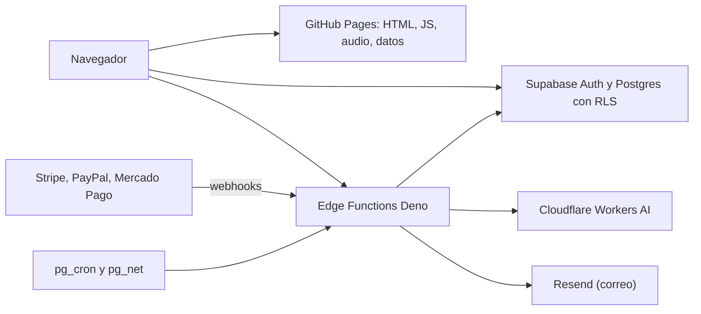

# Traspaso para agentes de IA: proyecto app movil de Ingles con Leo

- Fecha: 2026-11-25
- Commit de referencia: 41d4d8e (`41d4d8ee88323fa9b89c03f2ea0cd300c353fbb9`)
- Estado: Documento de planificacion, la app NO esta construida.
- Etiquetas: [V] verificado en codigo o documento oficial, [R] recomendacion, [S] supuesto, [P] pendiente de verificar.
- Documentos hermanos: [RISKS_AND_OPEN_QUESTIONS.md](RISKS_AND_OPEN_QUESTIONS.md), [DEVLOG.md](DEVLOG.md).

Este documento permite a un agente de IA empezar sin haber visto la conversacion que lo origino. Si un dato choca con lo que ves hoy en el repo, manda el repo: ejecuta antes la [lista de comprobaciones](#13-lista-de-comprobaciones-de-cambios-desde-41d4d8e).

---

## 1. Que es Ingles con Leo

Plataforma de ingles para hispanohablantes, de bajo costo (membresia de USD 2 al mes o USD 20 al ano [V: `terminos.html:76-77`]), con un profesor virtual, "Profe Leo", como mascota y voz. Sitio web en `inglesconleo.com`. El dueno, Leo, no es tecnico: decide producto y negocio, y el trabajo tecnico lo hacen agentes de IA.

Oferta actual [V]:

- Practica de ejercicios por habilidad: 1589 ejercicios en `data.js` (gramatica 505, vocabulario 396, listening 223, reading 96, speaking 155, writing 214), mas bancos de examenes Cambridge, IELTS, TOEFL y TOEIC (solo miembros), English Rush (122 preguntas) y 27 clases.
- Academia: 11 cursos de 5 lecciones (55 lecciones). Solo TO BE y Pronombres son publicos en el repo; los otros 9 estan marcados `protected:true` y su contenido sale por RPC desde el servidor, con audio por URL firmada de 15 minutos.
- Audio: 1642 mp3 (57 MB) en `audio/`, generados con `tools/generar_audios.py` y scripts hermanos.
- Leo AI: explicaciones con IA (Edge Function `leo-ai`, Cloudflare Workers AI, modelo Gemma, 220 tokens maximos de salida). LeoBot es un arbol de botones, no IA [V: `chatbot.js:2-5`].
- Contenido SEO: unas 355 fichas de glosario, articulos, 104 HTML en la raiz y 476 en total.
- Niveles de acceso: visitante (3 ejercicios de muestra), cuenta gratis (6 al dia), miembro (sin limite y paginas de miembros).

## 2. Como funciona hoy (arquitectura)

Sitio estatico en GitHub Pages (repo publico `Fio42/Ingles_Con_Leo`, rama `main` = produccion) mas Supabase como backend. Sin build, sin bundler, sin `package.json` en la raiz, sin service worker [V: F-10, F-12].



Piezas principales [V, detalle en las auditorias]:

- `app.js` (10 756 lineas, 602 KB, ambito global): motor de practica, diagnostico, plan, limites gratis, analitica.
- `backend.js` (1036 lineas, objeto `LeoBackend`): auth, perfil, `progress_sessions`, `mistake_stats`, comentarios, checkout.
- Academia: `academia-boot.js`, `academia-motor.js` (generado), `academia-nube.js` (sincronizacion con version y merge, sin DOM), `academia.js` (UI), `academia-audio.js`, `academia-cursos.js` (generado).
- Membresia: `profiles.is_member` (booleano, sin fecha de expiracion general). Solo la escriben webhooks y cron con service_role [V: auditoria de pagos, seccion 3].
- Seguridad: RLS en todas las tablas; la clave publica `sb_publishable_...` esta en `backend.js` por diseno; no hay service_role en el cliente.

## 3. Objetivos

1. Llegar a 1 000 000 de usuarios registrados [S: objetivo del dueno, sin plazo definido].
2. Publicar una app en App Store (iOS) y Google Play (Android) con la misma identidad visual y pedagogica.
3. Mantener el sitio web y el SEO funcionando en paralelo (las fichas de glosario y articulos siguen siendo el motor de captacion).
4. Que el mantenimiento lo haga un unico equipo asistido por agentes de IA, con el menor codigo duplicado posible.
5. No romper produccion: la web actual sigue viva durante todo el proyecto.

Estado de preparacion [V: D8]: la plataforma NO esta lista para publicar app. Es una base sana con 8 bloqueadores (Fase 0, ver D5 abajo).

## 4. Decisiones tomadas y por que (D1-D11)

Son la fuente de verdad. No las contradigas sin registrar la razon en [DEVLOG.md](DEVLOG.md).

| ID | Decision | Por que | Etiqueta |
|---|---|---|---|
| D1 | Arquitectura principal: Capacitor (v8 segun la investigacion de tiendas) empaquetando la academia web, con un shell y UI movil propios (no un WebView simple) y plugins nativos: compras in-app (RevenueCat o StoreKit/Play Billing), push (FCM/APNs), Sign in with Apple, audio offline, almacenamiento seguro. Previo: refactor de `app.js` a modulos ES y un spike de 1-2 semanas con puerta de decision. | Reutiliza HTML/JS, Supabase, bancos y tests; es la ruta mas corta y la mejor para mantener con agentes de IA y un solo equipo. Apple 4.2 rechaza un sitio reempaquetado, por eso el shell propio y las funciones nativas. | [R] |
| D2 | Alternativa: Expo / React Native con un paquete TypeScript compartido (cliente Supabase, logica de `academia-nube.js`, bancos como JSON versionado). Se activa si el spike de Capacitor falla en rendimiento o UX nativa, o si Apple rechaza por 4.2. Descartadas por ahora: Flutter y nativo puro (reescritura total sin reuso), PWA sola (iOS sin tienda ni IAP), TWA Android como atajo posible pero no estrategia. | No se elige por popularidad sino por reuso y mantenimiento. Expo SDK 58 y EAS tienen plan gratuito (investigacion de tiendas). | [R] |
| D3 | Backend unico: Supabase existente. Nueva tabla `entitlements` multi-fuente (stripe, paypal, mercadopago, apple, google, manual) con expiracion; `profiles.is_member` pasa a derivarse de ella. | Hoy el derecho de acceso es un booleano sin vigencia y hasta 3 proveedores pueden coexistir (H-02). No existe aun ninguna migracion. | [R] |
| D4 | Pagos: en la app, compras in-app (Apple IAP, Google Play Billing) via RevenueCat (gratis hasta 2,5K USD de MTR, luego 1%) con webhooks hacia Supabase; alternativas Adapty (gratis bajo 5K USD de MTR) o validacion propia. La web sigue con Stripe, PayPal y Mercado Pago. Doble compra entre canales bloqueada en servidor (hoy los checkouts no lo hacen: H-01). No depender del enlace de pago externo en EEUU (regimen litigioso, 0% provisional, confianza media). Restaurar compras y eliminar cuenta son obligatorios. | Apple 3.1.1 obliga a IAP para contenido digital; 3.1.3(b) permite acceso multiplataforma si tambien se ofrece IAP. | [R] sobre hechos [V] de las guias oficiales |
| D5 | Fase 0 antes de la app: corregir la plataforma. Lista completa abajo. | Cada punto es un hallazgo verificado que la app agravaria. Se DOCUMENTA, no se ejecuta ahora. | [V] hallazgos, [R] orden |
| D6 | Leo AI hoy: Cloudflare Workers AI (Gemma), 220 tokens, topes en BD que no escalan (AI-07). LeoBot no es IA. Los costos con modelos Claude del informe de tiendas son solo un escenario alternativo. Cambiar de proveedor de IA es decision pendiente del dueno. | Evitar confundir el escenario de costos con la realidad. | [V] |
| D7 | Escalabilidad por escenarios 1k/10k/100k/1M registrados. Supuestos [S]: MAU 30-40% y DAU 10-15% del registrado; concurrentes 1-3% en hora pico. Supabase Pro 25 USD, 100k MAU incluidos, 0,00325 USD por MAU extra (unos 2.925 USD/mes solo de MAU a 1M). Audio a CDN o Storage con cache. | Decisiones tempranas (entitlements, contenido en servidor, push sobre cola) frente a aplazables (compute, CDN). | [S] salvo tarifas [V] |
| D8 | Reutilizable directo: bancos de contenido, academia (cursos y RPC protegidos), `academia-nube.js`, `progress_sessions`, `mistake_stats`, tokens visuales y mascota, scripts de audio. Adaptacion menor: `backend.js`, `academia-nube.js`, audio. Refactor: `app.js`, analitica, reanudacion de sesiones (F-03). Desde cero: UI nativa, speaking nativo, repeticion espaciada, offline, push, IAP, entitlements, borrado de cuenta. | Clasificacion de la auditoria de frontend, seccion 5. | [V] |
| D9 | Roadmap Fases 0 a 6 con complejidad S/M/L/XL, costo estimado [S] y despliegue gradual: TestFlight y pruebas internas, Play con 12 testers durante 14 dias (cuenta personal nueva), rollout por etapas 1/5/20/50/100%, feature flags en BD, kill switches (ya existe el triple de Leo AI), plan de rollback. | Reduce riesgo en cada salto. | [R] |
| D10 | Restricciones: no construir la app, no tocar codigo funcional de produccion, no migraciones, no pagos, usuarios ni configuracion. El `DEVLOG.txt` de la raiz es del sitio; `docs/mobile-app/DEVLOG.md` es aparte y solo del proyecto movil. | Fase de planificacion. | [V] |
| D11 | Primer paso el dia de iniciar: (1) correr la lista de comprobaciones, (2) Fase 0 en orden de gravedad, empezando por contenido premium en servidor y fixes de pagos, (3) abrir cuentas de desarrollador pronto, (4) spike Capacitor. | Las cuentas y los 14 dias de testers son tiempo de espera que no se puede comprimir. | [R] |

### Fase 0: prerrequisitos (D5), en orden de gravedad aproximado

| Prerrequisito | Hallazgos |
|---|---|
| Mover contenido premium a servidor (RPC o Storage con URL firmada) | B-02, F-06, H-09 |
| Webhooks que respondan error al fallar para que el proveedor reintente | H-03 |
| Guardas anti doble cobro y cliente Stripe unico, preapproval MP reutilizable | H-01, H-02 |
| Reembolsos, disputas y pago fallido | H-04, H-11 |
| Firma de Mercado Pago y tolerancia de tiempo en Stripe | H-05, H-10, B-07 |
| Cancelacion de membresia autoservicio y coherente con los terminos | H-06, H-07 |
| Confirmar correo (Confirm email) y CAPTCHA | B-01, AI-06 |
| Sesion unica frente a multidispositivo | B-03 |
| Cuota diaria gratis en servidor | B-10, H-08, AI-16 |
| Borrado de cuenta | H-18, AI-05 |
| Consentimiento GA4 y Pixel, politica de privacidad, menores | AI-03, AI-04, AI-05, F-07 |
| Retirar del sitio publico backend, DEVLOG, AUDITORIA y migraciones; limpiar datos de clientes del historial | AI-01, AI-02 |
| Versionar la config de Edge Functions y alinear repo con lo desplegado | B-08, H-12, H-13 |
| Backups y PITR | B-09 |
| Paginar `getMistakeStats` y `syncProgressFromCloud` | F-01, AI-18 |
| Topes de IA y cache servidor por hash | AI-07, AI-08, AI-09, AI-10 |
| CORS y origen para app nativa (`report-error`, redirects de auth) | B-11, AI-11, B-04 |
| Push sobre cola, no barrido de `profiles` | AI-13, AI-14, AI-15 |
| `.gitignore` de archivos sin rastrear | AI-22, F-17 |

## 5. Componentes a reutilizar (rutas reales)

Verificado contra el repo en la fecha del documento. Detalle de justificacion: auditoria de frontend, seccion 5.

| Componente | Ruta | Clase |
|---|---|---|
| Bancos de ejercicios | `data.js`, `cambridge-data.js`, `cambridge-b1-data.js`, `cambridge-c1-data.js`, `toefl-data.js`, `ielts-data.js`, `toeic-data.js`, `juego-data.js`, `aprender-data.js` | Directo, tras exportar a JSON o servidor (gating: F-06) |
| Cursos de academia | `academia-data.js`, `academia-cursos.js` (generado), RPC `academia_get_content` | Directo |
| Sincronizacion de academia | `academia-nube.js` (367 lineas, logica pura con `mergeStates`) | Adaptacion menor, portable a TS |
| Capa de backend | `backend.js` (objeto `LeoBackend`) | Adaptacion menor (F-01, F-02) |
| Motor de practica | `app.js` | Refactor a modulos ES; la UI se rehace |
| Progreso | tablas `progress_sessions`, `mistake_stats`, RPC `apply_mistake_results` | Directo, con paginacion |
| Identidad visual | tokens `:root` de `style.css`, Baloo 2 e Inter, `leo-front.png`, `leo-hero.png`, `leo-pointing.png`, `leo-thinking.png`, `leo-real.webp`, `leobot.png` | Directo (falta modo oscuro) |
| Audio y TTS | `audio/`, `tools/generar_audios.py`, `tools/lista_audios.csv` | Directo o adaptacion menor (empaquetado, F-13) |
| Pruebas | `tools/tests/`, `tools/e2e/` | Directo como especificacion |
| Monitor de errores | `error-monitor.js`, `supabase_functions/report-error.ts` | Ampliar origenes (B-11) |
| Funciones de correo y cron | `supabase_functions/*.ts` | Reutilizable; la logica de racha sirve para push (AI-13) |

A construir desde cero: UI nativa y shell, speaking nativo (hoy Web Speech API, `app.js:2033-2080`), repeticion espaciada, offline y service worker, push, IAP, entitlements, borrado de cuenta.

## 6. Restricciones y reglas del dueno

Reglas permanentes del dueno, a respetar siempre:

1. El dueno no es tecnico: explica en lenguaje simple, antes y despues de actuar, y evita jerga sin traducirla.
2. Avisa de riesgos antes de que ocurran (costos, pagos, datos de clientes, rechazo de tiendas).
3. No hagas commits con coautor de IA: sin lineas `Co-Authored-By` ni marcas de IA en commits o mensajes [P: confirma la regla vigente con el dueno si una herramienta insiste en anadirlas].
4. Verifica siempre en telefono (anchos 320, 375 y escritorio), no solo en escritorio.
5. Al terminar tareas, anota en `DEVLOG.txt` (sitio) o en `docs/mobile-app/DEVLOG.md` (proyecto movil), con pocas lineas y sin repetir.
6. No repitas oraciones ni ejemplos entre ejercicios.
7. Las opciones multiples se aleatorizan con `shuffleOptions()` (`app.js:2382`).
8. Las secciones de miembros deben ser reanudables (claves `leo_inflight_*`, `app.js:2252`; la academia sincroniza "a medias" por `academia_progress`).
9. Texto visible sin rayas largas (em dash) y negrita con moderacion.
10. Audio via `tools/generar_audios.py` y scripts hermanos.
11. SEO continuo: no degradar titulos, metadatos, FAQ ni JSON-LD de paginas indexadas.
12. Dar al dueno los comandos `git push` para que los ejecute el; push a `main` es produccion.
13. Actua con criterio y explica despues, salvo en acciones destructivas, de pagos o de datos de clientes, que se consultan antes.
14. Mantener la identidad visual y pedagogica del sitio en la app.

Restricciones del proyecto movil en esta fase (D10): no construir la app, no tocar produccion, no migraciones, no tocar pagos, usuarios ni configuracion de Supabase, Stripe, PayPal o Mercado Pago.

Privacidad: `DEVLOG.txt` lineas 4064-4066 y 4070 contienen datos de clientes. No los copies ni los cites. No pongas correos del dueno en documentos nuevos.

Reglas propias del repo: quien cambie `data.js`, `temas.js`, una plantilla de enlaces o un destino dinamico corre `node tools/conexiones/auditar.js --write` en la misma tarea [V: DEVLOG.txt:3952]. Quien cambie `GRAMMAR_BANK` corre `node tools/generar_mini_lecciones.js` [V: DEVLOG.txt:1879].

## 7. Mapa del repo

| Ruta | Contenido |
|---|---|
| Raiz (104 HTML, `app.js`, `backend.js`, `data.js`, `style.css`) | Sitio. `index.html`, `miembros.html`, `academia.html`, `practica-miembros.html`, `privacidad.html`, `terminos.html`, `baja.html` |
| `academia-*.js`, `academia.css` | Academia (ver seccion 2) |
| `audio/` | 1642 mp3 (57 MB) |
| `glosario/`, `glosario-ingles/` | Unas 355 fichas SEO generadas por `tools/generar_glosario.js` |
| `supabase_functions/` | 24 Edge Functions (arbol principal) y SQL (`leo-ai.sql`, `error-monitoring.sql`) |
| `supabase/functions/` | 6 funciones (copia parcial, diverge: ver trampas) |
| `supabase/migrations/` | 28 migraciones. Mas `rollback/` (destructivo) y `verify/` (SELECT) |
| `supabase_schema.sql` | Esquema base (1113 lineas), no reproduce solo la base real |
| `private/` | Bancos de examen y semillas SQL; ignorado por git (`.gitignore:51`), respaldo manual en 7z |
| `tools/` | Generadores, pruebas (`tests/`, `e2e/`), `respaldo_supabase.sh`, `site-health/`, `conexiones/` |
| `docs/` | Documentos de lanzamiento; este proyecto vive en `docs/mobile-app/` |
| `.github/workflows/` | `indexnow.yml`, `site-health.yml` (las pruebas NO corren en CI) |
| `DEVLOG.txt` (4335 lineas) | Bitacora del sitio |
| `AUDITORIA_COMPLETA_2026-10-14.md`, `AUDITORIA_SISTEMA_2026-11-11.md`, `AUDITORIA_PLATAFORMA_2026-11-24.md` (cerrada), `MAPA_CONEXIONES.md`, `ACADEMIA_INTEGRACION.md` (obsoleto) | Documentacion previa |
| Sin rastrear (no tocar ni publicar) | `_push.patch`, `_revision_commit/`, `_video_index/`, `h`, `revision-videos.diff`, `tools/sandbox/`, 5 mp3 sueltos en `audio/` |

## 8. Como correr las pruebas

Node 22 [V: v22.15.0 en la maquina del dueno]. No hay `package.json` en la raiz; las dependencias (`jsdom`, `playwright`, `@electric-sql/pglite`) se instalan fuera del proyecto [V: F-10, AUDITORIA_PLATAFORMA].

```bash
# Informe completo: microtemas + regresiones + toda la suite de tools/tests (sin red, sin Supabase)
node tools/e2e/run-all.js

# Una prueba de la suite (la mayoria no necesita nada extra)
node tools/tests/academia-modelo.test.js

# Pruebas que usan jsdom, playwright o PGlite instalados globalmente
NODE_PATH=$(npm root -g) node tools/tests/academia-can.e2e.js

# Otras utiles
node tools/e2e/regresiones.js
node tools/e2e/test-microtema.js --all-active
node tools/tests/glossary.test.js
node tools/conexiones/auditar.js --write
```

- Hay 120 archivos en `tools/tests/` (21 son `.e2e.js` con navegador, 8 usan jsdom) [V].
- `tools/tests/academia-pg-helpers.js` busca `@electric-sql/pglite` fuera del proyecto para simular Postgres con las funciones SQL reales.
- Rojas conocidas por entorno (falta contenido privado y `ffprobe`): `academia-articulos` y `academia-piloto` [V: AUDITORIA_PLATAFORMA]. `error-monitor.test.js` y `session-cycle.test.js` tenian fallos previos conocidos [V: DEVLOG.txt:45]. Estado actual de la suite: [P] (no se ejecuto al redactar este documento).
- Las pruebas NO corren en CI (`.github/workflows` solo tiene IndexNow y Site Health): primera mejora barata de Fase 0 [R].
- Prueba movil manual: `tools/prueba-movil-curso3.html` y verificacion real en telefono (regla 4).

## 9. Glosario

| Termino | Significado |
|---|---|
| Leo, Profe Leo | Dueno y mascota/voz del producto |
| Miembro | Cuenta con `profiles.is_member = true` |
| Cuenta gratis | Usuario registrado no miembro (6 ejercicios al dia) |
| Visitante o invitado | Sin cuenta (3 ejercicios de muestra, en localStorage) |
| Leo AI | Explicaciones con IA (`leo-ai`) |
| LeoBot | Chat de soporte por botones, no IA (`chatbot.js`) |
| Academia | Cursos de 5 lecciones con examen oficial e insignias |
| Curso protegido | `protected:true` en `academia-data.js`; contenido por `academia_get_content` |
| `inflight` | Sesion a medias guardada en localStorage (`leo_inflight_*`) |
| `mistake_stats` | Tabla de errores por ejercicio; 2 aciertos seguidos = recuperado, 4 = dominado |
| `entitlements` | Tabla propuesta de derechos de acceso (D3); no existe hoy |
| IAP | In-App Purchase (compra dentro de la app) |
| MTR | Monthly Tracked Revenue (ingreso mensual medido por RevenueCat o Adapty) |
| RLS | Row Level Security de Postgres |
| RPC | Funcion SQL invocada desde el cliente |
| Kill switch | Interruptor para apagar una funcion (Leo AI tiene tres: `LEO_AI_ENABLED`, `leo_ai_config.enabled`, `public`) |
| Spike | Prueba tecnica corta con puerta de decision |
| TWA | Trusted Web Activity (PWA en Play via Chrome) |
| PITR | Point-in-time recovery (restauracion a un instante) |

## 10. Trampas conocidas

1. Los nombres desplegados de tres Edge Functions NO coinciden con sus archivos [V: B-08, H-24]:
   - `supabase_functions/create-checkout.ts` esta desplegada como `super-service` (`backend.js:576`).
   - `supabase_functions/send-password-reset.ts` como `clever-responder` (`backend.js:138`).
   - `supabase_functions/mp-webhook.ts` como `rapid-service` (DEVLOG.txt:2303).
   - Ademas existe `quick-endpoint` desplegada y sin copia en el repo, proposito desconocido [P].
2. Reaplicar `supabase_functions/leo-ai.sql` sobrescribe `leo_ai_reserve` con la version sin prueba gratis; la vigente esta en `supabase/migrations/20261016001253_leo_ai_trial.sql` [V: auditoria de backend, seccion 8].
3. `ACADEMIA_INTEGRACION.md` esta obsoleto (dice "nada aplicado, todo apagado", rama `academia/piloto-to-be`); en `main` los tres interruptores estan encendidos (F-04). No lo uses como fuente.
4. Dos arboles de funciones: `supabase_functions/` (24) y `supabase/functions/` (6). Verificado con `diff` el 2026-11-25: solo `stripe-checkout` DIFIERE (la copia de `supabase/functions` pierde la proteccion contra doble cobro; B-08, H-12). `leo-ai`, `upgrade-nudge-emails` y `brevo-check` son identicas; `resend-webhook` solo difiere en finales de linea (CRLF). La afirmacion de H-12 de que `upgrade-nudge-emails` diverge no se reproduce hoy. Desplegar desde `supabase/functions` puede revertir correcciones.
5. No hay `supabase/config.toml`: `verify_jwt` no esta versionado (B-08).
6. `supabase_schema.sql` conserva un bloque cron viejo con marcadores `TU_SECRET_KEY_AQUI`; no lo reapliques (las lineas ~900-915 lo reemplazan) [V: auditoria de backend, seccion 8].
7. `mp_preapproval_id` y `mp_preapproval_status` no estan definidas en ningun SQL del repo (H-13): un entorno nuevo falla.
8. Las migraciones del repo y las de produccion no tienen paridad total (AUDITORIA_COMPLETA 6.3).
9. El generador del glosario (`tools/generar_glosario.js`) ya esta corregido; las 12 fichas editadas a mano viven en `tools/glosario/fichas-editadas.js`. Edita ahi, no el HTML [V: DEVLOG.txt:3907].
10. `academia-motor.js` y `academia-cursos.js` son generados: no se editan a mano (F-18).
11. Todo el repo es publico y se sirve por HTTP (AI-01): cualquier archivo nuevo que subas queda visible. Nunca subas claves ni datos de clientes.
12. El sitio es produccion directa: un `git push` a `main` publica. Los archivos sin rastrear de la raiz no deben entrar en un `git add .` (usa rutas explicitas).
13. `private/` solo existe en disco local y en 7z; no esta en git.
14. Las cifras de costos y comisiones de tiendas son volatiles; revalida antes de decidir (seccion 14).

## 11. Primer paso concreto

1. Ejecuta la [lista de comprobaciones](#13-lista-de-comprobaciones-de-cambios-desde-41d4d8e) y anota en [DEVLOG.md](DEVLOG.md) que cambio desde 2026-11-25.
2. Con el dueno, confirma las decisiones abiertas de [RISKS_AND_OPEN_QUESTIONS.md](RISKS_AND_OPEN_QUESTIONS.md) que bloquean Fase 0 (Q1 a Q5: privacidad del repo, politica de contenido premium, confirmacion de correo, modelo de cobro movil, sesion unica).
3. Empieza Fase 0 por contenido premium en servidor y por los fixes de pagos (H-03, H-01, H-02), una tarea por vez, con pruebas y verificacion en telefono.
4. En paralelo, y porque son tiempos de espera: el dueno abre las cuentas de Apple Developer (99 USD al ano) y Google Play (25 USD unico), y se programa la ventana de 12 testers durante 14 dias.
5. Spike de Capacitor de 1-2 semanas con puerta de decision (D1) una vez refactorizado lo minimo de `app.js`.

## 12. Prompt de arranque (para pegar en un chat nuevo)

```text
Eres un agente de IA que continua el proyecto "app movil iOS/Android de Ingles con Leo".
Repo: C:\Users\fiocc\OneDrive\Desktop\inglesconLeo. Lee primero, en este orden:
1) docs/mobile-app/AI_HANDOFF.md  2) docs/mobile-app/RISKS_AND_OPEN_QUESTIONS.md  3) docs/mobile-app/DEVLOG.md
Contexto: la app NO esta construida; hay documentos de planificacion fechados 2026-11-25 sobre el commit 41d4d8e. Las decisiones D1-D11 de AI_HANDOFF.md son la fuente de verdad: no las contradigas sin registrar la razon en DEVLOG.md.
El dueno (Leo) no es tecnico: explica en lenguaje simple, avisa de riesgos antes de actuar, y consulta antes de cualquier accion destructiva, de pagos, de usuarios o de datos de clientes.
Reglas permanentes: no commits con coautor de IA; sin rayas largas en texto visible; negrita con moderacion; opciones multiples con shuffleOptions(); secciones de miembros reanudables; no repetir oraciones entre ejercicios; audio con tools/generar_audios.py; verificar siempre en telefono; al terminar una tarea, anotar en DEVLOG (docs/mobile-app/DEVLOG.md para el proyecto movil, DEVLOG.txt para el sitio); dar a Leo los comandos git push, nunca hacer push tu mismo. No publiques archivos sin rastrear de la raiz (usa git add con rutas explicitas). No copies datos de clientes de DEVLOG.txt (lineas 4064-4070) ni pongas correos o claves en documentos.
Primera tarea: 1) ejecuta la LISTA DE COMPROBACIONES de AI_HANDOFF.md seccion 13 y resume que cambio desde el commit 41d4d8e; 2) revalida las politicas de tiendas (seccion 14) y avisa de diferencias; 3) propon al dueno, en lenguaje simple, el orden de Fase 0 y que decisiones necesitas de el (ver RISKS_AND_OPEN_QUESTIONS.md). No escribas codigo ni migraciones hasta que el dueno apruebe la Fase 0.
Antes de afirmar algo sobre el repo, verificalo leyendo el archivo; marca lo no verificable como [P].
```

## 13. Lista de comprobaciones de cambios desde 41d4d8e

Objetivo: saber si los documentos siguen vigentes. Ejecutar en la raiz del repo (Git Bash; los comandos usan `git` y `rg`).

```bash
# 0. Punto de partida
git rev-parse --short HEAD
git log --oneline 41d4d8e..HEAD | wc -l
git status --short | head -20

# 1. Pagos y membresia (checkouts, webhooks, recuperacion)
git log --oneline 41d4d8e..HEAD -- supabase_functions/stripe-checkout.ts supabase_functions/stripe-webhook.ts supabase_functions/paypal-checkout.ts supabase_functions/paypal-webhook.ts supabase_functions/create-checkout.ts supabase_functions/mp-webhook.ts supabase_functions/payment-recovery-emails.ts supabase/functions/stripe-checkout miembros.html terminos.html
rg -n "is_member|access_until|entitlement" supabase_functions supabase/migrations -g "!*.md" | head -40
rg -n "refund|dispute|charge\.refunded|payment_failed" supabase_functions | head

# 2. Esquema y migraciones
git diff --name-status 41d4d8e..HEAD -- supabase/migrations supabase_schema.sql supabase_functions/leo-ai.sql supabase_functions/error-monitoring.sql
ls supabase/migrations | tail -5
ls supabase/config.toml 2>/dev/null || echo "sigue sin config.toml"
rg -n "entitlements|device_tokens|webhook_events" supabase supabase_functions supabase_schema.sql | head

# 3. Academia
git log --oneline 41d4d8e..HEAD -- academia-data.js academia-nube.js academia.js academia-boot.js academia-motor.js academia-cursos.js academia-lanzamiento.js
rg -c '"protected":\s*true' academia-data.js   # esperado 2026-11-25: 9
rg -n "CLOUD_ON|enabled\s*=|PUBLIC\s*=" academia-boot.js academia-motor.js academia-lanzamiento.js | head

# 4. Cliente: backend.js y app.js
git log --oneline 41d4d8e..HEAD -- backend.js app.js data.js
git diff --stat 41d4d8e..HEAD -- backend.js app.js | tail -3
wc -l app.js backend.js
rg -n "scope:\s*'others'|signOut\(" backend.js
rg -n "deleteUser|eliminar mi cuenta|delete_account" backend.js miembros.html supabase_functions | head

# 5. Politicas y cumplimiento (web)
git log --oneline 41d4d8e..HEAD -- privacidad.html terminos.html baja.html
rg -n "consent|cookie" index.html privacidad.html | head
rg -n "turnstile|captcha|hcaptcha" --glob "*.html" --glob "backend.js" . | head

# 6. Exposicion publica y higiene
git log --oneline 41d4d8e..HEAD -- .gitignore robots.txt
ls .nojekyll 2>/dev/null || echo "sin .nojekyll"
git ls-files | rg "^(supabase_functions|supabase|DEVLOG|AUDITORIA)" | head -5
git status --short | rg "^\?\?" | head -20

# 7. Trabajo movil ya iniciado por alguien mas
rg -il "capacitor|revenuecat|storekit|play billing" --glob "!docs/mobile-app/**" --glob "!*.md" --glob "!tools/**" . | head
ls package.json capacitor.config.* 2>/dev/null
git log --oneline 41d4d8e..HEAD -- docs/mobile-app

# 8. Infra y pruebas
git log --oneline 41d4d8e..HEAD -- .github/workflows tools/tests tools/e2e
node tools/e2e/run-all.js | tail -15

# 9. Cuantos cambios nuevos tiene el DEVLOG publico (solo contar; no copiar datos de clientes)
git log --oneline 41d4d8e..HEAD -- DEVLOG.txt | wc -l
```

Interpretacion [R]:

- Si cambio un archivo de las secciones 1 a 4, relee el hallazgo asociado (H, B, F o AI) antes de seguir y actualiza [DEVLOG.md](DEVLOG.md).
- Si aparece `entitlements`, `capacitor.config.*` o `package.json`, alguien ya empezo: lee ese trabajo antes de decidir.
- Si la suite `run-all.js` falla en algo que antes pasaba, resuelvelo antes de iniciar Fase 0.

## 14. Revalidacion de politicas de tiendas

Los datos de tiendas son volatiles. Informe base: investigacion del 2026-11-25 (confianza A alta, M media, B baja). Revalidar antes de decidir precios o enviar a revision:

| Tema | Fuente a releer | Dato a contrastar |
|---|---|---|
| Reglas de revision de Apple (3.1.1, 3.1.3(b), 4.2, 4.8, 5.1.1(v)) | https://developer.apple.com/app-store/review/guidelines/ | Cambios desde la actualizacion de 2026-10-16 |
| Comisiones y Small Business Program (30%, 15%, 15% bajo 1M USD) | https://developer.apple.com/app-store/subscriptions/ y https://developer.apple.com/app-store/small-business-program/ | Porcentajes y umbral |
| Epic v. Apple en EEUU (0% provisional, certiorari, argumento oral enero 2027) | docket y prensa; fuente primaria no verificada | Tasa de enlace externo; no basar el modelo en 0% |
| UE (DMA) y Japon (MSCA) | https://developer.apple.com/support/dma-and-apps-in-the-eu/ | Terminos desde 2026-10-01 |
| Requisitos de SDK de Apple (Xcode 26, iOS 13 minimo) | https://developer.apple.com/news/upcoming-requirements/ | Fechas |
| Google Play pagos y tarifas | https://support.google.com/googleplay/android-developer/answer/9858738 y https://support.google.com/googleplay/android-developer/answer/112622 | Tarifas por region y tier (extraccion confusa, confirmar) |
| Play Billing Library (usar v8 o v9) y target API 36 | https://developer.android.com/google/play/billing/deprecation-faq y https://support.google.com/googleplay/android-developer/answer/11926878 | Fechas de soporte |
| Testers en cuentas personales nuevas (12 durante 14 dias) | https://support.google.com/googleplay/android-developer/answer/14151465 | Cambio de requisito |
| Eliminacion de cuenta y Data safety | https://support.google.com/googleplay/android-developer/answer/13327111 | Formulario |
| RevenueCat (gratis hasta 2,5K USD de MTR, luego 1%) y webhooks | https://www.revenuecat.com/pricing/ y https://www.revenuecat.com/docs/integrations/webhooks | Precios, soporte de PayPal y Mercado Pago [P] |
| Adapty | https://adapty.io/pricing/ | Precios |
| Supabase (Pro 25 USD, 100k MAU, 0,00325 USD por MAU extra) | https://supabase.com/pricing | Tarifas |
| Capacitor 8, Expo SDK, EAS | https://capacitorjs.com/docs/updating/8-0 y https://expo.dev/pricing | Versiones |
| Costos de IA (solo si se cambia de proveedor, D6) | https://platform.claude.com/docs/en/about-claude/pricing | Tarifas |

Pendientes de la investigacion original [P]: reglas de Apple y Google para Brasil y Corea; Play RTDN y Play Developer API (documentacion oficial); integracion RevenueCat con Stripe y soporte para PayPal y Mercado Pago; formato V2 de las notificaciones de App Store Server; precios de TTS; aprobacion judicial final del acuerdo Epic-Google y tasa final de Apple en EEUU.
