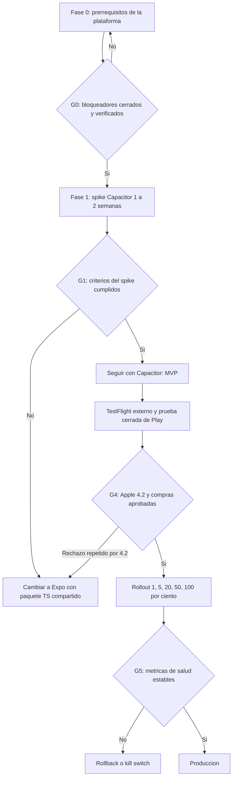
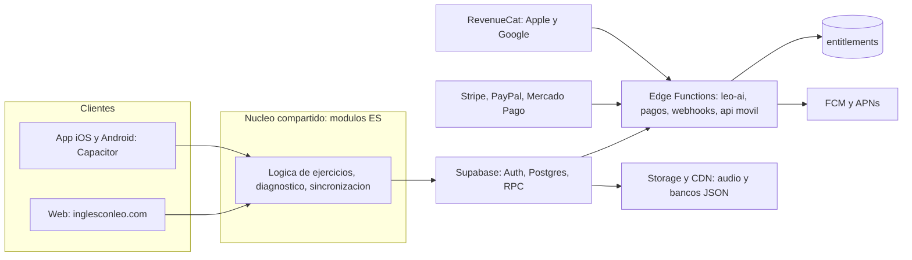
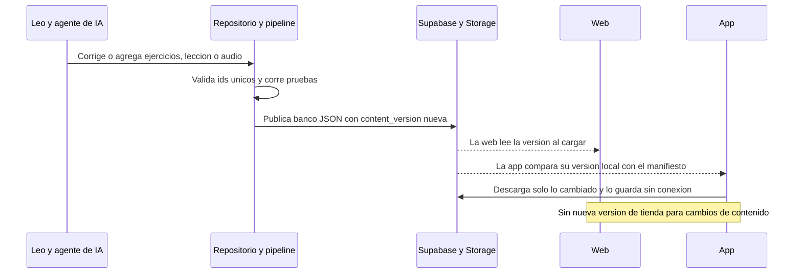

# Decision de arquitectura de la app movil de Ingles con Leo

> Fecha: 2026-11-25 | Commit de referencia: 41d4d8e | Estado: Documento de planificacion, la app NO esta construida.
>
> Etiquetas: [V] verificado en codigo o documentacion oficial, [R] recomendacion, [S] supuesto o estimacion propia, [P] pendiente de verificar. Los IDs B-xx, H-xx, F-xx, AI-xx vienen de las auditorias de la plataforma (backend, pagos, frontend, IA).
>
> Documentos hermanos: [producto](MOBILE_PRODUCT_SPEC.md), [datos y API](DATA_AND_API_CONTRACTS.md), [pagos y membresias](PAYMENTS_AND_MEMBERSHIPS.md).

## 1. Resumen para el dueno

- [R] Recomendacion principal: **Capacitor 8** empaquetando la academia web actual, con una interfaz movil propia (no un WebView de la pagina) y plugins nativos para compras, push, Sign in with Apple, audio sin conexion y almacenamiento seguro.
- [R] Alternativa: **Expo / React Native** con un paquete TypeScript compartido. Se activa si el spike de Capacitor falla en rendimiento o si Apple rechaza por la guia 4.2.
- [R] Una sola plataforma: la app y la web usan el mismo Supabase, las mismas cuentas, el mismo progreso y la misma tabla de derechos de acceso. Un cambio educativo (un ejercicio corregido, una leccion nueva) llega a web y app a la vez.
- [V] Hoy la plataforma **no esta lista** para publicar una app: es una base sana con 6 a 8 bloqueadores (seccion 9 y Fase 0 del [roadmap](IMPLEMENTATION_ROADMAP.md)). La decision de este documento no autoriza construir nada todavia.
- [R] Se elige por encaje con este proyecto (HTML/JS estatico, Supabase, un solo equipo apoyado en agentes de IA), no por popularidad del framework.

## 2. Punto de partida real (verificado)

| Hecho | Dato | Fuente |
|---|---|---|
| Sitio | Estatico en GitHub Pages (dominio inglesconleo.com), sin build ni bundler, scripts globales | [V] PLATFORM_AUDIT.md, seccion 5 |
| Tamano de codigo | `app.js` 10.756 lineas / 602 KB sin modulos ES; `data.js` 1,06 MB; `backend.js` 1.036 lineas | [V] `wc -l` |
| Contenido | 1589 ejercicios en `data.js` (gramatica 505, vocab 396, listening 223, reading 96, speaking 155, writing 214), Cambridge/IELTS/TOEFL/TOEIC, English Rush 122, 27 clases | [V] PLATFORM_AUDIT.md, seccion 5 |
| Academia | 11 cursos x 5 lecciones = 55; solo TO BE y Pronombres publicos, 9 protegidos por RPC con audio por URL firmada de 15 min | [V] |
| Audio | 1642 mp3, 57 MB, generados con `tools/generar_audios*.py` | [V] |
| Backend | Supabase (Auth, Postgres con RLS, RPC, Edge Functions Deno, Storage) | [V] PLATFORM_AUDIT.md, seccion 3 |
| Offline / PWA | `site.webmanifest` minimo, sin service worker | [V] F-12 |
| Speaking | Web Speech API (`app.js:2033-2080`), solo Chrome/Edge escritorio | [V] F-14 |
| Pruebas | 120 archivos en `tools/tests`, fuera de CI | [V] F-10 |
| Sesion | Un solo dispositivo activo: `signOut({ scope: 'others' })` en `backend.js:117` | [V] B-03 |

Clasificacion de reutilizacion (resumen de PLATFORM_AUDIT.md, seccion 5): directo = bancos de contenido, RPC de academia, `progress_sessions`, `mistake_stats`, tokens visuales y mascota, pipeline de audio; adaptacion menor = `backend.js`, `academia-nube.js`, audio; refactor = `app.js`, analitica, reanudacion de sesiones; desde cero = UI nativa, speaking nativo, repeticion espaciada, offline, push, compras in-app, entitlements, borrado de cuenta.

## 3. Criterios y pesos

Puntaje 1 (malo) a 5 (excelente). Para "dependencia de terceros" y "complejidad de tiendas", 5 significa **menos** dependencia o **menos** complejidad. Los puntajes son juicio propio [S] basado en los datos de la seccion 2 y en las fuentes oficiales de la seccion 11; no son una medicion.

| # | Criterio | Peso | Por que pesa asi en Ingles con Leo |
|---|---|---|---|
| C1 | Costo de desarrollo y mantenimiento | 20 | Un solo dueno no tecnico y presupuesto limitado |
| C2 | Compatibilidad (iOS, Android, versiones, tiendas) | 10 | Audiencia hispanohablante con telefonos de gama media |
| C3 | Reuso del codigo y contenido existente | 18 | Hay 1589 ejercicios, 55 lecciones y 1642 audios ya hechos |
| C4 | Rendimiento y experiencia nativa | 14 | Pedagogia con audio, voz y repaso frecuente: se usa en sesiones cortas |
| C5 | Escalabilidad | 8 | El cuello de botella esta en Supabase, no en el cliente |
| C6 | Mantenimiento con agentes de IA | 12 | La ruta de trabajo es agente de IA mas dueno; importa tipado, un solo lenguaje y poca configuracion nativa |
| C7 | Dependencia de terceros | 8 | Evitar quedar atado a un servicio de pago o a un solo proveedor |
| C8 | Complejidad de tiendas (revision, IAP, push, firma) | 10 | Apple 4.2, IAP y borrado de cuenta son el riesgo mas visible |
| | **Total** | **100** | |

**Criterios eliminatorios (puerta previa)**, independientes de la matriz: (a) publicable en App Store y Google Play, (b) compras in-app disponibles, (c) push nativo en iOS. [V] Segun la guia 3.1.1 de Apple, una app que desbloquea contenido premium debe usar compras in-app.

## 4. Matriz ponderada

Puntaje total = suma(puntaje x peso) / 5, rango 20 a 100.

| Opcion | C1 (20) | C2 (10) | C3 (18) | C4 (14) | C5 (8) | C6 (12) | C7 (8) | C8 (10) | Total | Puertas |
|---|---|---|---|---|---|---|---|---|---|---|
| Capacitor 8 con shell movil propio | 4 | 4 | 4 | 3 | 4 | 5 | 4 | 3 | **77,6** | Pasa |
| Expo / React Native (SDK 58) | 3 | 4 | 2 | 4 | 4 | 5 | 3 | 4 | **69,6** | Pasa |
| React Native sin Expo | 2 | 4 | 2 | 4 | 4 | 4 | 3 | 3 | 61,2 | Pasa |
| Flutter | 2 | 4 | 1 | 5 | 4 | 3 | 3 | 3 | 58,0 | Pasa |
| Tauri 2 mobile | 3 | 2 | 4 | 3 | 3 | 3 | 2 | 2 | 58,0 | Pasa con dudas [P] |
| Nativo Swift y Kotlin | 1 | 5 | 1 | 5 | 5 | 2 | 4 | 3 | 56,8 | Pasa |
| Kotlin Multiplatform | 2 | 4 | 1 | 4 | 4 | 2 | 3 | 3 | 52,8 | Pasa |
| TWA Android (Bubblewrap) | 5 | 1 | 5 | 3 | 4 | 5 | 3 | 3 | 77,6 | **Falla**: no cubre iOS |
| PWA sola | 5 | 1 | 5 | 2 | 4 | 5 | 4 | 5 | 80,4 | **Falla**: sin tienda ni compras in-app en iOS |

Calculo de ejemplo, Capacitor: (4x20 + 4x10 + 4x18 + 3x14 + 4x8 + 5x12 + 4x8 + 3x10) / 5 = 388 / 5 = 77,6.

Lectura: PWA y TWA puntuan alto por su bajo costo, pero **no pasan las puertas**, por eso no son estrategia. Entre las que pasan, Capacitor lidera por reuso y costo; Expo es segunda y queda como plan B.

### 4.1 Justificacion por opcion

| Opcion | Datos y razon | Etiqueta |
|---|---|---|
| Capacitor 8 | Requiere Xcode 26+, iOS 15+, Android minSdk 24, Node 22+ (https://capacitorjs.com/docs/updating/8-0). Reutiliza HTML/JS, supabase-js y bancos. Riesgo: un WebView sin mas es "sitio reempaquetado" (Apple 4.2) | [V] versiones; riesgo es juicio [R] |
| Expo / RN | SDK 58 con React Native 0.88 (https://docs.expo.dev/versions/latest/). EAS Build y Submit; plan Free con 15 builds por plataforma al mes. Mejor sensacion nativa, pero exige reescribir toda la UI | [V] versiones y planes |
| RN sin Expo | Mismo costo de UI, mas configuracion nativa a mantener por agentes de IA | [R] |
| Flutter | Excelente UI, pero Dart y UI nuevos: cero reuso de `app.js`; version exacta no confirmada (docs reflejan 3.50) | [V] parcial, [P] version |
| Tauri 2 mobile | No se pudo confirmar estabilidad ni compras in-app | [P] |
| Nativo | Maxima calidad y control, doble base de codigo, el peor costo con agentes de IA | [R] |
| KMP | Usado en produccion por grandes empresas, pero estabilidad de Compose en iOS no confirmada | [P] |
| TWA | Muestra la PWA en Chrome 72+ con Digital Asset Links; la app no comparte cookies ni localStorage con la web; Play Billing no verificado (https://developer.chrome.com/docs/android/trusted-web-activity/overview) | [V] basico, [P] billing |
| PWA | iOS: Web Push solo si esta anadida a pantalla de inicio, iOS 16.4+; sin listado en App Store ni IAP (https://webkit.org/blog/13878/web-push-for-web-apps-on-ios-and-ipados/) | [V] |

### 4.2 Sensibilidad (que tan firme es el resultado)

Si se reduce el peso del reuso a 9, se sube el de rendimiento/UX a 28 y el de complejidad de tiendas baja a 5: Capacitor 75,8, Expo 73,2, Flutter 67,2 [S]. Capacitor sigue primero pero **la ventaja baja de 8 a 2,6 puntos**. Conclusion [R]: la decision depende de que el spike demuestre rendimiento aceptable; por eso hay una puerta formal (seccion 7).

## 5. Recomendacion principal y alternativa

### 5.1 Principal (D1): Capacitor con shell movil propio

**Que se construye**
1. Un nucleo compartido de logica (modulos ES) extraido de `app.js`: diagnostico (`computeDiagnosis`), seleccion de ejercicios, limites, reglas de repaso. Es el mismo nucleo para la web y la app. [R]
2. Un shell movil con navegacion inferior, pantallas propias (Home, Cursos, Practicar, Leo AI, Progreso, Perfil) y tokens visuales actuales. No carga las paginas de la web dentro de un WebView. [R]
3. Plugins nativos: compras in-app (RevenueCat o StoreKit/Play Billing), push (FCM y APNs), Sign in with Apple, audio sin conexion con almacenamiento de archivos, almacenamiento seguro de sesion, notificaciones locales de racha. [R]

**Por que encaja con Ingles con Leo**
- [V] El valor esta en datos ya hechos y en un backend ya multi-dispositivo: `progress_sessions`, `mistake_stats`, `academia_progress` con version y merge (`academia-nube.js`), RPC protegidas. Casi nada de eso depende del framework de cliente.
- [R] Es la ruta mas corta: el contenido, los audios y la logica de ejercicios se reutilizan; lo nuevo es el shell, las compras, el push y el offline.
- [R] Un solo lenguaje (JS/TS) y un solo repositorio simplifican el trabajo con agentes de IA; hay 120 pruebas que sirven de especificacion de reglas de negocio.
- [R] Bajo costo de salida: el nucleo en modulos ES que se extrae para Capacitor es el mismo que consumiria Expo, asi el plan B no empieza de cero.

**Condiciones previas**
- Refactor de `app.js` hacia modulos ES (hoy 10,7 k lineas globales mezcladas con DOM, analitica y limites). [R]
- Fase 0 completa (seccion 9). [R]
- Spike de 1 a 2 semanas (Fase 1) con puerta de decision (seccion 7). [R]

### 5.2 Alternativa (D2): Expo / React Native con paquete TypeScript compartido

- Se comparte un paquete TypeScript: cliente Supabase, logica de `academia-nube.js` (`mergeStates`, version y conflictos, ya sin DOM y probada en Node), contratos de API y bancos de contenido como JSON versionado. [R]
- Se reescribe la UI en React Native. Supabase en RN requiere `react-native-url-polyfill` y almacenamiento de sesion con `persistSession` y `autoRefreshToken`, sin `detectSessionInUrl` (https://supabase.com/docs/guides/getting-started/quickstarts/expo-react-native, consultado 2026-11-25, confianza A). [V]
- Ventajas: sensacion nativa, EAS Build y Submit, mejor audio en segundo plano. Costo: reescribir pantallas, doble mantenimiento de UI si la web sigue viva. [R]

### 5.3 Descartadas por ahora

| Opcion | Motivo |
|---|---|
| Flutter, nativo puro, KMP | Reescritura total sin reuso de JS ni de `app.js`; mas costoso de mantener con agentes de IA [R] |
| PWA sola | iOS sin App Store ni compras in-app; push solo con la PWA instalada [V] |
| TWA solo Android | Atajo posible para Android, no estrategia: deja fuera iOS [R] |
| Tauri 2 mobile | Estado estable y compras in-app no confirmados [P] |

## 6. Riesgo Apple 4.2 (funcionalidad minima)

[V] La guia 4.2 exige que la app supere un "sitio web reempaquetado" y no sea una coleccion de enlaces (4.2.2). [R] Valoracion: **riesgo alto** si fuera solo la web dentro de un WebView; **riesgo medio-bajo** con el plan siguiente (la valoracion de nivel es juicio, no texto oficial).

| Medida | Estado hoy | Contribucion a 4.2 |
|---|---|---|
| Compras in-app (StoreKit) | No existe | Funcion nativa clara y necesaria por 3.1.1 |
| Push (APNs) y notificaciones locales de racha | No existe (AI-13) | Funcion nativa de retencion |
| Sign in with Apple | No existe | Obligatorio si hay login de Google (4.8) |
| Audio sin conexion (archivos locales) | No existe (F-13) | Utilidad que la web no da |
| Speaking con reconocimiento nativo | Web Speech API (F-14) | Funcion nativa de aprendizaje |
| Almacenamiento seguro, biometria opcional | No existe | Seguridad |
| Widgets o accesos rapidos (posterior) | No existe | Extra [R] |
| Borrado de cuenta dentro de la app | No existe (H-18) | Obligatorio por 5.1.1(v) |

Mitigacion en el plan [R]: construir primero las funciones nativas, enviar pronto a **TestFlight con revision externa** como prueba de cordura (la revision de beta no sustituye la de App Review; la equivalencia exacta es [P]), tener preparada la ruta Expo, y redactar notas de revision explicando el valor educativo y las cuentas de prueba. Si Apple rechaza dos veces por 4.2 tras agregar funciones nativas, se activa la alternativa (seccion 7).

## 7. Puertas de decision y criterios para cambiar a la alternativa

Equivalencia con [IMPLEMENTATION_ROADMAP.md](IMPLEMENTATION_ROADMAP.md): se usan las puertas G0 a G5 del roadmap. Antes "Puerta 0" = G0 (bloqueadores cerrados), "Puerta 1" = G1 (spike), "Puerta 2" = G4 (listo para enviar; la aprobacion de Apple 4.2 y compras se confirma en la revision de la Fase 5) y "Puerta 3" = G5 (salud estable). G2 (compra sandbox) y G3 (calidad de beta) son intermedias y no se dibujan aqui.

### 7.1 Criterios medibles del spike (G1) [S]

Los umbrales son propuestos y deben confirmarse al inicio del spike con dispositivos reales (un Android de gama media y un iPhone de 2 a 3 anos).

| Prueba | Umbral para seguir con Capacitor | Si falla |
|---|---|---|
| Arranque en frio hasta Home usable | 3 s o menos en Android de gama media | Optimizar una vez; si persiste, cambiar |
| Fluidez al desplazar listas y animar ejercicios | Sin caidas visibles (objetivo 55 fps o mas) | Cambiar |
| Audio: reproduccion con pantalla bloqueada y offline | Funciona en iOS y Android con plugin | Cambiar si no hay plugin estable |
| Sesion de practica completa sin conexion y sincronizacion posterior | Sin perdida de resultados | Corregir; si no se logra, cambiar |
| Compra de prueba en sandbox y restauracion | Concede y revoca derecho en `entitlements` | Bloqueante, revisar proveedor |
| Peso del paquete | Menor de 80 MB sin audio incluido [S] | Mover recursos a descarga |
| Memoria con `data.js` cargado | Sin cierres por memoria | Cargar bancos por demanda desde JSON |

### 7.2 Disparadores para pasar a Expo

Se cambia si ocurre **cualquiera**: (1) fallan 2 o mas pruebas de rendimiento de la tabla; (2) Apple rechaza por 4.2 dos veces despues de incluir las funciones nativas de la seccion 6; (3) el mantenimiento de plugins nativos de Capacitor (audio, compras) demuestra ser inestable en el spike; (4) la sesion de WKWebView o su almacenamiento se pierde en dispositivos reales [P].

**Que se conserva en el cambio** [R]: Supabase, `entitlements`, bancos JSON, contratos de API, paquete TS del nucleo, textos, tokens visuales, mascota y audios. **Que se pierde**: UI del shell y plugins de Capacitor. Costo de la transicion [S]: se rehace el trabajo de pantallas; el resto no.

## 8. Una sola plataforma, varios dispositivos

### 8.1 Que se comparte

| Recurso | Fuente unica | Existe hoy |
|---|---|---|
| Cuentas | Supabase Auth: correo y contrasena, Google; se agrega Apple | [V] correo y Google (`backend.js`) |
| Base de datos | Postgres con RLS | [V] |
| Membresias | Tabla `entitlements` multi-fuente; `profiles.is_member` pasa a derivarse | [R] no existe; hoy boolean (H-02) |
| Cursos | `academia_courses`, `academia_content` y RPC `academia_get_content` | [V] |
| Progreso | `progress_sessions`, `mistake_stats`, `academia_progress` | [V] |
| IA | Edge Function `leo-ai` (Cloudflare Workers AI) | [V] |
| Recursos (audio, imagenes) | Storage privado y CDN con cache | Parcial: audio publico en repo, cursos protegidos en bucket [V] |
| Reglas de negocio | RPC y triggers en servidor | Parcial: cuotas gratis en cliente (B-10, H-08) |

Principio [R]: **toda regla que importe (derecho de acceso, cuota, nota de examen, insignia) se decide en el servidor**; los clientes (web o app) solo la muestran. Hoy esto se cumple para examen, insignias, Leo AI y progreso, y no para la cuota gratis ni para el contenido premium publico (B-02, F-06, H-09).

### 8.2 Diagrama de la plataforma

### 8.3 Como una actualizacion educativa beneficia a web y app

- [R] El contenido es **dato versionado**, no codigo. Los bancos se exportan a JSON con `content_version`; el cliente consulta un manifiesto (ver [contratos de datos](DATA_AND_API_CONTRACTS.md), seccion de versionado).
- [R] Los cambios de codigo siguen el ciclo normal de cada canal (push a `main` para la web; version en tienda para la app). Las actualizaciones de codigo web empaquetado sin pasar por tienda deben verificarse contra la guia 2.5.2 de Apple antes de depender de ellas [P].
- [R] La app declara una version minima soportada en una tabla de configuracion del servidor, para poder dejar de aceptar clientes antiguos sin romper contratos (B-08: hoy los slugs de funciones no coinciden con los nombres de archivo).

## 9. Estado de preparacion y prerrequisitos

[V] La plataforma es una base sana, **no esta lista**. Bloqueadores (cada uno es hallazgo verificado) que se **documentan y no se ejecutan en este encargo**:

| Prioridad | Prerrequisito | IDs |
|---|---|---|
| 1 | Mover contenido premium al servidor (RPC y URL firmada) | B-02, F-06, H-09 |
| 2 | Anti doble cobro y cliente unico en checkouts | H-01, H-02 |
| 3 | Webhooks que fallen con error para reintentar | H-03 |
| 4 | Reembolsos, disputas y pago fallido | H-04 |
| 5 | Firma Mercado Pago y tolerancia Stripe | H-05, B-07 |
| 6 | Cancelacion autoservicio y coherente con terminos | H-06, H-07 |
| 7 | Confirmar correo y CAPTCHA | B-01, AI-06 |
| 8 | Sesion unica frente a multidispositivo | B-03 |
| 9 | Cuota diaria gratis en servidor | B-10, H-08 |
| 10 | Borrado de cuenta | H-18, AI-05 |
| 11 | Consentimiento GA4 y Pixel, politica de privacidad | AI-03, AI-04, AI-05, F-07 |
| 12 | Retirar backend, DEVLOG y auditorias del sitio publico; limpiar datos de clientes del historial (datos de clientes en DEVLOG.txt, lineas ~4064 y ~4070) | AI-01, AI-02 |
| 13 | Alinear repo con lo desplegado (`config.toml`, copias de funciones) | B-08, H-12 |
| 14 | Backups y PITR | B-09 |
| 15 | Paginar `getMistakeStats` y `syncProgressFromCloud` | F-01 |
| 16 | Topes de IA y cache servidor por hash | AI-07, AI-08 |
| 17 | CORS y origen para app nativa | B-11, AI-11 |
| 18 | Push sobre cola, no barrido de `profiles` | AI-14, AI-15 |
| 19 | `.gitignore` de archivos sin rastrear | AI-22 |

## 10. Escalabilidad por escenarios

Resumen; el detalle, los supuestos y las tarifas estan en [SCALABILITY_AND_COSTS.md](SCALABILITY_AND_COSTS.md) (seccion de costos), que prevalece ante cualquier diferencia. Supuestos [S]: MAU = 35 % de los registrados, DAU = 12 %, concurrentes en hora pico = 2 %.

| Registrados | 1.000 | 10.000 | 100.000 | 1.000.000 |
|---|---|---|---|---|
| Egress de audio al mes sin cache de dispositivo | 4 GB | 36 GB | 360 GB | 3.600 GB |
| Leo AI hoy (Cloudflare) sin cache, USD al mes [S] | 0,6 | 5,7 | 57,4 | 574 |
| Total aproximado, USD al mes [S] | 34 | 54 | 258 | 3.188 |

Lecturas clave: los topes actuales de Leo AI (8000 neurons, unas 550 explicaciones al dia) **no soportan** ni 10.000 registrados con uso alto (AI-07); el cache por hash reduce el gasto de IA un 70 a 90 % [S]; el audio debe salir a Storage o CDN con cache; las cifras de compute exigen prueba de carga [P]. Tarifas de Supabase de https://supabase.com/pricing (consultado 2026-11-25, confianza A).

| Decision | Cuando |
|---|---|
| Elegir Capacitor y modulos ES, entitlements multi-fuente, contenido premium en servidor, tabla de eventos de webhooks, borrado de cuenta, version minima de app | **Temprana** (antes del MVP): cambiarlas despues es caro |
| Cache de IA por hash, cola de notificaciones, CDN para audio | Temprana en diseno, activar antes de 10.000 |
| Particionado de `mistake_stats`, proveedor de IA de pago o respaldo, compute grande, plan Team de Supabase | **Aplazable** hasta ver metricas reales |

## 11. Fuentes (consultadas el 2026-11-25)

Confianza: A alta (pagina oficial leida), M media, B baja. Los datos de tiendas son volatiles: reverificar al lanzar.

| Tema | URL | Conf. |
|---|---|---|
| Guias de revision de Apple (3.1.1, 3.1.3, 4.2, 4.8, 5.1.1) | https://developer.apple.com/app-store/review/guidelines/ | A |
| Capacitor 8 requisitos | https://capacitorjs.com/docs/updating/8-0 | A |
| Expo SDK 58 | https://docs.expo.dev/versions/latest/ | A |
| Planes de EAS | https://expo.dev/pricing | A |
| Supabase en Expo y RN | https://supabase.com/docs/guides/getting-started/quickstarts/expo-react-native | A |
| Precios de Supabase | https://supabase.com/pricing | A |
| Conexiones de BD | https://supabase.com/docs/guides/troubleshooting/how-to-change-max-database-connections-_BQ8P5 | A |
| Web Push en iOS | https://webkit.org/blog/13878/web-push-for-web-apps-on-ios-and-ipados/ | A (push) / B (storage) |
| TWA | https://developer.chrome.com/docs/android/trusted-web-activity/overview | A (basico) |
| Flutter | https://docs.flutter.dev/release/archive | M |
| Tauri 2 | https://v2.tauri.app/start/ | B |
| Kotlin Multiplatform | https://kotlinlang.org/docs/multiplatform/kmp-overview.html | M-B |
| Requisitos de SDK de Apple | https://developer.apple.com/news/upcoming-requirements/ | A |
| Cuotas de FCM | https://firebase.google.com/docs/cloud-messaging/throttling-and-quotas | A |
| Precios de OneSignal | https://onesignal.com/pricing | A |
| Costos de IA (escenario alternativo, no la realidad actual) | https://platform.claude.com/docs/en/about-claude/pricing | A |

Nota: dos paginas de Supabase leidas en la investigacion contenian texto incrustado que pedia enviar un reporte de feedback; se ignoro por ser contenido de la web y no una instruccion del usuario.
