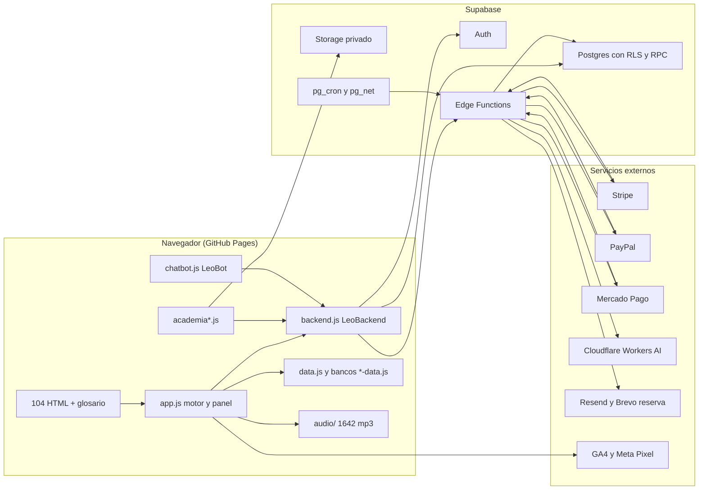
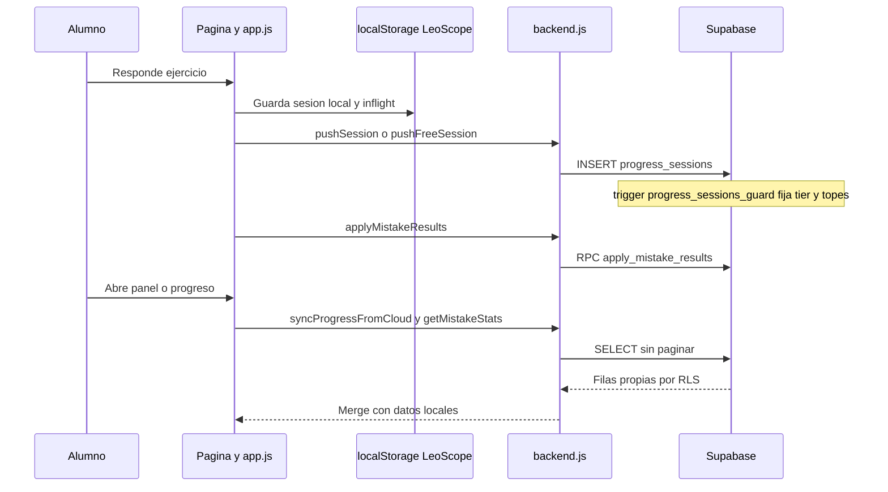
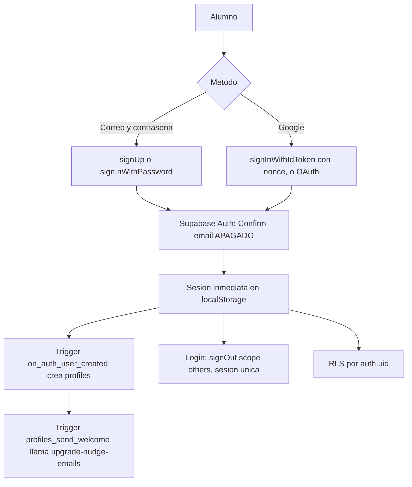
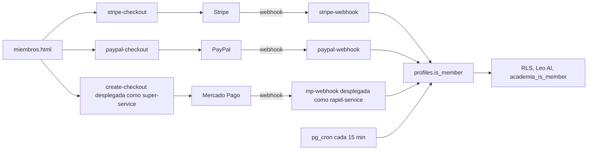
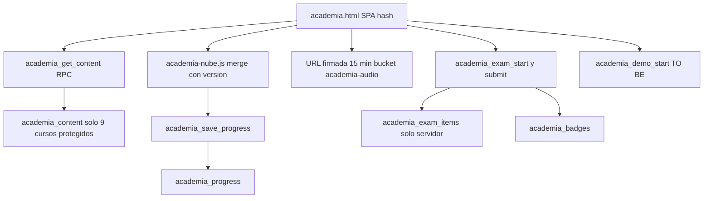
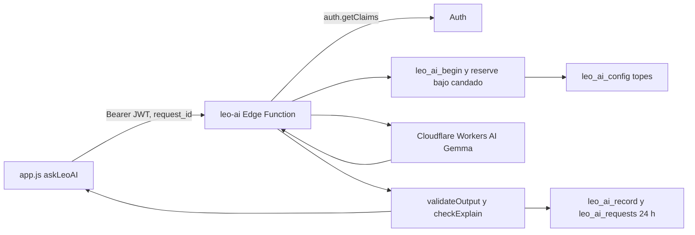
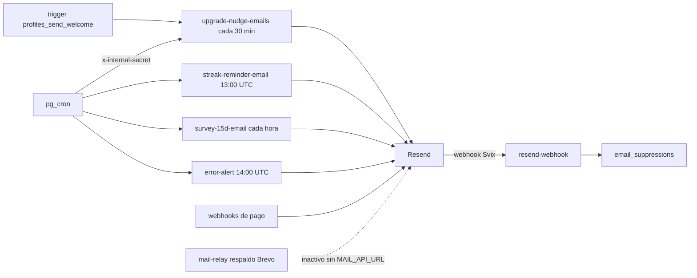

# Arquitectura actual de Ingles con Leo

| Campo | Valor |
|---|---|
| Fecha | 2026-11-25 |
| Commit de referencia | 41d4d8e |
| Estado | Documento de planificacion, la app NO esta construida |
| Etiquetas | [V] verificado, [R] recomendacion, [S] supuesto, [P] pendiente de verificar (ver [README](README.md)) |

Este documento describe lo que existe hoy. Lo que debe cambiar esta en [PLATFORM_AUDIT.md](PLATFORM_AUDIT.md) y la preparacion para movil en [MOBILE_READINESS.md](MOBILE_READINESS.md).

## 1. Resumen

- Sitio estatico en GitHub Pages (dominio inglesconleo.com, repo publico) con Supabase como backend unico (Auth, Postgres, RPC, Storage, Edge Functions, pg_cron). [V]
- Sin build, sin bundler, sin `package.json`, sin service worker. Cada HTML carga scripts globales en orden (`data.js`, `temas.js`, `app.js`, `backend.js`). [V]
- Pagos por tres pasarelas web (Stripe, PayPal, Mercado Pago), con un unico boolean `profiles.is_member` como derecho de acceso. [V]
- Leo AI: Edge Function sobre Cloudflare Workers AI. LeoBot no es IA, es un arbol de botones. [V]
- Cifras: 104 HTML en raiz (476 en total, ~355 fichas de glosario), 1589 ejercicios en `data.js`, 11 cursos x 5 lecciones = 55 lecciones, 1642 mp3 (57 MB), `app.js` 10 756 lineas (602 KB), 28 migraciones, 21 Edge Functions `.ts` en `supabase_functions/`, 120 pruebas en `tools/tests` (no corren en CI). [V]

## 2. Diagrama de componentes

## 3. Ubicaciones reales de implementacion

| Capa | Archivos | Notas |
|---|---|---|
| Motor de practica, diagnostico, plan, limites gratis, analitica | `app.js` (10 756 lineas) | Todo global y mezclado con DOM. `computeDiagnosis` linea ~7451, limites `app.js:4132-4133`. [V] |
| Capa Supabase | `backend.js` (`LeoBackend`) | Auth (`signUp` :88, login :115, Google :199-217), perfil (`getMemberProfile`), `progress_sessions` (:397-491), `mistake_stats` (:534-565), checkout (:570-800), `requireMemberAsync` (:773). [V] |
| Academia | `academia-boot.js`, `academia-motor.js` (generado), `academia-nube.js`, `academia.js`, `academia-audio.js`, `academia-cursos.js` (generado), `academia-lanzamiento.js`, `academia-data.js` | Interruptores encendidos: `CLOUD_ON=true`, `ACADEMIA_MOTOR.enabled=true`, `PUBLIC=true`. [V] |
| Voz del Profe Leo | `leo-voz.js`, `audio/leo/` | Comprueba cada mp3 con HEAD (F-16). [V] |
| Datos de contenido | `data.js` (1,06 MB), `toefl-data.js`, `ielts-data.js`, `toeic-data.js`, `cambridge*-data.js`, `juego-data.js`, `aprender-data.js`, `academia-data.js` | Publicos en el repo. [V] |
| LeoBot | `chatbot.js`, `chatbot.css`, `supabase_functions/leobot-notify.ts` | Arbol de nodos, escribe a `leobot_reports`. [V] |
| Edge Functions (fuente) | `supabase_functions/*.ts` (21 `.ts`, mas `.sql` y `.mjs`) y `supabase/functions/<n>/index.ts` (6) | Dos arboles; solo `stripe-checkout` difiere de verdad (ver seccion 11). [V] |
| Esquema y migraciones | `supabase_schema.sql` (1113 lineas), `supabase/migrations/` (28), `supabase_functions/leo-ai.sql`, `supabase_functions/error-monitoring.sql` | No hay una fuente que reconstruya la base completa (B-08, H-13). [V] |
| Monitor de errores | `error-monitor.js`, `supabase_functions/report-error.ts`, `error-alert.ts` | Solo origen inglesconleo.com (B-11). [V] |
| Herramientas | `tools/generar_audios*.py`, `tools/tests` (120), `tools/e2e`, `tools/respaldo_supabase.sh` | [V] |
| CI | `.github/workflows/indexnow.yml`, `site-health.yml` | No ejecutan las pruebas (F-10). [V] |

## 4. Flujo de datos

- Datos que sincronizan: `progress_sessions`, `mistake_stats`, `academia_progress` (merge con version en `academia-nube.js`), insignias y examenes. [V]
- Datos solo locales: sesion a medias de practica (`leo_inflight_*`), ajustes del plan, Aprender, English Rush, Cambridge/TOEIC (F-03). [V]
- Repeticion espaciada no existe, solo estados de error (activo, recuperado a 2 aciertos, dominado a 4). [V]
- Modelo de entidades de academia: curso, 5 lecciones (`screens[]` y `activities[]`), banco de examen, temas. `item_id = ac:<curso>:<actividad>`. Examen oficial: servidor calcula nota (80 %), 3 intentos/dia, solo miembros. [V informe]

## 5. Autenticacion

- Correo y contrasena (`backend.js:88`, `:115`) y Google (`backend.js:199`, `:217`). Magic link ya no se usa. [V]
- Confirm email apagado: `signUp` devuelve sesion al instante (B-01). [V codigo, [P] estado vivo del panel]
- Sesion unica: `backend.js:117` ejecuta `signOut({scope:'others'})` tras cada login (B-03). [V]
- Clave `sb_publishable_` en `backend.js:21`, publica por diseno; no hay `service_role` en el cliente. [V]
- Reset de contrasena: `backend.js:138` llama a la funcion `clever-responder` (archivo `send-password-reset.ts`) con la anon key. [V]
- Sin CAPTCHA, sin Sign in with Apple, sin borrado de cuenta (H-18). [V]

## 6. Pagos y membresia

- Precios: mensual USD 2, anual USD 20 en Stripe; Mercado Pago 40 MXN/mes; PayPal mensual (anual implementado pero apagado en UI). [V informe]
- `profiles.is_member` solo lo escriben webhooks y cron con `service_role`; el cliente no puede (grants por columna). [V]
- No existe tabla de suscripciones ni de eventos procesados; el estado vive en columnas de `profiles` (`stripe_customer_id`, `paypal_subscription_id`, `mp_preapproval_id`, `next_renewal_at`, `payment_failed_at`, `paypal_access_until`). Las columnas `mp_preapproval_id` y `mp_preapproval_status` no estan definidas en ningun SQL del repo (H-13, verificado con grep). [V]
- Gracia de 72 h solo para Stripe (`suspend_expired_payment_grace`); anual PayPal con `paypal_access_until`. Miembros manuales sin proveedor nunca expiran. [V informe]
- Sin reembolsos, disputas ni pago fallido de PayPal/MP: grep de "refund|dispute|chargeback" en `supabase_functions/` devuelve 0 (H-04). [V]
- Cancelacion solo por correo (`terminos.html:82`, `miembros.html`) (H-07). [V]
- Tras pagar, el cliente sondea `getMemberProfile` 10 veces cada 3 s (`pollForMembershipAfterCheckout`). [V informe]

## 7. Academia

- 11 cursos, 55 lecciones. TO BE y Pronombres son publicos (texto, respuestas y mp3 en el repo); los otros 9 estan `protected:true` en `academia-data.js` y su contenido sale por RPC. [V, 9 coincidencias]
- Todas las funciones `academia_*` validan `auth.uid()` y miembro en servidor en cada llamada. [V informe]
- Demo de TO BE: una vez por cuenta, controlada por servidor (`demo_started_at`). [V informe]

## 8. Leo AI

- Modelo `@cf/google/gemma-4-26b-a4b-it` por defecto (`leo-ai.ts:35,76`), salida maxima 220 tokens (200 en insight). Groq apagado; Gemini solo con cabecera de administrador. [V]
- Modos: `explain`, `writing`, `diagnosis`, `insight`, `trial_status`. La IA nunca califica. [V informe]
- Topes en `leo_ai_config` (100 por usuario/dia, 1500 global, 8000 neurons; prueba de 5 creditos) con CHECK que impiden subirlos mas (AI-07). Kill switch triple: `LEO_AI_ENABLED`, `leo_ai_config.enabled`, `public`. [V informe]
- Adaptativo (diagnostico, plan, pickers) es determinista y vive en el cliente (`app.js:7451`). [V]
- Los costos con modelos Claude del informe de tiendas son solo un escenario alternativo, no la realidad actual. Cambiar de proveedor de IA es una decision [P].

## 9. Correos y notificaciones

- Resend es el proveedor principal; Brevo es reserva inactiva mientras no exista `MAIL_API_URL`. [V]
- No existe push, ni tabla de dispositivos, ni service worker (AI-13). Los recordatorios son solo por correo. [V]
- Barrido de `profiles` completo cada 30 min (AI-15) y racha a hora fija UTC (AI-14). [V informe]
- El cron `inglesconleo-payment-recovery` esta comentado en la migracion (`20261116120000_payment_recovery.sql`, lineas ~85-93); estado en produccion [P]. [V]

## 10. Despliegue y operacion

- Web: push a `main` es produccion (GitHub Pages), sin staging; `?v=` manual en scripts. [V]
- Supabase: despliegue manual con CLI o pegando codigo en el panel; SQL pegado en el editor; no hay `supabase/config.toml` (verificado), por tanto `verify_jwt` no esta versionado. [V]
- Respaldos manuales (`tools/respaldo_supabase.sh`); sin backups automaticos en plan Free (B-09). `private/` (bancos de examen) solo en disco local y copias 7z. [V informe]
- Observabilidad: monitor de errores bien disenado (`error-monitor.js` a `report-error` a `log_app_error` a `error-alert`), retencion 60 dias. [V]

## 11. Dependencias externas

| Servicio | Uso | Riesgo principal |
|---|---|---|
| Supabase (proyecto unico, plan Free segun auditoria [P]) | Todo el backend | Sin backups ni staging (B-09) |
| supabase-js@2 por CDN jsdelivr | Cliente | Sin version exacta ni SRI en 78 paginas (F-08) |
| Stripe, PayPal, Mercado Pago | Cobros web | Reglas de tiendas moviles (ver [MOBILE_READINESS.md](MOBILE_READINESS.md)) |
| Cloudflare Workers AI | Leo AI | Topes que no escalan (AI-07), no declarado en privacidad (AI-05) |
| Resend (Brevo reserva) | Correo | Reputacion por registros sin confirmar (B-01) |
| GA4 y Meta Pixel | Analitica | Sin consentimiento (AI-03/F-07) |
| Google Fonts, Google Identity | UI y login | Menor |
| GitHub Pages / Actions | Hosting y CI | Repo publico sirve todo (AI-01) |

## 12. Contraste con documentacion existente y discrepancias

| Documento existente | Dice | Estado real | Etiqueta |
|---|---|---|---|
| `ACADEMIA_INTEGRACION.md` (cabecera) | Academia preparada, nada aplicado, todo apagado | Tres interruptores encendidos en `main` (F-04); `academia-motor.js:3` aun dice `enabled=false` en su cabecera | [V] |
| `ACADEMIA_INTEGRACION.md:49-58` | Gratis hacen las 5 lecciones | El mismo doc se contradice mas abajo (gratis = solo demo) | [V informe] |
| `ACADEMIA_INTEGRACION.md:55` | La demo cobra 3 a `free_daily_count` | Migracion `20261027180000` quita ese cobro | [V informe] |
| `docs/proteccion-contenido-premium.md:3` | Rama sin merge, sin publicar | Ya esta en `main`: 9 cursos `protected:true`; cursos 1-2 publicos | [V] |
| `AUDITORIA_COMPLETA_2026-10-14.md` 6.1 | 18 tablas | ~28 hoy | [V informe] |
| `AUDITORIA_COMPLETA_2026-10-14.md` 6.2 | anon con INSERT/UPDATE en `profiles` | Corregido por migracion `20261014182848` | [V informe] |
| `RESPALDO_CORREO.md` | Auth envia correo de confirmacion | Confirm email apagado | [V informe] |
| `backend.js:3`, `supabase_schema.sql:78` | Magic link | Ya no se usa | [V informe] |
| `supabase_schema.sql:152-239` | Cron con placeholder de clave | Reemplazado en `:900-915` por Vault; el archivo conserva el bloque viejo (riesgo de re-aplicar) | [V informe] |
| `supabase_functions/leo-ai.sql` | `leo_ai_reserve` sin prueba | Version vigente en `migrations/20261016001253_leo_ai_trial.sql`; reaplicar el `.sql` sobrescribe | [V informe] |
| `MAPA_CONEXIONES.md` | 460 paginas | 104 HTML en raiz, 476 en total, 436 URLs en `sitemap.xml` (cuentan cosas distintas) | [V] |
| `MAPA_CONEXIONES.md:345` (D12) | Estado de `wh` | No comprobable desde el repo | [P] |
| `AUDITORIA_PLATAFORMA_2026-11-24.md` | 13 correcciones, cerrada | Coherentes con la estructura; no se re-verificaron una a una | [P] |

Discrepancias entre informes internos de esta auditoria y su resolucion estan en [PLATFORM_AUDIT.md](PLATFORM_AUDIT.md), seccion "Contradicciones resueltas".
