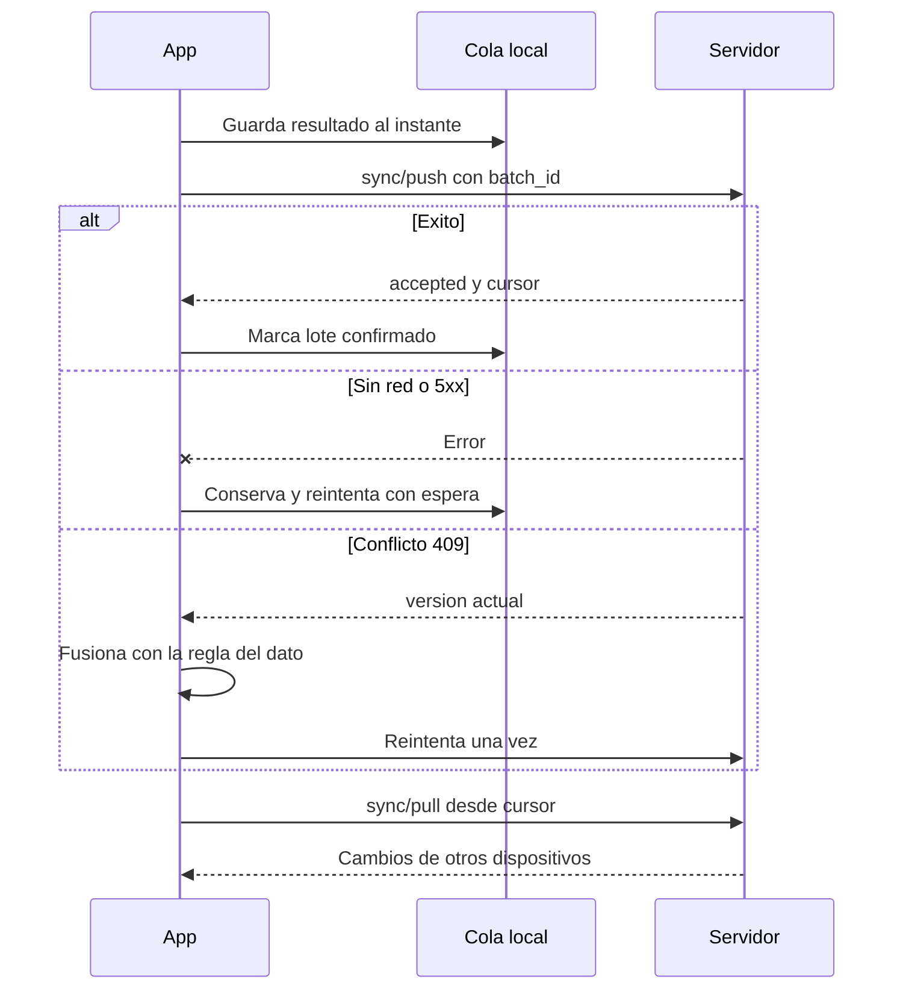

# Datos y contratos de API para la app movil

> Fecha: 2026-11-25 | Commit de referencia: 41d4d8e | Estado: Documento de planificacion, la app NO esta construida. No se crea ninguna migracion real: los esquemas propuestos son descripciones, no SQL aplicable.
>
> Etiquetas de existencia: **[V]** existe y se verifico en el repo; **[R]** propuesto, no existe. Ademas: [S] supuesto, [P] pendiente de verificar. IDs B-xx, H-xx, F-xx, AI-xx de las auditorias.
>
> Relacionados: [arquitectura](ARCHITECTURE_DECISION.md), [producto](MOBILE_PRODUCT_SPEC.md), [pagos](PAYMENTS_AND_MEMBERSHIPS.md).

## 1. Principios del contrato

1. [R] Los datos viven en Supabase; los clientes web y app hablan con el mismo backend. Lectura de datos propios por tablas con RLS o RPC; orquestaciones por Edge Functions.
2. [R] Todo cliente movil usa solo la clave publicable (`sb_publishable`) y el JWT de usuario; nunca `service_role` (B-11, checklist 6).
3. [R] La app pide **columnas explicitas**, no `select('*')` de `profiles`, que hoy trae columnas internas (tokens de encuesta, claves de correo; `backend.js:242`, H-25).
4. [R] Versionado: cada endpoint nuevo lleva `/v1/` en la ruta; las RPC existentes no se renombran (hoy las funciones desplegadas tienen slugs distintos al archivo, B-08, H-24).
5. [R] Toda escritura que pueda reintentarse lleva clave de idempotencia (hoy no la tienen `pushSession` ni `apply_mistake_results`, F-02).

## 2. Tablas actuales [V]

Fuentes: `supabase_schema.sql`, `supabase/migrations/*` (28 archivos), PLATFORM_AUDIT.md, seccion 3. No hay una sola fuente reproducible de la BD (H-13, B-08).

### 2.1 Cuenta, acceso y cuotas

| Tabla | Uso para la app | Acceso del cliente |
|---|---|---|
| `profiles` (id = `auth.users.id`) | Perfil, nivel (`level`, `level_source`), `onboarded_at`, `display_name`, **`is_member`**, `member_since`, `stripe_customer_id`, `paypal_subscription_id`, `mp_preapproval_id`, `mp_preapproval_status` (esta ultima sin definicion en SQL del repo, H-13), `next_renewal_at`, `payment_failed_at`, `paypal_access_until`, cuotas `free_daily_count/date`, correos | SELECT de su fila. UPDATE solo de columnas concedidas (`last_seen_at`, `free_*`, `display_name`, `last_practice_at`, `level`, `onboarded_at`, `level_source`). `is_member` y columnas de pago solo `service_role` |
| `payment_recovery` | Episodios de cobro fallido (Stripe) | Sin acceso cliente |
| `leo_ai_config` (fila unica), `leo_ai_trial`, `leo_ai_requests`, `ai_usage`, `ai_usage_daily`, `leo_ai_testers` | Topes, prueba gratis e idempotencia de Leo AI | Sin politicas: solo RPC `service_role` |

### 2.2 Progreso y aprendizaje

| Tabla | Columnas clave | Acceso |
|---|---|---|
| `progress_sessions` | `user_id, skill, level, topics jsonb, date, started_at, duration_ms, results jsonb, tier ('free' o NULL), created_at`. Trigger `progress_sessions_guard` fija `tier` y `created_at` en servidor; tope 40 filas por 24 h gratis, 300 miembro; resultados con maximo 500 elementos y 100 KB | SELECT e INSERT propios; sin UPDATE ni DELETE |
| `mistake_stats` | `user_id, item_id, kind, topic, fail_count, correct_streak, status, last_correct, recovered_at`, unica por (usuario, item). Estados: activo, recuperado (2 aciertos seguidos), dominado (4) | SELECT, INSERT, UPDATE propios; sin limites de tamano (B-06) |
| `academia_progress` | `user_id, course_id, state jsonb (max 60 KB), version, demo_started_at, demo_done_at` | SELECT propio; escritura por RPC |
| `academia_badges` | Insignias de examen | SELECT propio; creada solo por `academia_exam_submit` |
| `academia_mistake_batches` | Lotes idempotentes de errores de academia | Sin acceso cliente |

### 2.3 Cursos y contenido

| Tabla | Uso | Acceso |
|---|---|---|
| `academia_courses` | `course_id, enabled, members_only, demo_items, pass_pct, max_attempts_day` | SELECT autenticado |
| `academia_content` | Contenido de los 9 cursos protegidos | Solo RPC `academia_get_content` |
| `academia_exam_items` | Banco de examen (campos publicos y respuesta separados) | Solo servidor |
| `academia_exam_attempts` | Intentos | SELECT propio de columnas permitidas |

### 2.4 Social, soporte y operacion

`article_comments` (lectura publica, insercion con limites), `leobot_reports` (solo INSERT), `survey_responses`, `member_feedback` y `member_feedback_state`, `member_reactivation_log`, `email_suppressions`, `app_errors`, `app_error_hourly`, `app_error_rate`. Buckets privados: `academia-audio` (URL firmada de 15 min), `leobot-reports`, `libros`.

### 2.5 Lo que NO existe hoy [V]

No hay tabla de suscripciones, pagos ni eventos de webhook (el estado vive en columnas de `profiles`, H-02); no hay tabla de tokens de dispositivo, de cola de notificaciones ni de preferencias por canal (AI-13, AI-17); no hay sincronizacion de sesiones a medias ni de ajustes del plan (F-03); no hay registro de versiones de contenido; no hay configuracion de version minima de cliente.

## 3. Esquema propuesto [R]

Descripciones de tablas nuevas. Cada una con RLS activada y sin permisos de escritura directa para `authenticated` salvo donde se indica.

### 3.1 `entitlements` (fuente unica de derechos de acceso)

| Columna | Tipo | Nota |
|---|---|---|
| `id` | uuid | PK |
| `user_id` | uuid | FK a `auth.users`, indexado |
| `source` | text | `stripe`, `paypal`, `mercadopago`, `apple`, `google`, `manual` |
| `external_id` | text | id de suscripcion o transaccion original en esa fuente; unico junto con `source` |
| `plan` | text | `monthly`, `annual`, `lifetime` [S] |
| `status` | text | `active`, `grace`, `billing_retry`, `canceled_active` (cancelado pero vigente), `expired`, `revoked`, `refunded` |
| `starts_at`, `expires_at` | timestamptz | `expires_at` NULL solo para `manual` sin vencimiento |
| `will_renew` | boolean | |
| `environment` | text | `production` o `sandbox` |
| `store_account_token` | uuid | `appAccountToken` (Apple) u `obfuscatedExternalAccountId` (Google) para mapear al usuario |
| `last_event_at` | timestamptz | orden de eventos: se ignora un evento mas viejo |
| `raw_ref` | jsonb | referencia minima, sin datos de tarjeta ni personales |

Regla de derivacion [R]: `profiles.is_member` = existe un `entitlement` con `status` en (`active`, `grace`, `billing_retry`, `canceled_active`) y `expires_at` en el futuro (o NULL manual). La derivacion corre por funcion o trigger, para no romper `academia_is_member`, `progress_sessions_guard` ni `leo-ai`, que hoy leen `profiles.is_member` (PLATFORM_AUDIT.md, seccion 2, H-09). Los miembros manuales de hoy (sin proveedor, nunca expiran, `billingSync` los cuenta) se migran como `source = manual`.

### 3.2 `webhook_events` (idempotencia)

`provider`, `event_id` (unico junto con provider), `received_at`, `processed_at`, `status`, `error`. Corrige H-03 y H-10: permite devolver 5xx para reintento y detectar repeticiones.

### 3.3 `device_tokens`

| Columna | Nota |
|---|---|
| `id`, `user_id` | |
| `platform` | `ios` o `android` |
| `token` | token FCM o APNs, unico |
| `app_version`, `os_version`, `locale`, `timezone` | zona horaria IANA por dispositivo (corrige AI-14) |
| `last_seen_at`, `disabled_at` | se desactiva al primer error de entrega |

### 3.4 `notification_preferences` y `notification_queue`

`notification_preferences`: `user_id`, categorias `streak`, `review`, `weekly_goal`, `billing`, `news`, `quiet_hours`, `email_opt_out_at` (hoy un solo flag para todo, AI-17). `notification_queue`: `id`, `user_id`, `category`, `payload jsonb`, `send_after`, `dedupe_key` (unico), `status`, `attempts`, `sent_at`. Un trabajo programado la procesa en lotes (reemplaza el barrido completo de `profiles`, AI-14, AI-15).

### 3.5 Sincronizacion y estado entre dispositivos

| Tabla | Para que |
|---|---|
| `inflight_sessions` | Sesion de practica a medias por (usuario, habilidad, nivel), reemplaza las claves `leo_inflight_*` de localStorage (F-03) |
| `user_settings` | Longitud de sesion, dificultad del plan y similares, hoy solo locales (`leo_session_length`, `leo_plan_*`) |
| `sync_log` [S] | Cursor de cambios por dispositivo si se adopta sincronizacion incremental |

### 3.6 Contenido, configuracion y cumplimiento

| Tabla | Para que |
|---|---|
| `content_versions` | `bank`, `version`, `sha256`, `url`, `min_app_version`, `published_at` (seccion 6) |
| `app_config` | `min_app_version`, `latest_app_version`, banderas (feature flags), kill switches (ya existe el triple de Leo AI) |
| `ai_cache` | Respuestas validadas de Leo AI por hash de (ejercicio, respuesta, nivel), compartidas (AI-08) |
| `account_deletion_requests` | Solicitud, estado, fecha limite, cancelacion de suscripciones externas (H-18) |
| `consents` | Version de politica aceptada, consentimiento de analitica y de IA, edad declarada (AI-03, AI-04) |

## 4. Endpoints y RPC reales [V]

Base: `https://<proyecto>.supabase.co`. Las funciones desplegadas usan el slug de `backend.js`, no el nombre del archivo.

### 4.1 Edge Functions invocadas desde el cliente

| Slug desplegado | Archivo | Metodo y auth | Uso |
|---|---|---|---|
| `leo-ai` | `supabase_functions/leo-ai.ts` | POST, Bearer JWT (`auth.getClaims`) | Modos `explain`, `writing`, `diagnosis`, `insight`, `trial_status` |
| `stripe-checkout` | `supabase_functions/stripe-checkout.ts` | POST, Bearer, `auth.getUser` | Checkout embebido; `action:'mark'` |
| `paypal-checkout` | `paypal-checkout.ts` | POST, Bearer | Suscripcion PayPal |
| `super-service` | `create-checkout.ts` | POST, Bearer | Preapproval Mercado Pago |
| `clever-responder` | `send-password-reset.ts` | POST, clave anon como Bearer, sin limite (B-04) | Recuperacion de contrasena |
| `notify-new-comment`, `leobot-notify`, `report-error`, `submit-survey`, `email-unsubscribe`, `libro-download` | mismos nombres | Sin JWT o con token propio | Avisos y operaciones auxiliares |

Webhooks (no los llama el cliente): `stripe-webhook`, `paypal-webhook`, `rapid-service` (= `mp-webhook.ts`), `resend-webhook`.

### 4.2 Contrato de `leo-ai` [V]

Peticion de ejemplo para `explain` en gramatica de opcion multiple (campos construidos por `buildLeoAiPayload` en `app.js` ~3036-3060 y leidos por `buildPrompt` en `leo-ai.ts`):

```json
{
  "mode": "explain",
  "request_id": "k3J9x-example-id-01",
  "level": "facil",
  "isCorrect": false,
  "studentAnswer": "she have",
  "skill": "grammar",
  "topic": "Presente simple",
  "exerciseType": "Elegir la opcion correcta",
  "question": "She ___ a car.",
  "options": ["have", "has"],
  "correctAnswer": "has",
  "baseExplanation": "Con she usamos has."
}
```

Reglas [V]: `request_id` de 8 a 64 caracteres `[A-Za-z0-9_-]`, uno por pulsacion (reutilizado en los reintentos del cliente, hasta 3, con timeout de 18 s); los textos se recortan (respuesta del alumno 400, explicacion base 500, contexto hasta 1500); `writing` exige al menos 2 palabras reales y lleva `question`, `target`, `example`, `studentAnswer`; `insight` lleva `scope`, `facts` (2 a 5), `candidates` (hasta 3 ids de tema) y `shown`. Respuesta correcta: `{ "ok": true, "answer": { ... }, "trial": { ... } }` (`trial` solo en cuentas gratis). Errores (campo `reason`): `no_session`, `bad_input`, `insufficient_text`, `members_only`, `not_member`, `not_allowed`, `daily_limit`, `busy`, `disabled`, `trial_off`, `trial_exhausted`, `trial_noverify`, `trial_pool`, `trial_busy`, `in_progress`, `error`; `final: true` indica que no conviene reintentar. Consulta de prueba: `{ "mode": "trial_status" }` devuelve `{ "ok": true, "trial": { "enabled": true, "credits": 5, "used": 1, "remaining": 4 } }` (los valores del ejemplo son ilustrativos, la forma es [V] en `trialInfo`, `leo-ai.ts:680-687`).

Propuesta [R]: enviar `itemId` y reconstruir el prompt en servidor en lugar de aceptar texto libre (AI-10); cabecera `x-app-version` y `x-platform` para telemetria.

### 4.3 RPC y acceso a tablas desde el cliente

| RPC / tabla | Parametros | Quien |
|---|---|---|
| `apply_mistake_results(p_items jsonb)` | lista de `{ item_id, kind, topic, is_correct }` (`jsonb_to_recordset`, `supabase_schema.sql:684-695`) | authenticated |
| `member_feedback_status()`, `submit_member_feedback(p_score int, p_comment text)`, `dismiss_member_feedback()` | | authenticated |
| `academia_access(p_course text, p_today date, p_local_count int)` | | authenticated |
| `academia_demo_start(p_course, p_today, p_local_count)`, `academia_demo_finish(p_course)` | | authenticated |
| `academia_save_progress(p_course text, p_state jsonb, p_base_version int)` | version base | authenticated |
| `academia_apply_mistakes(p_batch uuid, p_items jsonb)`, `academia_retry_pending()`, `academia_record_session(p_course, p_session jsonb)` | | authenticated |
| `academia_exam_status(p_course)`, `academia_exam_start(p_course)`, `academia_exam_submit(p_attempt uuid, p_answers jsonb)` | | authenticated |
| `academia_get_content(p_course)`, `academia_audio_allowed(p_name)` | | authenticated, requiere derecho |
| Tabla `profiles` | select propio; update de columnas concedidas | authenticated |
| Tabla `progress_sessions` | select e insert propios | authenticated |
| Tabla `mistake_stats` | select propio | authenticated |

Ejemplo de respuesta real de `academia_access` [V] (`20261026120000_academia_integracion.sql:125-155`):

```json
{
  "ok": true,
  "member": false,
  "demo": { "cost": 3, "used": false, "done": false, "resumable": false, "available": true },
  "daily": { "count": 2, "limit": 6, "remaining": 4 }
}
```

Errores del mismo contrato: `{ "ok": false, "error": "auth" }`, `"course"`, `"demo_off"`, `"demo_used"`, `"limit"`.

Funciones internas, no invocables por el cliente [V]: `academia_is_member`, `academia_free_count`, `academia_today`, `academia_free_daily_limit`, `academia_apply_batch`, `academia_item_public`, `leo_ai_reserve/begin/finish/record/trial_status/trial_report`, `internal_secret_ok`.

## 5. API movil propuesta v1 [R]

Una Edge Function `api` (un solo slug estable) con rutas versionadas, para no depender de los slugs historicos. Todas con `Authorization: Bearer <jwt>` salvo `config`. CORS: lista de origenes de la web y de la app nativa (`capacitor://localhost`, `https://localhost`) mas clave de aplicacion y, a futuro, App Attest o Play Integrity (B-11, AI-11).

| Ruta | Metodo | Proposito |
|---|---|---|
| `/api/v1/config` | GET | Version minima, kill switches, banderas, precios de referencia (sin auth) |
| `/api/v1/me` | GET | Perfil minimo, `entitlement` vigente, cuotas del dia, consentimientos |
| `/api/v1/entitlements` | GET | Lista de derechos por fuente y el efectivo |
| `/api/v1/entitlements/restore` | POST | Reconciliar con RevenueCat o tienda y devolver el derecho |
| `/api/v1/devices` | POST, DELETE | Registrar y borrar token de push |
| `/api/v1/notifications/preferences` | GET, PUT | Categorias y horas de silencio |
| `/api/v1/content/manifest` | GET | Versiones de bancos de contenido |
| `/api/v1/sync/pull` | GET | Cambios desde un cursor |
| `/api/v1/sync/push` | POST | Lote de resultados y estado con idempotencia |
| `/api/v1/sessions/inflight` | GET, PUT, DELETE | Sesion a medias entre dispositivos |
| `/api/v1/account/delete` | POST | Solicitud de borrado de cuenta |
| `/api/v1/events` | POST | Lote de eventos de analitica de la app con consentimiento |

### 5.1 Ejemplos de payload

`GET /api/v1/config`

```json
{
  "min_app_version": "1.0.0",
  "latest_app_version": "1.2.0",
  "kill_switches": { "leo_ai": false, "purchases": false },
  "flags": { "offline_audio": true, "spaced_repetition": false },
  "content": { "data_bank": 41, "academia": 17 }
}
```

`GET /api/v1/me`

```json
{
  "user_id": "00000000-0000-0000-0000-000000000000",
  "level": "facil",
  "entitlement": {
    "effective": true,
    "source": "apple",
    "status": "active",
    "plan": "monthly",
    "expires_at": "2026-12-25T00:00:00Z",
    "will_renew": true
  },
  "quota": { "date": "2026-11-25", "used": 2, "limit": 6 },
  "consents": { "policy_version": "2026-11", "analytics": false, "ai_text": true }
}
```

`POST /api/v1/devices`

```json
{ "platform": "ios", "token": "<token-de-push>", "app_version": "1.0.0", "os_version": "26.1", "locale": "es-MX", "timezone": "America/Mexico_City" }
```

`POST /api/v1/sync/push`

```json
{
  "device_id": "dev-example-01",
  "batch_id": "b-2026-11-25-0001",
  "sessions": [
    {
      "client_id": "s-example-01",
      "skill": "grammar",
      "level": "facil",
      "topics": ["to-be-presente"],
      "started_at": "2026-11-25T14:00:00Z",
      "duration_ms": 240000,
      "results": [ { "itemId": "g-principiante-num-1", "isCorrect": true } ]
    }
  ],
  "mistakes": [ { "item_id": "g-principiante-num-2", "kind": "grammar", "topic": "numeros", "is_correct": false } ]
}
```

Respuesta: `{ "ok": true, "accepted": ["s-example-01"], "duplicates": [], "cursor": "c-000123" }`. `client_id` y `batch_id` hacen la operacion idempotente (hoy la deduplicacion depende de `progressSessionIdentity`, `app.js:783`, F-02).

`POST /api/v1/entitlements/restore` devuelve el mismo bloque `entitlement` de `/me`. `POST /api/v1/account/delete` recibe `{ "confirm": true, "reason": "opcional" }` y responde `{ "ok": true, "status": "pending", "deadline": "2026-12-25" }`.

Codigos de error comunes [R]: 401 sin sesion, 403 sin derecho, 409 conflicto de version o doble compra, 426 version de app obsoleta (con `min_app_version`), 429 limite, 503 temporal (el cliente reintenta con espera exponencial).

## 6. Versionado de bancos de contenido [R]

[V] Hoy los bancos son JS globales publicos (`data.js` 1,06 MB, `*-data.js`, `academia-data.js`). Los items tienen id unico (`g-principiante-num-1`, ids unicos al 100 %) y los de academia usan `ac:<curso>:<actividad>` hacia el motor.

Propuesta:
1. Un script de exportacion genera `bank-<nombre>.json` con ids **estables**; un cambio de id rompe `mistake_stats` y el historial, por eso nunca se reutiliza ni se renombra un id.
2. `content_versions` guarda `version` entera, `sha256` y `url` (CDN o Storage con cache). Los bancos premium solo se sirven con derecho vigente (no son publicos, B-02).
3. La app lee `/api/v1/content/manifest` al abrir y cuando vuelve a primer plano; descarga solo lo cambiado y valida el `sha256`.
4. Compatibilidad: cada version declara `min_app_version`; una app antigua sigue con su version anterior en vez de romper.
5. Los resultados guardan `itemId`, asi un item corregido conserva el historial; un item **retirado** se marca `retired` y se ignora en seleccion, pero no se borra del historial.
6. Pruebas: las 120 pruebas de `tools/tests` (hoy fuera de CI, F-10) pasan a validar ids unicos, esquema y audios referenciados antes de publicar.

## 7. Sincronizacion de progreso y resolucion de conflictos

[V] Lo que ya existe y es reutilizable: `academia_save_progress(p_course, p_state, p_base_version)` devuelve `{ ok, version }` o `{ conflict, version }`; el cliente (`academia-nube.js`, `mergeStates`) fusiona y reintenta. Reglas de fusion verificadas: lecciones hechas, gana la fecha mas antigua y el mejor resultado; a mitad de leccion, gana el guardado mas reciente salvo que la leccion ya este hecha despues; errores segun marcas de tiempo por actividad; dias, completados e intentos, union. Cola de respuestas de academia en lotes con id (`leo_academia_cola_v1`, `academia_apply_mistakes`).

[V] Lo que falla y debe corregirse antes de la app: `pushSession` de miembros no tiene cola ni reintento (F-02); `syncProgressFromCloud` y `getMistakeStats` leen todo sin paginar (F-01); la sesion a medias no cruza dispositivos (F-03).

| Dato | Regla de resolucion propuesta [R] |
|---|---|
| Sesiones de practica (`progress_sessions`) | Solo se agregan (append-only). Conflicto imposible: se deduplica por `client_id`. Orden por `started_at` |
| `mistake_stats` | El servidor es la fuente: aplicar resultados en lote con id de lote; estado se recalcula por orden de `started_at` de los resultados |
| `academia_progress` | Mantener `mergeStates` y version (ya probado) |
| Sesion a medias (`inflight_sessions`) | Gana la mas reciente por `updated_at`; si la leccion ya se completo en otro dispositivo, se descarta |
| Ajustes (`user_settings`) | Ultimo en escribir gana por campo, con marca de tiempo del servidor |
| Cuota diaria | Siempre el servidor; el cliente nunca decrementa por su cuenta |
| Derecho de acceso | Siempre servidor (`entitlements`); el cliente solo cachea con vencimiento corto |

Algoritmo de sincronizacion [R]: al abrir y al volver la red, 1) subir cola local con `batch_id`; 2) `sync/pull` desde el ultimo cursor, paginado; 3) aplicar y limpiar cola confirmada; 4) ante 409, traer, fusionar y reintentar una vez.



## 8. Claves de localStorage a migrar o reemplazar [V]

Capa de aislamiento por cuenta: `LeoScope.store` (`app.js:116`, claves `PROG`, `PEND`).

| Clave | Hoy | Destino en la app |
|---|---|---|
| `leo_progress_v2` | Historial de sesiones, sincroniza con merge por identidad | Cache local; verdad en `progress_sessions` con `client_id` |
| `leo_free_pending_v1` | Cola de sesiones gratis con reintento | Cola unica de `sync/push` |
| `leo_inflight_<skill>_<level>` (`app.js:2252`) | Solo local, caduca a 3 dias (`DASH_RESUME_MAX_AGE_MS`) | **Servidor**: `inflight_sessions` |
| `leo_clases_inflight_v2`, `leo_check_seen_v1`, `leo_micro_stats_v1`, `leo_derived_meta_v1` | Local o derivado | Servidor la sesion de clases; el resto se rederiva |
| `leo_academia_piloto_v1`, `leo_academia_v1_<curso>` | Avance con sync | Cache; verdad en `academia_progress` |
| `leo_academia_cola_v1:<cuenta>:<curso>` | Cola de respuestas | Sin cambio de logica |
| `leo_academia_exam_draft_v1[:curso]` | Borrador de examen local | Opcional: guardar borrador en servidor [R] |
| `leo_profile`, `leo_session_length`, `leo_plan_*` | Local, ajustes sin sync | `user_settings` |
| `leo_aprender_v1`, `leo_rush_record`, `leo_rush_runs`, `leo_cambridge_level`, `leo_toeic_draft_*` | Solo local | Posterior; `user_settings` o tabla propia |
| `leo_member_hint` | Pista de membresia (no da acceso) | Se reemplaza por `entitlement` en `/me` |
| `leo_voz_vol` | Volumen de voz | Local (aceptable) |
| `leo_ev_*`, `leo_ai_*`, `leo_first_*` | Estado de embudo y analitica | Se reemplaza por SDK de la app con consentimiento |

Migracion de usuarios existentes [R]: no se mueven datos de localStorage del navegador a la app; la app se alimenta del servidor tras iniciar sesion. Lo unico que se pierde son las claves marcadas "solo local" de la web.

## 9. Eventos de analitica

[V] Hoy: ~35 eventos via `trackLeoEvent` (`app.js:4151-4177`) hacia GA4 y 3 mapeados a Meta Pixel (`CompleteRegistration`, `InitiateCheckout`, `Purchase`); sin consentimiento (F-07, AI-03); la compra se mide en el cliente (`miembros.html:818`, AI-20). Eventos conocidos: `guest_exercise_limit_reached`, `free_daily_limit_reached`, `free_signup_completed`, `membership_cta_clicked`, `checkout_started`, `membership_purchase_completed`, `first_practice_started`, `first_session_completed`, `signup_prompt_shown`, `reinforce_shown`, `leo_ai_trial_*`, `academia_demo_*`, `video_promo_play`, entre otros.

[R] Diccionario para la app (reutiliza nombres existentes donde aplica). Solo se envian con consentimiento y sin identificadores de IA ni texto del alumno.

| Evento | Cuando | Propiedades |
|---|---|---|
| `app_open` | Arranque | `app_version`, `platform` |
| `signup_completed` | Cuenta creada | `method` (email, google, apple) |
| `onboarding_completed` | Fin | `level_source` |
| `first_practice_started`, `first_session_completed` | Hitos | `skill`, `level` |
| `session_completed` | Fin de sesion | `skill`, `level`, `items`, `correct`, `duration_ms` |
| `lesson_completed`, `exam_submitted` | Academia | `course_id`, `lesson_id`, `passed` |
| `leo_ai_used` | Explicacion entregada | `mode`, `is_trial` (sin texto) |
| `paywall_viewed`, `purchase_started`, `purchase_completed`, `purchase_restored`, `purchase_failed` | Compra | `product_id`, `source` (apple, google), `price_tier` |
| `limit_reached` | Tope gratis | `kind` (guest, free) |
| `push_permission_prompt`, `push_permission_result` | Permiso | `result` |
| `offline_session`, `sync_failed` | Offline | `queued_items` |
| `account_delete_requested` | Borrado | |

[R] La conversion de compra se envia **desde el servidor** (webhook) con `event_id` para deduplicar, y atribucion con SKAdNetwork en iOS y Install Referrer en Android (AI-20). Sin consentimiento de seguimiento no se usa el prompt ATT: solo analitica propia, que no lo requiere (https://developer.apple.com/app-store/user-privacy-and-data-use/, consultado 2026-11-25, conf. A).

## 10. Observabilidad y compatibilidad de entorno

- [V] `error-monitor.js` solo corre en los dominios web y `report-error` descarta cualquier `Origin` distinto (`error-monitor.js:31-46`, `report-error.ts:30,146-157`, B-11). [R] Ampliar la lista a origenes nativos y aceptar clave de app.
- [V] Auth: `redirectTo` usa `window.location.origin` (`backend.js:146,199`) y no sirve en WebView; [R] deep link o universal link (`assetlinks.json`, `apple-app-site-association`, ninguno existe, AI-23) y `redirectTo` propio en la lista de Redirect URLs de Supabase.
- [V] Sesion unica por `signOut({scope:'others'})` (`backend.js:117`, B-03): [R] retirarla o hacerla opcional para permitir telefono mas web; los JWT revocados siguen validos hasta ~1 h en RLS y `leo-ai` (`getClaims`).

## 11. Pendiente de verificar [P]

Forma de la respuesta de `academia_get_content` y del cuerpo real de `answer` de `leo-ai` (solo se leyo el contrato de entrada); `verify_jwt` real por funcion; contenido de `quick-endpoint` (sin copia en el repo); existencia en BD de `mp_preapproval_id/status` y otras columnas; formato de App Store Server Notifications V2 y de Google RTDN (ver [pagos](PAYMENTS_AND_MEMBERSHIPS.md)).
