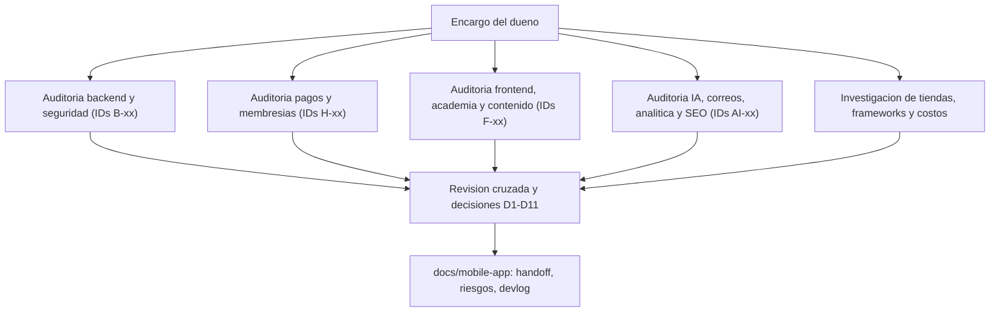

# DEVLOG del proyecto movil: Ingles con Leo

- Fecha de creacion: 2026-11-25
- Commit de referencia: 41d4d8e
- Estado: Documento de planificacion, la app NO esta construida.
- Etiquetas: [V] verificado en codigo o documento oficial, [R] recomendacion, [S] supuesto, [P] pendiente de verificar.
- Alcance: solo el proyecto de la app movil. El `DEVLOG.txt` de la raiz es del sitio web y es otro registro.
- Documentos hermanos: [AI_HANDOFF.md](AI_HANDOFF.md), [RISKS_AND_OPEN_QUESTIONS.md](RISKS_AND_OPEN_QUESTIONS.md).
- Regla: orden cronologico, entradas nuevas al final, pocas lineas, sin repetir lo que ya esta en otro documento (enlazalo). No incluir secretos, correos ni datos de clientes.

---

## 2026-11-25 Auditoria de la plataforma y decisiones de arquitectura para la app movil

### Objetivo

Decidir si la plataforma esta lista para una app iOS y Android, con la meta de 1 000 000 de usuarios, y dejar documentado el camino: arquitectura, pagos, requisitos de tiendas, escalabilidad, riesgos y primer paso. No se construyo nada.

### Metodo

Cinco agentes de IA trabajaron en paralelo, cada uno de solo lectura sobre el commit 41d4d8e, y despues hubo una revision cruzada de sus informes.



Reglas del metodo: cada afirmacion relevante se etiqueta [V], [R], [S] o [P]; lo no verificable desde el repo se marca [P]; se conservan los IDs de hallazgos; no se tocaron codigo, base de datos, pagos ni configuracion; no se uso git para modificar nada.

### Investigaciones realizadas (con fuentes)

Fecha de consulta 2026-11-25. Confianza: A alta (pagina oficial leida), M media, B baja. Las paginas se leyeron con una herramienta de resumen, por lo que algunas extracciones fueron parciales.

| Tema | Hallazgo | Fuente | Conf. |
|---|---|---|---|
| Apple: compras | 3.1.1 exige IAP para contenido o funciones premium; 3.1.3(b) permite acceso a lo comprado en otras plataformas si tambien hay IAP | https://developer.apple.com/app-store/review/guidelines/ | A |
| Apple: calidad | 4.2 rechaza sitios reempaquetados; 4.8 pide Sign in with Apple si hay login de terceros; 5.1.1(v) exige borrado de cuenta in-app | misma | A (texto), B (nivel de riesgo para Leo) |
| Apple: comisiones | 30% el primer ano de suscriptor y 15% desde el segundo; Small Business Program 15% bajo 1M USD | https://developer.apple.com/app-store/subscriptions/ y .../small-business-program/ | A |
| Apple: cuenta y SDK | 99 USD al ano; Xcode 26 y iOS 13 de minimo | https://developer.apple.com/support/enrollment/ y .../news/upcoming-requirements/ | A |
| Epic v. Apple (EEUU) | Enlace externo permitido sin entitlement; comision 0% provisional; certiorari y argumento oral en enero de 2027 | prensa (MacRumors, Fenwick, Bloomberg Law) | M-B |
| UE y Japon | Terminos unificados desde 2026-10-01; cifras de Japon por nota de prensa | https://developer.apple.com/support/dma-and-apps-in-the-eu/ | A / M |
| Google Play: pagos y tarifas | Play Billing obligatorio para contenido digital; suscripciones 15% en la mayoria de mercados; extraccion de la tabla confusa | https://support.google.com/googleplay/android-developer/answer/9858738 y .../112622 | A / M |
| Google Play: cuenta | 25 USD unico; cuentas personales nuevas: 12 testers durante 14 dias | https://support.google.com/googleplay/android-developer/answer/14151465 | A |
| Google Play: requisitos | Play Billing v8 o v9; target API 36; borrado de cuenta y Data safety | https://developer.android.com/google/play/billing/deprecation-faq y paginas de ayuda | A |
| Gestores de suscripcion | RevenueCat gratis hasta 2,5K USD de MTR y luego 1%; Adapty gratis bajo 5K USD; webhooks de RevenueCat con reintentos | https://www.revenuecat.com/pricing/ , https://adapty.io/pricing/ | A |
| Frameworks | Expo SDK 58 y EAS con plan gratis; Capacitor 8 (Xcode 26, iOS 15, Android minSdk 24); PWA iOS con push solo si esta instalada | https://docs.expo.dev/versions/latest/ , https://expo.dev/pricing , https://capacitorjs.com/docs/updating/8-0 , https://webkit.org/blog/13878/ | A |
| Supabase | Pro 25 USD, 100k MAU incluidos, 0,00325 USD por MAU extra, conexiones por tamano de compute | https://supabase.com/pricing | A |
| Push | FCM cuota de 600.000 mensajes por minuto; OneSignal 0,012 USD por MAU movil sobre el plan gratuito | https://firebase.google.com/docs/cloud-messaging/throttling-and-quotas , https://onesignal.com/pricing | A |
| IA (escenario alternativo) | Tarifas por millon de tokens de modelos Claude | https://platform.claude.com/docs/en/about-claude/pricing | A |

Nota de seguridad de la investigacion: dos paginas de Supabase contenian texto incrustado que pedia enviar un reporte de feedback; se ignoro por ser contenido de la web y no una instruccion del dueno.

Auditorias del repo (fuente: informes internos del 2026-11-25): 20 hallazgos de backend (B-01 a B-20), 25 de pagos (H-01 a H-25), 20 de frontend (F-01 a F-20) y 24 de IA y operacion (AI-01 a AI-24). Los detalles y su mapa a Fase 0 estan en [AI_HANDOFF.md](AI_HANDOFF.md#fase-0-prerrequisitos-d5-en-orden-de-gravedad-aproximado).

Verificaciones propias al redactar (2026-11-25, lectura del repo): cifras citadas en AI_HANDOFF (`app.js` 10 756 lineas, `backend.js` 1036, `academia-nube.js` 367); 9 cursos con `"protected": true` en `academia-data.js`; `shuffleOptions` en `app.js:2382`; `inflightKey` en `app.js:2252`; 120 archivos en `tools/tests`; 28 migraciones en `supabase/migrations`; 24 funciones en `supabase_functions` y 6 en `supabase/functions`; ausencia de `package.json` en la raiz y de `supabase/config.toml`; precios USD 2 y USD 20 en `terminos.html:76-77`.

### Decisiones D1 a D11 y su razon

El detalle completo esta en [AI_HANDOFF.md](AI_HANDOFF.md#4-decisiones-tomadas-y-por-que-d1-d11); aqui el resumen con la razon.

| ID | Decision | Razon |
|---|---|---|
| D1 | Capacitor con shell nativo propio y plugins, tras un refactor de `app.js` y un spike de 1-2 semanas | Maximo reuso de HTML, JS, Supabase y tests; mejor para mantener con agentes de IA; el shell evita el rechazo 4.2 |
| D2 | Alternativa Expo y React Native; descartadas Flutter, nativo puro, PWA sola y TWA como estrategia | Se activa si falla el spike; las demas implican reescritura o no tienen tienda ni IAP en iOS; no se elige por popularidad |
| D3 | `entitlements` multi-fuente en Supabase; `is_member` derivado | Hoy es un booleano sin vigencia y conviven hasta 3 proveedores (H-02) |
| D4 | IAP via RevenueCat y webhooks a Supabase; web con Stripe, PayPal y Mercado Pago; bloqueo de doble compra en servidor | Reglas 3.1.1 y 3.1.3(b); H-01; no apoyarse en el 0% provisional de EEUU |
| D5 | Fase 0: corregir 19 areas de la plataforma antes de la app | Son hallazgos verificados que la app agravaria; se documenta, no se ejecuta |
| D6 | Leo AI actual (Cloudflare, Gemma) como realidad; costos con Claude solo como escenario | Evitar confundir estimacion con produccion |
| D7 | Escenarios 1k, 10k, 100k, 1M con supuestos explicitos [S] | Separar decisiones tempranas de aplazables |
| D8 | Plataforma no lista; base sana con 8 bloqueadores; clasificacion de reuso | PLATFORM_AUDIT.md, seccion 5 |
| D9 | Roadmap Fases 0 a 6 con despliegue gradual, flags y rollback | Reducir riesgo en cada salto |
| D10 | No construir, no tocar produccion, no migraciones; DEVLOG del movil separado | Fase de planificacion |
| D11 | Primer paso: comprobaciones, Fase 0, cuentas de desarrollador, spike | Los tiempos de espera de cuentas y testers no se comprimen |

### Contradicciones resueltas

| Tema | Fuentes en conflicto | Resolucion |
|---|---|---|
| Estado de la academia | `ACADEMIA_INTEGRACION.md` ("nada aplicado, todo apagado") frente al codigo en `main` (tres interruptores encendidos) | Manda el codigo (F-04); el documento se declara obsoleto y no se usa como fuente |
| Copias de funciones | B-08 dice que las dos carpetas son identicas salvo `stripe-checkout`; H-12 dice que `upgrade-nudge-emails` tambien diverge | Verificado con `diff` el 2026-11-25: solo `stripe-checkout` difiere; `resend-webhook` solo en CRLF; `upgrade-nudge-emails`, `leo-ai` y `brevo-check` identicas. H-12 sobre `upgrade-nudge-emails` no se reproduce hoy |
| Cursos protegidos | H-09 menciona solo el Curso 3 protegido; B-02 y F-06 hablan de 9 cursos | Verificado: 9 entradas con `"protected": true` en `academia-data.js`; solo TO BE y Pronombres son publicos |
| Conteo de paginas HTML | `MAPA_CONEXIONES.md` dice 460; la auditoria cuenta 476 | 476 incluye carpetas auxiliares como `_to_delete`; desfase menor, no se corrige el MAPA aqui |
| Rama de proteccion de contenido | `docs/proteccion-contenido-premium.md` dice "sin merge" | La proteccion ya esta en `main` (migracion `20261028180000`); el documento esta desactualizado |
| Proveedor de IA | El informe de tiendas calcula costos con modelos Claude; el repo usa Cloudflare Workers AI con Gemma | La realidad es Cloudflare (leo-ai.ts); los costos Claude son solo escenario alternativo (D6) |
| Instalacion de `profiles` desde migraciones | `supabase_schema.sql` frente a migraciones frente a produccion | No hay una sola fuente reproducible (H-13, B-08); se incluye en Fase 0 |
| Magic link | Cabeceras de `backend.js` y de `supabase_schema.sql` mencionan magic link | Ya no se usa; el login real es correo y contrasena mas Google (auditoria de backend, seccion 4) |
| Correo de confirmacion | `RESPALDO_CORREO.md` lo da por existente | Confirm email esta apagado segun DEVLOG.txt:4020 y `backend.js:82`; estado vivo en panel [P] |

### Que NO se hizo

- No se construyo la app ni se creo proyecto Capacitor o Expo.
- No se escribio ninguna migracion, `entitlements`, `webhook_events` ni cambio de esquema.
- No se modifico codigo de produccion, funciones, pagos, usuarios ni configuracion de Supabase, Stripe, PayPal, Mercado Pago, Cloudflare o Resend.
- No se accedio a produccion ni a paneles; todo lo que depende de ellos esta como [P] (ver seccion 4 de [RISKS_AND_OPEN_QUESTIONS.md](RISKS_AND_OPEN_QUESTIONS.md)).
- No se ejecuto la suite de pruebas al redactar; el estado actual es [P].
- No se hizo ningun commit ni push; los archivos de `docs/mobile-app/` quedan sin rastrear hasta que el dueno decida.
- No se limpio el historial de git ni se retiro contenido publico (decision Q1 pendiente).
- No se investigo TTS de pago, reglas de Brasil y Corea, RTDN de Google, formato V2 de App Store Server Notifications ni la integracion de RevenueCat con Stripe, PayPal y Mercado Pago.
- No se crearon cuentas de desarrollador.

### Siguiente paso

Ver [AI_HANDOFF.md, seccion 11](AI_HANDOFF.md#11-primer-paso-concreto). Decisiones que esperan al dueno: Q1 a Q10 en [RISKS_AND_OPEN_QUESTIONS.md](RISKS_AND_OPEN_QUESTIONS.md#2-preguntas-abiertas-y-decisiones-del-dueno).

---

## Plantilla para futuras entradas

Copiar al final del archivo, debajo de una linea `---`. Mantener breve.

```markdown
## AAAA-MM-DD Titulo corto de la tarea

- Commit base o HEAD: <hash corto>
- Fase y tarea: <Fase N, descripcion>
- Objetivo: <una frase>
- Que se hizo: <archivos y funciones tocados con rutas reales; migraciones aplicadas con su nombre>
- Decisiones nuevas o cambiadas: <ID, razon; si cambia D1-D11, explicar por que>
- Verificacion: <pruebas ejecutadas con comando y resultado; telefono 320, 375 y escritorio; produccion o pruebas>
- Hallazgos nuevos o cerrados: <IDs B, H, F, AI o R>
- Riesgos y [P] abiertos: <lo que no se pudo comprobar>
- Que NO se hizo: <alcance excluido>
- Comandos para el dueno: <git add con rutas explicitas, commit sin coautor de IA, git push>
- Siguiente paso: <una frase>
```
