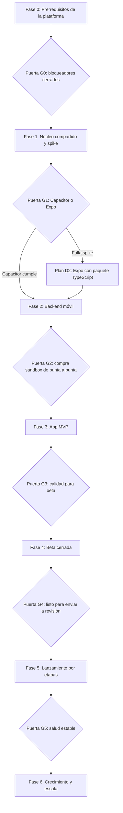
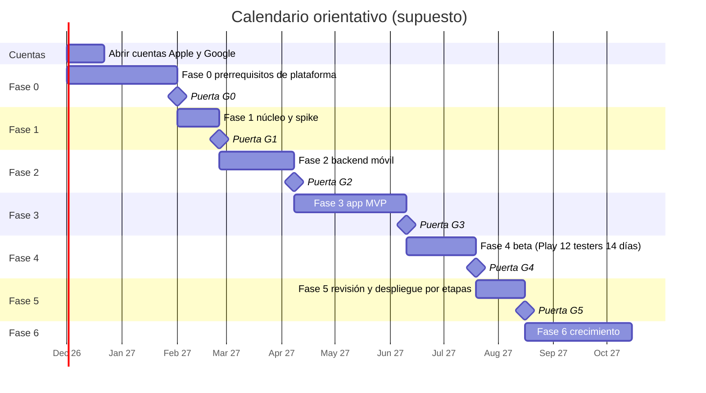
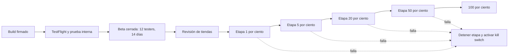

# Hoja de ruta de implementación de la app móvil

> Fecha: 2026-11-25 | Commit de referencia: 41d4d8e | Estado: Documento de planificación, la app NO está construida.
> Leyenda: [V] verificado en código o documentación oficial, [R] recomendación, [S] supuesto, [P] pendiente de verificar.
> Documentos hermanos: [SECURITY_AND_PRIVACY.md](SECURITY_AND_PRIVACY.md), [SCALABILITY_AND_COSTS.md](SCALABILITY_AND_COSTS.md), [TESTING_AND_RELEASE.md](TESTING_AND_RELEASE.md).
> Nada de lo descrito se ejecuta ahora: no se construye la app, no se tocan archivos de producción, no se crean migraciones, no se tocan pagos, usuarios ni configuración.

## 1. Resumen y decisiones de partida

Estado de preparación: la plataforma NO está lista para publicar una app todavía. Es una base sana con unos 8 bloqueadores verificados, todos recogidos en la Fase 0 [V, auditorías].

Decisiones del arquitecto, que este documento no contradice:

| Id | Decisión |
|---|---|
| D1 | Arquitectura principal: Capacitor 8 empaquetando la academia web con un shell móvil propio (no un simple WebView, por la regla 4.2 de Apple) y plugins nativos: compras in-app, push, Sign in with Apple, audio offline, almacenamiento seguro. Condición previa: pasar `app.js` (10.756 líneas globales, 602 KB, sin módulos [V, F]) a módulos ES y un spike de 1 a 2 semanas con puerta de decisión |
| D2 | Alternativa: Expo con React Native y un paquete TypeScript compartido, si el spike falla en rendimiento o UX nativa o si Apple rechaza por 4.2. Descartadas por ahora: Flutter, nativo puro, PWA sola; TWA solo Android como atajo posible |
| D3 | Backend único: el Supabase actual, con tabla nueva `entitlements` como única fuente de derechos y `profiles.is_member` derivado (hoy es un boolean sin fecha de vencimiento [V, H]) |
| D4 | Pagos: IAP de Apple y Google con RevenueCat y webhooks a Supabase; la web sigue con Stripe, PayPal y Mercado Pago. No depender del enlace externo de pago en EEUU (régimen litigioso, 0 por ciento provisional, confianza media [V, informe]) |
| D6 | Leo AI hoy: Cloudflare Workers AI (no Claude). Cualquier cambio de proveedor es una decisión pendiente |

Primer paso el día de iniciar [D11]:

1. Comprobar cambios desde esta auditoría: `git log 41d4d8e..HEAD` sobre `backend.js`, `app.js`, `supabase/`, `supabase_functions/`, `miembros.html`, `privacidad.html`, `terminos.html`.
2. Ejecutar la Fase 0 por orden de gravedad: contenido premium en servidor y arreglos de pagos primero.
3. Abrir cuentas de desarrollador (Apple y Google) cuanto antes: tardan en verificarse y Google exige 12 testers durante 14 días.
4. Hacer el spike de Capacitor.

## 2. Vista general

Calendario orientativo [S], part-time con agente de IA y revisión del dueño; las fechas se mueven con la disponibilidad:

Nota sobre solapes: cada fase empieza tras su puerta. Solo se permite solapar tareas sin dependencia de la puerta previa (abrir cuentas de tienda, reclutar los 12 testers durante la Fase 3, T3.1 que depende solo de G1, y las tareas de la Fase 0 sin dependencias); un solape así acortaría el calendario, pero no se cuenta aquí.

Resumen de esfuerzo y costo [S]. Horas de desarrollo con agente de IA (incluye revisión humana); sin tarifa horaria porque se desconoce. Las cuentas son costos en efectivo:

| Fase | Horas [S] | Complejidad | Costos en efectivo [V] |
|---|---|---|---|
| 0 | 340 a 510 | XL | Supabase Pro USD 25 al mes desde el inicio |
| 1 | 85 a 127 | L | 0 |
| 2 | 162 a 245 | XL | RevenueCat gratis hasta USD 2.500 de MTR al mes; luego 1 por ciento [V, informe] |
| 3 | 320 a 480 | XL | 0 (Firebase y servicios de push: plan gratuito [P]) |
| 4 | 72 a 108 | M | Apple USD 99 al año; Google USD 25 único |
| 5 | 30 a 50 | M | 0 |
| 6 | 104 a 158 (primer trimestre) | L | Según escala (ver [SCALABILITY_AND_COSTS.md](SCALABILITY_AND_COSTS.md)) |
| Total | unas 1.110 a 1.680 horas (suma de subtotales: 1.113 a 1.678) | | Primer año: unos USD 424 en cuentas y Supabase Pro (99 + 25 + 25 x 12), sin asesoría legal [P] |

## 3. Fase 0: Prerrequisitos de la plataforma

Objetivo: corregir en la web, antes de construir la app, los hallazgos verificados que la app amplificaría o que las tiendas rechazarían. Todo es trabajo sobre la plataforma actual, con despliegue gradual y reversible.

Orden de gravedad: contenido premium (T0.1), pagos (T0.2 a T0.6), cuentas y abuso (T0.7 a T0.10), privacidad (T0.10 a T0.12), higiene y escala (T0.13 a T0.20), CI (T0.21).

| Tarea | Qué hace | Hallazgos | Archivos reales afectados | Complejidad | Horas [S] | Depende de |
|---|---|---|---|---|---|---|
| T0.1 | Mover contenido premium a servidor: RPC paginada y Storage con URL firmada, siguiendo el patrón de Academia; decidir qué bancos son premium | B-02, F-06, H-09 | `data.js`, `toefl-data.js`, `ielts-data.js`, `toeic-data.js`, `cambridge*-data.js`, `juego-data.js`, `aprender-data.js`, `audio/`, `practica-miembros.html`, `backend.js` (`guardMemberPage`), nueva migración en `supabase/migrations/`, modelo `20261028180000_academia_contenido_protegido.sql` | XL | 60 a 90 | Decisión de producto (qué es gratis) |
| T0.2 | Webhooks que responden 5xx cuando falla la escritura de activación; tabla `webhook_events` idempotente | H-03 | `supabase_functions/stripe-webhook.ts`, `mp-webhook.ts`, `paypal-webhook.ts`, migración nueva | M | 12 a 18 | T0.13 |
| T0.3 | Guardas contra doble cobro y customer único de Stripe; `PayPal-Request-Id` estable; reutilizar preapproval de MP | H-01, H-02 | `supabase_functions/stripe-checkout.ts`, `paypal-checkout.ts`, `create-checkout.ts` | M | 14 a 20 | T0.13 |
| T0.4 | Reembolsos, disputas y pago fallido: `charge.refunded`, `charge.dispute.*`, `invoice.payment_failed/paid`, `PAYMENT.SALE.REFUNDED`, pagos de MP | H-04, H-11 | los tres webhooks, `payment-recovery-emails.ts`, migración `payment_grace` | L | 24 a 36 | T0.2 |
| T0.5 | Firma de MP, tolerancia de tiempo y comparación constante en Stripe | H-05, H-10, B-07 | `mp-webhook.ts`, `stripe-webhook.ts` (`verifyStripeSignature`) | S | 6 a 10 | T0.2 |
| T0.6 | Cancelación autoservicio y acceso hasta fin de periodo coherente con los términos (Customer Portal de Stripe, enlaces de gestión) | H-06, H-07 | `miembros.html`, `terminos.html`, `mp-webhook.ts`, `paypal-webhook.ts`, nueva función de portal | L | 24 a 36 | T0.4 |
| T0.7 | Activar Confirm email con SMTP propio y CAPTCHA (Turnstile) en registro y reset | B-01, AI-06, B-04 | `backend.js` (`signUp`, reset), `miembros.html`, `supabase_functions/send-password-reset.ts`, panel de Auth | M | 14 a 20 | Ninguna |
| T0.8 | Sesión multidispositivo: retirar `signOut({scope:'others'})` y añadir "cerrar sesión en todos" | B-03 | `backend.js:117` | S | 6 a 10 | Decisión de producto |
| T0.9 | Cuota diaria gratis en servidor: contador solo escribible por RPC; quitar GRANT UPDATE de `free_*` | B-10, H-08, AI-16 | `supabase_schema.sql` (grants), nueva migración, `app.js:4132-4277`, `supabase_functions/upgrade-nudge-emails.ts` | M | 14 a 20 | Ninguna |
| T0.10 | Borrado de cuenta (función `delete-account`, botón, cancelación de suscripciones externas) y política de privacidad completa | H-18, AI-05 | nueva función en `supabase_functions/`, `miembros.html`, `privacidad.html`, `backend.js` | L | 24 a 36 | T0.6 |
| T0.11 | Consentimiento de GA4 y Meta Pixel; protección de menores (edad al registrarse) | F-07, AI-03, AI-04 | `index.html` y unos 100 HTML con el bloque de gtag, `meta-pixel.js`, `app.js` (`trackLeoEvent`), `privacidad.html` | M | 16 a 24 | Ninguna |
| T0.12 | Retirar del sitio público el backend, DEVLOG, AUDITORIA y migraciones; limpiar del historial los datos de clientes; decisión de repo privado | AI-01, AI-02, B-18 | `DEVLOG.txt` (líneas indicadas por AI-02), `supabase_functions/`, `supabase/`, `AUDITORIA_*.md`, `CNAME`, flujo de GitHub Pages | L | 20 a 30 | Ninguna; riesgo alto, ver sección 10 |
| T0.13 | Versionar la configuración de funciones y alinear repo con desplegado | B-08, H-12, H-13, H-24, B-16 | `supabase/config.toml` (no existe), `supabase/functions/stripe-checkout/index.ts` frente a `supabase_functions/stripe-checkout.ts`, migración idempotente de `mp_preapproval_*`, función `quick-endpoint` sin copia | M | 14 a 22 | T0.20 |
| T0.14 | Backups automáticos y evaluar PITR | B-09 | Panel de Supabase, `tools/respaldo_supabase.sh` | S | 3 a 5 | Ninguna |
| T0.15 | Paginar `syncProgressFromCloud` y `getMistakeStats`; cola de reintento para `pushSession` | F-01, F-02, AI-18 | `backend.js:401-403,458-491,540-543`, `app.js:1313` | M | 14 a 20 | T0.21 |
| T0.16 | Topes de IA realistas y caché de servidor por hash; ejercicio por `itemId` | AI-07, AI-08, AI-09, AI-10 | `supabase_functions/leo-ai.ts`, `supabase_functions/leo-ai.sql`, `supabase/migrations/20261016001253_leo_ai_trial.sql` (CHECK), `app.js` | L | 24 a 36 | T0.13 |
| T0.17 | CORS y origen para app nativa | B-11, AI-11, B-17 | `supabase_functions/report-error.ts`, `error-monitor.js`, `supabase/functions/libro-download/index.ts` | S | 4 a 8 | T0.13 |
| T0.18 | Notificaciones y recordatorios sobre cola, no sobre barrido de `profiles` | AI-14, AI-15, AI-17 | `supabase_functions/streak-reminder-email.ts`, `supabase_functions/upgrade-nudge-emails.ts`, nueva tabla de cola | L | 30 a 45 | T0.13 |
| T0.19 | `.gitignore` de archivos sin rastrear; eliminar `ACCESS_CODE` muerto | AI-22, F-17, B-12 | `.gitignore`, `_video_index/`, `_push.patch`, `_revision_commit/`, `h`, `revision-videos.diff`, `tools/sandbox/`, `app.js:655` | S | 2 a 4 | Ninguna |
| T0.20 | Verificar el estado real de producción (lista de pendientes de las auditorías) | Secciones 11 de B y 9 de H | Panel de Supabase, Stripe, PayPal, Mercado Pago (solo lectura) | S | 4 a 6 | Ninguna |
| T0.21 | Poner las 120 pruebas en CI | F-10 | nuevo `package.json`, nuevo flujo en `.github/workflows/`, `tools/tests/`, `tools/e2e/` | M | 10 a 16 | Ninguna |

Subtotal Fase 0: 340 a 510 horas [S]. Las tareas sin dependencias (T0.7, T0.9, T0.11, T0.14, T0.19, T0.20, T0.21) pueden empezar el primer día.

Riesgos de la Fase 0:

| Riesgo | Mitigación |
|---|---|
| Un cambio de pagos cobra mal o bloquea a un miembro real | Despliegue por función, prueba en sandbox de cada proveedor, marcar `stripe-checkout` con la copia correcta y rollback a la versión anterior [R] |
| Confirmar correo bloquea altas legítimas si el SMTP falla | Activar con SMTP probado, plan de reenvío, indicador de errores en `report-error` |
| Purga del historial git rompe clones o enlaces | Hacerlo con copia de respaldo y aviso; ver sección 10 |
| Mover premium a servidor rompe páginas de práctica | Interruptor `premium_content_enabled`, carga en dos pasos, pruebas Playwright |

Pruebas: ver [TESTING_AND_RELEASE.md](TESTING_AND_RELEASE.md) sección de pagos en sandbox; además la suite existente de `tools/tests` y `tools/e2e/run-all.js` debe seguir verde.

Criterios verificables de finalización (puerta G0):

- Un usuario no miembro no puede obtener preguntas, respuestas ni audio premium por ninguna URL pública (comprobación con `curl` sin sesión sobre los archivos que antes eran públicos).
- Intentar un segundo checkout siendo miembro devuelve 409 en los tres proveedores.
- Un fallo simulado de BD en un webhook devuelve 5xx y el proveedor reintenta con éxito (prueba en sandbox).
- Un reembolso de prueba en Stripe y PayPal revoca el acceso en menos de 5 minutos [S].
- Registro sin CAPTCHA o sin correo confirmado no concede sesión.
- Existe botón de borrado de cuenta que elimina el usuario y cancela la suscripción externa de prueba.
- GA4 y Pixel no cargan antes del consentimiento (comprobación de red en un navegador limpio).
- `https://inglesconleo.com/supabase_functions/leo-ai.ts` y `DEVLOG.txt` ya no responden 200 [R: AI-01 documenta el 200 actual].
- Backup automático visible en el panel y una restauración de prueba documentada.
- Las 120 pruebas corren en CI y pasan (o las dos suites rojas conocidas están marcadas con su motivo, F-10).

## 4. Fase 1: Núcleo compartido y spike de Capacitor

Objetivo: demostrar con datos que Capacitor da una experiencia aceptable, o decidir pasar a Expo (D2), gastando como máximo 1 a 2 semanas en el spike.

| Tarea | Qué hace | Archivos reales | Complejidad | Horas [S] | Depende de |
|---|---|---|---|---|---|
| T1.1 | Fijar la versión de supabase-js (hoy `@2` por CDN en 78 páginas, F-08) con copia local o SRI | HTML de raíz, `academia-boot.js` | S | 3 a 5 | Ninguna |
| T1.2 | `package.json`, empaquetador (esbuild o Vite) y minificación | nuevo `package.json`, config de build | M | 14 a 20 | T0.21 |
| T1.3 | Extraer a módulos ES el mínimo necesario para el spike: motor de sesión, selección de ejercicios, `backend.js`, `academia-nube.js` | `app.js`, `backend.js`, `academia-nube.js`, `temas.js`, `data.js` | L | 24 a 36 | T1.2 |
| T1.4 | Proyecto Capacitor 8 en `mobile/` y shell mínimo con 3 pantallas | nuevo `mobile/` | M | 16 a 24 | T1.2 |
| T1.5 | Spike medible: login, una sesión real de práctica, audio, sincronización de progreso | `mobile/`, núcleo | L | 24 a 36 | T1.3, T1.4 |
| T1.6 | Informe del spike y decisión G1 | nuevo `docs/mobile-app/DEVLOG.md` (separado de `DEVLOG.txt` del sitio, D10) | S | 4 a 6 | T1.5 |

Subtotal: 85 a 127 horas [S]. Capacitor 8 exige Xcode 26 o superior, iOS 15 o superior, Android minSdk 24, Node 22 o superior [V, informe]; el spike prueba compatibilidad de tooling.

Riesgos: el refactor completo de `app.js` es mayor de lo previsto (mitigación: extraer solo lo necesario, el resto en Fase 3); el rendimiento del WebView en teléfonos de gama baja; rechazo por regla 4.2 (el shell debe aportar funciones nativas).

Pruebas: ejecutar `app.js` real contra nube simulada con `tools/e2e/run-all.js` antes y después de modularizar [V, README de e2e]; prueba manual en iPhone y Android reales.

Criterios de la puerta G1 [S, ajustables]:

| Métrica | Umbral para continuar con Capacitor |
|---|---|
| Arranque en frío en un Android de gama media | menor de 3 s hasta pantalla interactiva |
| Fluidez al desplazar y al cambiar de pantalla | sin saltos perceptibles en dispositivo real |
| Reproducción de audio con pantalla bloqueada | funciona |
| Sesión de práctica completa con sincronización | sin pérdida de datos con red cortada |
| Tamaño del paquete sin audio | menor de 30 MB |
| Sensación nativa evaluada por 3 personas | aceptable |

Si falla: plan D2 (Expo con paquete TypeScript compartido para cliente Supabase, `academia-nube.js` y bancos como JSON versionado) y se rehace la estimación de Fase 3.

## 5. Fase 2: Backend móvil

Objetivo: tener en Supabase todo lo que la app necesita, probado con sandbox, sin romper la web.

| Tarea | Qué hace | Archivos reales | Complejidad | Horas [S] | Depende de |
|---|---|---|---|---|---|
| T2.1 | Tabla `entitlements` multi-fuente (stripe, paypal, mercadopago, apple, google, manual) con vencimiento; backfill desde `profiles`; `profiles.is_member` derivado | nueva migración, `supabase_schema.sql` (solo referencia) | L | 30 a 45 | G0, T0.13 |
| T2.2 | Función `revenuecat-webhook` con firma HMAC, `id` idempotente y upsert en `entitlements` | nueva función en `supabase_functions/` | M | 16 a 24 | T2.1, T0.2 |
| T2.3 | Webhooks de Stripe, PayPal y MP escriben también en `entitlements` (doble escritura durante la transición) | `stripe-webhook.ts`, `paypal-webhook.ts`, `mp-webhook.ts` | L | 24 a 36 | T2.1 |
| T2.4 | Restaurar compras y conciliación diaria con proveedores | nueva función y cron | M | 16 a 24 | T2.2 |
| T2.5 | Auth móvil: Sign in with Apple, Google nativo, Redirect URLs, `apple-app-site-association` y `assetlinks.json` | `backend.js` (`redirectTo`, `signInWithIdToken`), nuevos archivos en la raíz del sitio, panel de Auth | M | 16 a 24 | T0.7, T0.8 |
| T2.6 | `app_config` con feature flags y `min_app_version` | nueva migración | S | 6 a 10 | T2.1 |
| T2.7 | `device_tokens` y preferencias por canal | nueva migración | M | 12 a 18 | T0.18 |
| T2.8 | API de contenido premium con caché y manifiesto de audio | nuevas RPC, Storage | L | 24 a 36 | T0.1 |
| T2.9 | Contrato de API versionado y documentado (nombres de funciones, `min_app_version`) | `docs/mobile-app/` | S | 6 a 10 | T2.1 |
| T2.10 | Productos de suscripción en App Store Connect, Play Console y RevenueCat | paneles | M | 12 a 18 | Cuentas abiertas |

Subtotal: 162 a 245 horas [S].

Riesgos: la derivación de `is_member` puede dejar a miembros manuales sin acceso (miembros sin proveedor, `billingSync` los cuenta [V]); mitigación: fuente `manual` sin vencimiento y migración con comparación fila a fila. Doble fuente de verdad durante la transición: mantener doble escritura y comparación diaria hasta confirmar 0 diferencias.

Pruebas: compra de prueba en sandbox de Apple, Google y Stripe con comprobación de `entitlements`; bloqueo de doble compra entre canales; webhook repetido (idempotencia); reembolso (ver [TESTING_AND_RELEASE.md](TESTING_AND_RELEASE.md)).

Criterios de la puerta G2:

- Compra sandbox de Apple y de Google concede acceso en menos de 2 minutos y lo revoca al reembolsar.
- Un usuario con derecho vivo en cualquier fuente no puede iniciar otra compra (409).
- Conciliación diaria con 0 diferencias durante 7 días.
- La web sigue funcionando con la lectura de `is_member` derivada, sin cambios visibles.
- Existe script de reversión (carpeta `supabase/rollback/`, patrón existente [V]).

## 6. Fase 3: App MVP

Objetivo: app nativa utilizable de principio a fin, con identidad visual y pedagógica de Inglés con Leo.

| Tarea | Qué hace | Archivos reales | Complejidad | Horas [S] | Depende de |
|---|---|---|---|---|---|
| T3.1 | Terminar la modularización del núcleo | `app.js`, `backend.js`, `academia-nube.js`, `academia.js`, `academia-motor.js` (generado), `tools/generar_academia_motor.js` | L | 40 a 60 | G1 |
| T3.2 | UI móvil propia: inicio, práctica, academia, progreso, ajustes (tokens `--paper`, `--ink`, `--blue`, Baloo 2 e Inter, mascota Leo) | `mobile/`, `style.css` (tokens), `leo-*.png` | XL | 80 a 120 | T3.1 |
| T3.3 | Audio offline por paquetes, con manifiesto y URL firmadas para premium | `academia-audio.js`, `leo-voz.js` (reemplazar HEAD por manifiesto), `audio/` | L | 30 a 45 | T2.8 |
| T3.4 | Paywall, IAP con RevenueCat, restaurar y gestionar suscripción | `mobile/` | L | 30 a 45 | G2 |
| T3.5 | Push con FCM y APNs, notificaciones locales de racha, permisos | `mobile/`, `device_tokens` | L | 30 a 45 | T2.7 |
| T3.6 | Almacenamiento seguro, cola de sincronización y reanudación de sesiones en servidor (F-02, F-03) | `backend.js`, `app.js` (`leo_inflight_*`), `mobile/` | L | 24 a 36 | T0.15 |
| T3.7 | Leo AI desde la app con `itemId` y permiso explícito de IA (regla 5.1.2(i)) | `app.js` (`askLeoAI`), `supabase_functions/leo-ai.ts` | M | 12 a 18 | T0.16 |
| T3.8 | Speaking con reconocimiento nativo (hoy Web Speech API, F-14) | `app.js:2033-2080`, plugin nativo | L | 30 a 45 | T3.1 |
| T3.9 | Analítica con consentimiento, diálogo y decisión ATT | `mobile/`, catálogo de eventos de `trackLeoEvent` | M | 14 a 20 | T0.11 |
| T3.10 | Ajustes de privacidad y borrado de cuenta en la app | `mobile/`, función `delete-account` | S | 8 a 12 | T0.10 |
| T3.11 | Reporte de errores nativo | `error-monitor.js`, `supabase_functions/report-error.ts` | S | 6 a 10 | T0.17 |
| T3.12 | Accesibilidad y modo oscuro (F-15) | `style.css`, `mobile/` | M | 16 a 24 | T3.2 |

Subtotal: 320 a 480 horas [S]. Requisitos de plataforma vigentes [V, informe]: Xcode 26 y SDK iOS 26 desde 2026-04-28; objetivo mínimo iOS 13 desde 2026-09-09; Android target API 36 (Android 16) desde 2026-08-31; Play Billing Library v8 o v9.

Riesgos: la UI nativa es la mayor partida y la más incierta; audio con pantalla bloqueada; compatibilidad de plugins con Capacitor 8; rechazo 4.2 si parece "web reempaquetada" (mitigación: push, IAP, audio offline, Sign in with Apple, notificaciones de racha).

Pruebas: unitarias del núcleo con la suite actual; E2E de práctica y sincronización; pruebas de dispositivos reales; accesibilidad con lector de pantalla (ver [TESTING_AND_RELEASE.md](TESTING_AND_RELEASE.md)).

Criterios de la puerta G3:

- Un alumno nuevo completa registro, diagnóstico, una sesión de práctica con audio, una lección de Academia y vuelve al día siguiente con recordatorio push.
- Sin red, funciona el contenido descargado y la cola de sincronización envía al reconectar.
- La suite de pruebas pasa en CI y no hay fallos críticos abiertos.
- El paquete no contiene contenido premium (inspección del `.ipa` y `.aab`).

## 7. Fase 4: Beta cerrada

Objetivo: validar con usuarios reales y cumplir los requisitos de publicación de Google.

| Tarea | Qué hace | Complejidad | Horas [S] |
|---|---|---|---|
| T4.1 | TestFlight interno y externo | S | 8 a 12 |
| T4.2 | Prueba cerrada en Google Play con 12 testers durante 14 días consecutivos (cuenta personal creada después del 2023-11-13 [V, informe]) | M | 10 a 16 más 14 días naturales |
| T4.3 | Pruebas de pagos en sandbox de Apple, Google y Stripe, con reembolso y restauración | M | 12 a 18 |
| T4.4 | Prueba de carga de Supabase y de funciones | M | 10 a 14 |
| T4.5 | Fichas de tienda, capturas, privacy labels, Data safety, cuenta de demostración para revisores | M | 12 a 18 |
| T4.6 | Corrección de errores de la beta | M | 20 a 30 |

Subtotal: 72 a 108 horas [S] (suma de T4.1 a T4.6) y al menos 14 días naturales. Empezar a reclutar los 12 testers durante la Fase 3.

Criterios de la puerta G4:

- 12 testers activos durante 14 días consecutivos en la prueba cerrada de Google.
- Sin fallos que cierren la app en la beta; crash-free sessions de 99,5 por ciento o más [S].
- Privacy labels, Data safety, términos, política de privacidad y borrado de cuenta enlazados dentro de la app y en las fichas.
- Pruebas de pago completas con reembolso y restauración.

## 8. Fase 5: Lanzamiento por etapas

Objetivo: salir a producción con riesgo controlado.

| Tarea | Qué hace | Complejidad | Horas [S] |
|---|---|---|---|
| T5.1 | Enviar a revisión de App Store y de Google Play (ver [TESTING_AND_RELEASE.md](TESTING_AND_RELEASE.md)) | S | 8 a 12 |
| T5.2 | Atender rechazos y correcciones | M | 12 a 20 |
| T5.3 | Despliegue por etapas 1, 5, 20, 50 y 100 por ciento con vigilancia | M | 10 a 18 |

Subtotal: 30 a 50 horas [S].

Riesgos: rechazo por 4.2, 3.1.1, 5.1.1(v) o por privacidad (R01 a R05); cambios de requisitos de SDK de las tiendas (R10); un fallo grave en una etapa (mitigación: kill switch y `min_app_version`, sección 10).

Depende de: G4; T5.2 depende de T5.1; T5.3 depende de T5.2.

Archivos afectados: metadatos y fichas de tienda (App Store Connect y Play Console, fuera del repo), `privacidad.html`, `terminos.html`, `miembros.html` (enlaces de gestión y borrado), `mobile/` (versión y build), tabla `app_config`.

Criterios de la puerta G5: tasa de errores y de cierres dentro de umbral en cada etapa durante 48 a 72 horas antes de ampliar; sin incidentes de pagos; soporte respondiendo en 24 horas [S].

## 9. Fase 6: Crecimiento y escala

Tareas candidatas, ordenadas por valor [R]; se decide con datos reales:

| Tarea | Archivos o áreas | Complejidad | Horas [S] |
|---|---|---|---|
| T6.1 | Repetición espaciada (hoy solo estados de error en `mistake_stats`, sin planificador [V, F]) | L | 40 a 60 |
| T6.2 | Migrar audio a Storage o CDN con caché y retirar peso del sitio | M | 16 a 24 |
| T6.3 | Widgets y atajos | M | 24 a 36 |
| T6.4 | Exportación de datos del usuario | S | 12 a 18 |
| T6.5 | Optimización de costos de IA (caché, modelo) y decisión de proveedor | M | 12 a 20 |
| T6.6 | Escalado de Postgres según umbrales de [SCALABILITY_AND_COSTS.md](SCALABILITY_AND_COSTS.md) | M | según medición |
| T6.7 | Localización a otros idiomas de interfaz | L | por definir |

Subtotal primer trimestre: 104 a 158 horas [S] (suma de T6.1 a T6.5; T6.6 y T6.7 sin estimar).

Riesgos: la repetición espaciada es un cambio de producto con esquema nuevo y puede retrasarse; migrar el audio a CDN rompe rutas si no se versiona el manifiesto (R27); un escalado de Postgres sin medición gasta de más (R28); cambiar de proveedor de IA sin topes dispara el costo (R25) y los topes actuales no escalan (R24).

Depende de: G5 (salud estable); T6.2 depende de T2.8 y T3.3; T6.5 depende de T0.16; T6.6 depende de las métricas de producción y de T4.4.

Archivos afectados: `mistake_stats` y nueva migración para el planificador, `audio/`, `academia-audio.js`, `leo-voz.js`, `supabase_functions/leo-ai.ts`, `supabase_functions/leo-ai.sql`, `mobile/`, `privacidad.html` (exportación de datos y nuevos tratamientos).

## 10. Despliegue gradual y recuperación ante errores

Mecanismos [R]:

| Mecanismo | Cómo |
|---|---|
| Feature flags en BD | Tabla `app_config` (ver [SECURITY_AND_PRIVACY.md](SECURITY_AND_PRIVACY.md), sección 14) |
| Kill switches | Patrón existente del triple interruptor de Leo AI [V]: `iap_enabled`, `push_enabled`, `premium_content_enabled`, `signup_enabled` |
| Versión mínima | `min_app_version` fuerza actualización si una versión tiene un fallo grave |
| Cambios de BD | Patrón expandir y contraer: añadir sin quitar, doble escritura, retirar después de comparar |
| Scripts de reversión | `supabase/rollback/` (existe, solo manual, destructivo [V]) |
| Edge Functions | Conservar la versión anterior; un solo árbol de código para no revertir protecciones (B-08) |
| Web | `git revert` y push a `main` (GitHub Pages) |
| Datos | Backup antes de cada migración mayor; PITR evaluado (T0.14) |

Plan de reversión de la purga del historial (T0.12): antes de reescribir, copia completa del repositorio fuera de OneDrive; la reescritura invalida clones existentes y cualquier enlace a commits; se hace en una ventana acordada y con aviso. Los datos ya indexados o descargados no se recuperan [R].

Cómo se decide retroceder una etapa: tasa de cierres inesperados por encima del umbral, errores de compra mayores de 2 por ciento [S], o cualquier incidente de seguridad. Se pausa la etapa en la consola de la tienda, se activa el kill switch correspondiente y se publica una versión corregida.

## 11. Puertas de decisión

| Puerta | Pregunta | Quién decide | Salida |
|---|---|---|---|
| G0 | ¿Están cerrados los bloqueadores de la plataforma? | Dueño con informe de la Fase 0 | Pasar a Fase 1 o seguir en Fase 0 |
| G1 | ¿El spike de Capacitor cumple los umbrales? | Dueño con informe | Capacitor (D1) o Expo (D2) |
| G2 | ¿La compra sandbox funciona de punta a punta sin doble cobro? | Dueño | Pasar a la UI de pago |
| G3 | ¿Calidad suficiente para beta? | Dueño con pruebas | Abrir beta |
| G4 | ¿Cumple requisitos de tiendas y calidad de beta? | Dueño | Enviar a revisión |
| G5 | ¿Salud estable en cada etapa? | Dueño con métricas | Ampliar porcentaje |

## 12. Qué NO hacer

- No construir la app ni empezar el spike antes de decidir qué contenido es premium (T0.1): el diseño depende de eso.
- No publicar una app que empaquete bancos premium: se regalarían a cualquiera que descomprima el paquete.
- No vender dentro de la app con enlace a Stripe, PayPal o Mercado Pago en regiones donde la regla 3.1.1(a) lo prohíbe; en EEUU la regla es inestable [V, informe]. No basar el modelo en el 0 por ciento temporal.
- No elegir Flutter, nativo puro o PWA sola por ahora (reescritura total o sin tienda ni IAP).
- No elegir el framework por popularidad.
- No migrar a Claude como IA sin medir calidad y coste; hoy Leo AI usa Cloudflare Workers AI (D6).
- No desplegar funciones de Supabase desde `supabase/functions/stripe-checkout/` sin sincronizar: revierte la protección contra doble cobro (B-08).
- No hacer `git add .` en la raíz: hay archivos sin rastrear que no deben publicarse (AI-22).
- No activar Confirm email sin SMTP probado.
- No aplicar ninguna migración sin script de reversión y comprobación.
- No usar el SDK de Meta en la v1 de la app ni compartir identificadores con Meta sin consentimiento.
- No quitar `signOut({scope:'others'})` sin cambiar a la política multidispositivo en un mismo despliegue y sin avisar al soporte.
- No lanzar a 100 por ciento de golpe.

## 13. Pendiente de verificar

El enunciado original de las fases no estaba disponible al redactar: la estructura sigue la decisión D9 del brief (fases 0 a 6 con objetivos, tareas, dependencias, archivos, riesgos, complejidad, costo, pruebas y criterios) y los nombres de fase son una propuesta. También: estado de producción de pagos y Supabase (T0.20), compatibilidad real de plugins con Capacitor 8, umbrales de rendimiento del spike (supuestos), costos de asesoría legal, política de privacidad por país, requisitos de Apple y Google a la fecha del lanzamiento (volátiles: revisar en [TESTING_AND_RELEASE.md](TESTING_AND_RELEASE.md)).
