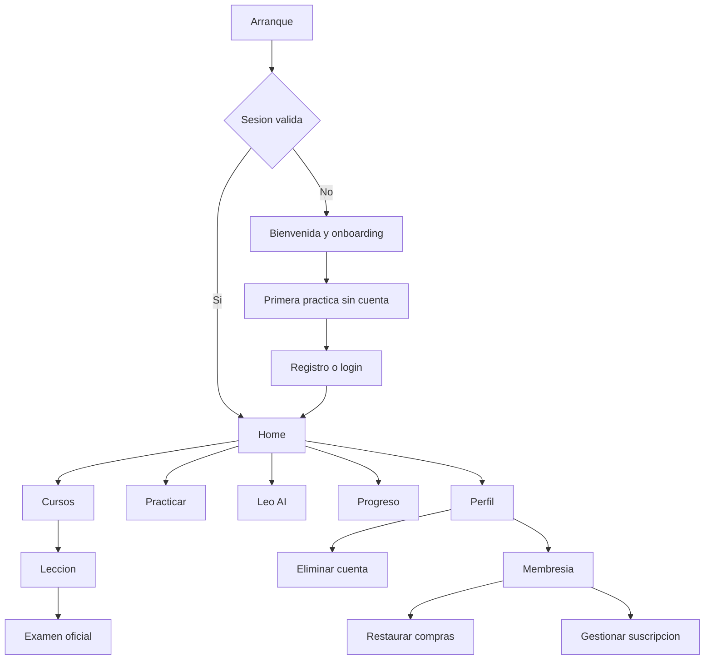

# Especificacion de producto de la app movil, desde el estudiante

> Fecha: 2026-11-25 | Commit de referencia: 41d4d8e | Estado: Documento de planificacion, la app NO esta construida.
>
> Etiquetas: [V] verificado en codigo o doc oficial, [R] recomendacion, [S] supuesto, [P] pendiente de verificar. IDs B-xx, H-xx, F-xx, AI-xx de las auditorias.
>
> Relacionados: [arquitectura](ARCHITECTURE_DECISION.md), [datos y API](DATA_AND_API_CONTRACTS.md), [pagos](PAYMENTS_AND_MEMBERSHIPS.md).

## 1. Principios del producto

1. [R] **Misma pedagogia, mejor momento de uso.** La app no inventa otro metodo: lleva la academia (cursos, practica, errores, Leo AI) a sesiones cortas en el telefono, con audio y repaso.
2. [R] **La cuenta es una sola.** Quien estudia en la web continua en la app donde se quedo (progreso, errores, sesion a medias, membresia).
3. [R] **Retencion con valor real.** Se recuerda al alumno lo que de verdad le ayuda (repasar errores, terminar una leccion), no se le presiona con trucos. Cumple 5.1.2 de Apple: ninguna funcion depende de aceptar notificaciones.
4. [V] **Identidad conservada.** Tokens de `style.css`: `--paper #FBF8F2`, `--ink #1B2333`, `--blue #3554F0`, acentos amber, coral, green, violet, teal, gold; tipografias Baloo 2 (titulos) e Inter (texto); mascota Leo (`leo-front.png`, `leo-hero.png`, `leo-pointing.png`, `leo-thinking.png`, `leo-real.webp`, `leobot.png`). [R] Se agrega variante oscura (hoy no existe, F-15) y se alinea `theme_color` (hoy `#030b1a` frente a paper `#FBF8F2`, F-12).
5. [V] **Reglas de estilo del proyecto**: sin rayas largas en texto visible, negrita con moderacion, opciones multiples aleatorizadas con `shuffleOptions()`, sesiones de miembros reanudables, audio generado con `tools/generar_audios.py`, verificar siempre en telefono real.

## 2. Tipos de usuario y reglas de acceso

[V] Fuentes: `app.js:4132-4133` (limites), `supabase_schema.sql` (grants), PLATFORM_AUDIT.md, secciones 2 y 3 (H-08, B-10).

| Capacidad | Visitante (sin cuenta) | Cuenta gratis | Miembro | Miembro en gracia o vencido |
|---|---|---|---|---|
| Practica | 3 ejercicios de muestra (`GUEST_EXERCISE_LIMIT`) | 6 al dia (`FREE_USER_DAILY_LIMIT`) | Sin limite | Gracia 72 h solo Stripe [V]: sin limite; vencido: como cuenta gratis |
| Progreso en la nube | No | Si (`progress_sessions` tier `free`, hasta 40 filas en 24 h) | Si (hasta 300 en 24 h) | Se conserva siempre |
| Academia | Temario | Demo de TO BE, una vez por cuenta | 11 cursos, examen, insignias | Cursos protegidos se bloquean al vencer; progreso se conserva |
| Leo AI | No (invitacion a crear cuenta) | Prueba: 5 explicaciones por cuenta, si `trial_enabled` [P estado real] | Tope diario `user_daily_limit` (100) | Como gratis |
| Examen oficial e insignias | No | No | Si, 80 % de umbral, 3 intentos al dia | Se conservan las insignias ya ganadas [R] |
| Comentarios, videos, glosario | Si | Si | Si | Si |

Reglas adicionales [R]:
- **Miembro por tienda** (Apple o Google): mismas capacidades; la gestion de la suscripcion lleva a los ajustes de la tienda. Ver [pagos](PAYMENTS_AND_MEMBERSHIPS.md).
- **Menores**: pedir edad o fecha de nacimiento al registrarse; bajo 13 años no se crea cuenta sin consentimiento parental; bajo 16 en la UE sin tracking ni marketing (AI-04). La app **no entra en la categoria Kids** (1.3 de Apple); va en Education con clasificacion de edad adecuada.
- **Cuotas en servidor**: el limite diario gratis debe vivir en el servidor (B-10, H-08); la app solo muestra el contador.
- **Contenido premium** nunca se empaqueta en la app; se descarga tras comprobar el derecho (B-02, F-06, H-09).

## 3. MVP indispensable frente a posterior

| Funcion | MVP | Version posterior | Motivo |
|---|---|---|---|
| Registro y login (correo, Google, Apple) | Si | Biometria opcional | Apple 4.8 exige opcion equivalente a Google |
| Verificacion de correo | Si | | B-01, AI-06 |
| Onboarding y diagnostico de nivel | Si | Plan personalizado avanzado | Primera experiencia |
| Home con "continuar" y meta del dia | Si | Widgets | Retencion |
| Cursos de academia (11, 55 lecciones) | Si | | Producto central |
| Practica por habilidad (6 habilidades) | Si | | Producto central |
| Repaso de errores (`mistake_stats`) | Si | Repeticion espaciada real | Hoy solo estados de error, sin scheduler (PLATFORM_AUDIT.md, seccion 5) |
| Leo AI (explicar, writing) | Si | `diagnosis` e `insight` completos | Diferencial |
| Progreso, insignias, rachas | Si | Logros extra | Motivacion |
| Perfil, membresia, compras in-app, restaurar | Si | Regalos, familias | Tiendas 3.1.1 |
| Eliminar cuenta dentro de la app | Si | | Apple 5.1.1(v), Google |
| Notificaciones push y recordatorio de racha | Si (basico) | Hora local por usuario, categorias | Retencion |
| Audio sin conexion de la leccion en curso | Si (parcial) | Descarga por curso completo | Valor nativo, F-13 |
| Sesion a medias entre dispositivos | Si | | F-03 |
| Speaking con reconocimiento nativo | Posterior | Si | F-14; el MVP deja speaking con la opcion disponible |
| Videos educativos | Si, enlaces a YouTube embebidos | Videos propios en la app, subtitulos | `video-tema.js` ya mapea 10 videos |
| Articulos y glosario (355 fichas) | Enlace a la web | Lector integrado | Mantener SEO en web |
| English Rush, clases, Cambridge/IELTS/TOEFL/TOEIC | Posterior | Si | Alcance |
| Modo oscuro | Posterior | Si | F-15 |
| Idiomas de interfaz distintos de espanol | No | Posterior [S] | Audiencia actual |

## 4. Funciones, flujos y criterios de aceptacion

Formato de criterios: Dado / Cuando / Entonces. Etiqueta [R] para los criterios (son requisitos propuestos).

### 4.1 Registro y login

[V] Hoy: correo y contrasena (`signUp`, `signInWithPassword`, `backend.js:88,115`), Google con `signInWithIdToken` y nonce (`backend.js:217`), Confirm email apagado (B-01), sesion unica (`signOut({scope:'others'})`, `backend.js:117`, B-03). [R] En la app: correo, Google y **Sign in with Apple** (`signInWithIdToken`, guardar el nombre en el primer login porque Apple lo envia una sola vez; https://supabase.com/docs/guides/auth/social-login/auth-apple, consultado 2026-11-25, conf. A).

```
+--------------------------------------+
|            [ Leo saluda ]            |
|   Aprende ingles a tu ritmo          |
|                                      |
|  [ Continuar con Apple ]             |
|  [ Continuar con Google ]            |
|  [ Usar correo y contrasena ]        |
|                                      |
|  Ya tengo cuenta: Entrar             |
|  Terminos  |  Privacidad             |
+--------------------------------------+
```

| Criterio | Requisito |
|---|---|
| CA-REG-1 | Dado un correo nuevo, cuando se registra, entonces recibe un codigo o enlace de verificacion y no obtiene beneficios de cuenta verificada hasta confirmarlo |
| CA-REG-2 | Dado un menor del limite de edad, cuando indica su edad, entonces se bloquea el registro o se pide consentimiento parental y no se activa marketing ni tracking |
| CA-REG-3 | Dado un usuario con cuenta en la web, cuando inicia sesion en la app, entonces **no** se cierra la sesion de la web (se retira la politica de sesion unica; B-03) |
| CA-REG-4 | Dado un login con Apple, cuando oculta su correo, entonces la cuenta se crea con el correo de retransmision y funciona |
| CA-REG-5 | Dados terminos y privacidad, entonces hay enlaces visibles en registro y en Perfil |
| CA-REG-6 | Dado un olvido de contrasena, cuando lo solicita, entonces el enlace abre la app por deep link con `redirectTo` propio (B-04) |

### 4.2 Onboarding y primera experiencia

[V] El perfil ya guarda `level` (principiante, facil, medio, avanzado), `level_source` (`self`, `skipped`, `suggested`, `history`, `test`) y `onboarded_at` (`supabase_schema.sql:953-970,1048-1067`). [R] La app reutiliza esos campos.

Flujo: bienvenida de Leo (1 pantalla) -> objetivo (hablar, trabajar, examen) -> nivel por autoevaluacion o prueba corta -> primera practica de 5 ejercicios sin pedir cuenta -> invitacion a crear cuenta para guardar progreso -> permiso de notificaciones **solo despues** de un primer exito y con explicacion.

```
[1/4] Hola, soy Leo       [2/4] Para que lo usaras   [3/4] Tu nivel
 ( ilustracion )           ( ) Conversar              ( ) Principiante
 [ Empezar ]               ( ) Trabajo                ( ) Facil
 Saltar                    ( ) Examen                 ( ) Medio  ( ) Avanzado
                           [ Siguiente ]              [ Hacer prueba corta ]
```

| Criterio | Requisito |
|---|---|
| CA-ONB-1 | Dado un usuario nuevo, cuando abre la app, entonces llega a su primer ejercicio en 3 toques o menos |
| CA-ONB-2 | Dado que salta el nivel, entonces `level_source = skipped` y se sugiere nivel segun resultados |
| CA-ONB-3 | Dado el primer ejercicio terminado, entonces se explica por que se piden notificaciones y puede rechazarlas sin perder ninguna funcion |
| CA-ONB-4 | El onboarding es reanudable: si cierra la app a la mitad, retoma en el mismo paso |

### 4.3 Home

Contenido [R]: saludo con nombre, tarjeta "Continuar" (sesion a medias o siguiente leccion), meta del dia y racha, repaso de errores pendientes (cantidad), acceso a Leo AI, video recomendado del tema debil.

```
+--------------------------------------+
| Hola, Ana           racha 4  [perfil]|
| Meta de hoy  [###------]  6 de 10    |
| +----------------------------------+ |
| | Continuar: TO BE, leccion 2      | |
| | 6 min   [ Seguir ]               | |
| +----------------------------------+ |
| Repaso: 12 errores por recuperar [>] |
| Leo te explica: pregunta algo   [>]  |
| Video: "In, On y At" (2 min)    [>]  |
|--------------------------------------|
| Inicio | Cursos | Practicar | Yo     |
+--------------------------------------+
```

| Criterio | Requisito |
|---|---|
| CA-HOME-1 | Dado una sesion a medias en cualquier dispositivo, entonces Home ofrece "Continuar" en menos de 2 s tras abrir |
| CA-HOME-2 | Dado un invitado, entonces Home muestra la muestra gratuita y el contador (3), sin mostrar datos que no existan |
| CA-HOME-3 | Dado que no hay red, entonces Home muestra lo ultimo conocido y marca lo no disponible |

### 4.4 Cursos y practica

[V] Academia: curso -> 5 lecciones -> pantallas y actividades -> banco de evaluacion; 11 cursos (`ACADEMIA_CURSOS` en `academia-data.js`); contenido protegido solo via `academia_get_content`; audio de cursos protegidos por URL firmada de 15 min (`academia.js:298-325`); examen oficial calculado en servidor (80 %, 3 intentos al dia). Practica libre por habilidad (gramatica, vocabulario, listening, reading, speaking, writing) con 1589 ejercicios; el resultado de cada ejercicio es `{ itemId, isCorrect }` (`app.js:2356`).

```
Cursos                         Leccion
+------------------------+     +------------------------+
| TO BE completo   2/5   |     | Am, is, are      5 min |
| Pronombres       5/5   |     | [ Leo explica ]        |
| Articulos [candado]    |     | ( ) I ___ a student    |
| ...                    |     |    am  is  are         |
+------------------------+     | [ Comprobar ]          |
                               +------------------------+
```

| Criterio | Requisito |
|---|---|
| CA-CUR-1 | Dado un curso protegido y un usuario sin derecho, entonces ve esqueleto y candado, nunca el contenido ni el audio |
| CA-CUR-2 | Dado un miembro, cuando abre una leccion, entonces el contenido llega por servidor y el audio de la leccion en curso queda disponible sin conexion |
| CA-CUR-3 | Las opciones multiples se presentan en orden aleatorio |
| CA-CUR-4 | Cada respuesta se guarda localmente al instante y se sincroniza con cola de reintento e idempotencia (corrige F-02) |
| CA-CUR-5 | Dado un cierre inesperado, entonces la sesion se retoma en este u otro dispositivo (corrige F-03) |
| CA-CUR-6 | El examen oficial muestra intentos restantes del dia y la nota la decide el servidor |
| CA-PRA-1 | Dado un usuario gratis que alcanza 6 ejercicios, entonces la app muestra el limite con la oferta de membresia y sin culpabilizar; el contador viene del servidor |

### 4.5 Leo AI

[V] Servidor: `leo-ai` (Cloudflare Workers AI, modelo Gemma, hasta 220 tokens de salida), modos `explain`, `writing`, `diagnosis`, `insight`, mas `trial_status`; no califica, solo explica; no guarda texto del alumno; `request_id` por pulsacion; kill switch triple (AI-24). LeoBot **no es IA**: es un arbol de botones que crea reportes (`chatbot.js`).

| Criterio | Requisito |
|---|---|
| CA-AI-1 | Dado un ejercicio fallado, cuando pulsa "Que paso?", entonces recibe una explicacion corta de Leo o un mensaje claro si el servicio esta apagado |
| CA-AI-2 | Dado un usuario gratis, entonces ve cuantas explicaciones de prueba le quedan (consulta `trial_status`) |
| CA-AI-3 | Dado un fallo de red, cuando reintenta, entonces se reutiliza el mismo `request_id` y no se cobra dos veces |
| CA-AI-4 | Antes de enviar texto libre a IA de terceros, la app informa y pide consentimiento (Apple 5.1.2(i)) |
| CA-AI-5 | Dado el kill switch activo, entonces la app oculta el boton sin errores |

### 4.6 Progreso e insignias

[V] Fuentes: `progress_sessions`, `mistake_stats` (estados activo, recuperado a 2 aciertos seguidos, dominado a 4), `academia_badges` creada solo por `academia_exam_submit`. [R] Pantalla Progreso: racha, minutos de la semana, nivel estimado, temas fuertes y debiles (motor `computeDiagnosis`), insignias de examen, historial de sesiones.

```
Progreso
 Racha 4 dias   Semana: 38 min
 Temas debiles:  [ IN/ON/AT 58 % ]  [ DO/DOES 61 % ]
 Insignias:      (TO BE) (Pronombres) ( ? ) ( ? )
 Historial >
```

| Criterio | Requisito |
|---|---|
| CA-PRO-1 | Los datos coinciden con los de la web para la misma cuenta |
| CA-PRO-2 | Con mas de 1000 sesiones o errores la lista no pierde las mas recientes (paginacion, F-01) |
| CA-PRO-3 | Las insignias se ganan solo por el servidor tras el examen |

### 4.7 Perfil y membresia

[R] Perfil: nombre, nivel, meta, recordatorios, idioma de audio, modo oscuro (posterior), membresia (estado, fecha de renovacion, origen), **Restaurar compras**, **Gestionar suscripcion** (abre ajustes de Apple o Google; o portal web si se compro en la web), ayuda y LeoBot, terminos y privacidad, **Eliminar cuenta**, cerrar sesion.

| Criterio | Requisito |
|---|---|
| CA-PER-1 | Dado un miembro, entonces ve su plan, origen (web, Apple, Google) y fecha de renovacion o fin de acceso |
| CA-PER-2 | Dado un miembro por Apple, cuando pulsa gestionar, entonces se abre el ajuste nativo de suscripciones |
| CA-PER-3 | Dado "Restaurar compras", entonces el derecho se reconcilia y se muestra el resultado |
| CA-PER-4 | Dado "Eliminar cuenta", entonces se informa de que cancelar la suscripcion de tienda es aparte, se pide confirmacion y se borra la cuenta y los datos en el plazo declarado (H-18) |
| CA-PER-5 | Los precios mostrados vienen de la tienda (moneda local), no de texto fijo (H-15) |

### 4.8 Notificaciones y recordatorios

[V] Hoy no hay push, ni service worker, ni tabla de dispositivos (AI-13); el unico recordatorio es un correo diario a las 13:00 UTC con hora de Mexico fija (AI-14). [R] Tipos: recordatorio de racha, repaso de errores pendientes, meta semanal, aviso de pago fallido o fin de acceso (transaccional), novedades de contenido (opcional). Regla anti-spam: un maximo de 1 mensaje por dia entre push y correo, respetando `last_marketing_email_at`; hora local por usuario; categorias independientes (AI-17).

| Criterio | Requisito |
|---|---|
| CA-NOT-1 | La app funciona igual si se rechazan los permisos |
| CA-NOT-2 | Cada categoria se activa o apaga en Perfil; los avisos de cobro no se pueden apagar por completo si hay un problema de pago [R] |
| CA-NOT-3 | No hay mas de 1 push de marketing al dia ni en horas de sueno locales |
| CA-NOT-4 | Un token invalido se elimina tras el primer error del proveedor |

### 4.9 Offline

[V] No existe offline (F-12). [R] MVP: la leccion en curso y los ejercicios de la sesion se guardan; el resultado se pone en cola y se sincroniza al volver la red. Posterior: descarga de curso completo y repaso offline. El audio de cursos protegidos requiere URL firmada: la app descarga el archivo mientras hay derecho y lo guarda cifrado o en almacenamiento privado, y lo borra si el derecho vence (F-13).

| Criterio | Requisito |
|---|---|
| CA-OFF-1 | Dado que se pierde la red a mitad de sesion, entonces no se pierde ningun resultado y se sincroniza despues |
| CA-OFF-2 | Dado un conflicto entre dos dispositivos, entonces se resuelve con la regla de merge versionado (ver [contratos](DATA_AND_API_CONTRACTS.md), seccion de sincronizacion) |
| CA-OFF-3 | Dado un derecho vencido, entonces el contenido protegido descargado deja de abrirse |

### 4.10 Videos educativos

[V] `video-tema.js` mapea 10 videos de YouTube a temas, guias y fichas; el video solo carga al tocarlo; existe `video/promo-ingles-con-leo.mp4`. [R] La app muestra la tarjeta "Mira el video de este tema" dentro de la leccion y en Home, con enlace a "Practicar" del mismo tema. Los videos son contenido libre; las anotaciones de analitica de video se limitan a eventos propios (ver [datos](DATA_AND_API_CONTRACTS.md), eventos).

| Criterio | Requisito |
|---|---|
| CA-VID-1 | Solo se enlazan videos que existen (regla de honestidad ya vigente) |
| CA-VID-2 | El video no carga ni envia datos hasta que el usuario lo toca |

### 4.11 Retencion con valor real

| Mecanismo | Valor para el alumno | Estado |
|---|---|---|
| Repaso de errores recuperables | Aprende lo que mas olvida | [V] estados en `mistake_stats`; sin scheduler |
| Repeticion espaciada | Memoria a largo plazo | No existe; [R] posterior con `due_at` e intervalos |
| Meta semanal | Constancia con objetivo propio | [V] `weeklyGoals` en academia |
| Racha | Habito | [V] correo; [R] push local |
| Diagnostico de debilidades | Practica enfocada | [V] `computeDiagnosis` |
| Insignias de examen | Evidencia de avance | [V] servidor |

Limites [R]: nada de cuentas regresivas falsas, no se oculta la cancelacion, no se condiciona el acceso a aceptar notificaciones.

## 5. Matriz resumen de criterios de aceptacion

| Funcion | Criterios | Prioridad |
|---|---|---|
| Registro y login | CA-REG-1 a 6 | MVP |
| Onboarding | CA-ONB-1 a 4 | MVP |
| Home | CA-HOME-1 a 3 | MVP |
| Cursos y practica | CA-CUR-1 a 6, CA-PRA-1 | MVP |
| Leo AI | CA-AI-1 a 5 | MVP |
| Progreso | CA-PRO-1 a 3 | MVP |
| Perfil y membresia | CA-PER-1 a 5 | MVP |
| Notificaciones | CA-NOT-1 a 4 | MVP basico |
| Offline | CA-OFF-1 a 3 | MVP parcial |
| Videos | CA-VID-1 a 2 | MVP |

## 6. Mapa de navegacion



## 7. Fuera de alcance del MVP y riesgos de producto

- [R] No competir con la web en SEO: articulos y glosario se enlazan, no se duplican.
- [R] Speaking: Web Speech API no sirve en movil (F-14); hasta tener reconocimiento nativo, la opcion se ofrece con aviso o se omite.
- [V] Contenido de Cambridge, IELTS, TOEFL y TOEIC esta hoy publico en archivos estaticos (F-06): no se incluye en el MVP hasta moverlo al servidor.
- [S] Edad minima por pais y categoria de edad exacta se definen con asesoria legal [P].
