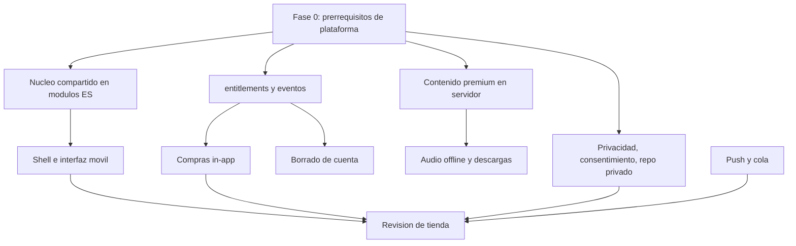

# Preparacion de la plataforma para una app movil

| Campo | Valor |
|---|---|
| Fecha | 2026-11-25 |
| Commit de referencia | 41d4d8e |
| Estado | Documento de planificacion, la app NO esta construida |
| Etiquetas | [V] verificado, [R] recomendacion, [S] supuesto, [P] pendiente de verificar |

Base: [CURRENT_ARCHITECTURE.md](CURRENT_ARCHITECTURE.md) (como esta hoy) y [PLATFORM_AUDIT.md](PLATFORM_AUDIT.md) (hallazgos con ID). Reglas y precios de tiendas son volatiles; fecha de consulta 2026-11-25, confianza segun el informe de investigacion (A alta, M media, B baja).

## 1. Veredicto

**La plataforma NO esta lista para publicar una app todavia.** Es una base sana (datos de progreso multi-dispositivo, academia con servidor como fuente de verdad, bancos de contenido limpios, pruebas de reglas de negocio), pero tiene 8 bloqueadores que son prerrequisitos de la Fase 0. [V] (hallazgos) y [R] (decision).

Arquitectura recomendada: Capacitor empaquetando la academia web existente, con una interfaz movil propia y plugins nativos (compras in-app, push, Sign in with Apple, audio offline, almacenamiento seguro). Alternativa si el spike falla o Apple rechaza por 4.2: Expo / React Native con un paquete TypeScript compartido. Backend unico: Supabase con una nueva tabla `entitlements`. [R]

## 2. Bloqueadores

| # | Bloqueador | Hallazgos | Por que bloquea | Etiqueta |
|---|---|---|---|---|
| 1 | Contenido premium publico en repo publico | B-02, F-06, H-09 | Una app empaquetada regala los bancos y el audio; las tiendas no protegen contenido | [V] |
| 2 | Pagos sin guardas: doble cobro, 200 ante fallos, sin reembolso ni disputa, firma MP y tolerancia Stripe | H-01, H-02, H-03, H-04, H-05, H-10 | Con IAP habria hasta 4 fuentes de cobro sin bloqueo cruzado ni revocacion | [V] |
| 3 | Sin modelo de derechos multi-fuente | H-02, H-06, H-11 | `profiles.is_member` es un boolean sin `access_until`; las tiendas exigen acceso hasta la fecha pagada | [V] |
| 4 | Cancelacion solo por correo y terminos incoherentes | H-06, H-07 | Apple 3.1.2 y Play exigen gestion de suscripcion; consumidor | [V] |
| 5 | Sin borrado de cuenta | H-18, AI-05 | Apple 5.1.1(v) lo exige dentro de la app; Play exige ruta y URL web (confianza A) | [V] |
| 6 | Registro sin confirmar y sesion unica | B-01, B-03 | Cuentas falsas y spam heredados; web y telefono se cerrarian mutuamente | [V] |
| 7 | Backend, DEVLOG y datos de clientes publicos | AI-01, AI-02 | Fuga de datos personales y de arquitectura; limpiar historial antes de publicar | [V] |
| 8 | Consentimiento, privacidad y menores | AI-03, AI-04, AI-05, F-07 | Privacy labels de Apple, Data Safety de Google, ATT, RGPD | [V] |

Tambien previos a Fase 0 o muy cercanos: alinear repo con lo desplegado (B-08), backups (B-09), paginacion (F-01). Detalle de prioridades en [PLATFORM_AUDIT.md](PLATFORM_AUDIT.md).

## 3. Clasificacion por componente

Esfuerzo [S] en tamanos relativos (S pocos dias, M 1-2 semanas, L 3-6 semanas, XL mas de 6 semanas, con agente de IA y un desarrollador). Son estimaciones propias, no medidas.

### 3.1 Reutilizable directo

| Componente | Archivos | Justificacion | Esfuerzo | Dependencia |
|---|---|---|---|---|
| Bancos de ejercicios | `data.js` (1589 items), `toefl/ielts/toeic/cambridge*-data.js`, `juego-data.js` | Estructura uniforme con ids unicos al 100 %; datos puros extraibles a JSON versionado. Condicion: mover los de miembros a servidor (B-02) | S (extraccion), M (servidor) | Bloqueador 1 |
| Cursos de academia | `academia-data.js`, RPC `academia_get_content` | Ya dirigido por servidor; el cliente nativo puede usar las mismas RPC | S | Ninguna |
| Modelo de progreso | `progress_sessions`, `mistake_stats`, RPC `apply_mistake_results` | Fuente de verdad en servidor y ya multi-dispositivo; fijar paginacion (F-01) | S | Ninguna |
| Identidad visual y mascota | tokens `:root`, Baloo 2 e Inter, `leo-*.png`, `leo-real.webp` | Paleta, tipografia y arte listos; falta variante oscura (F-15) | S | Ninguna |
| Pipeline de audio | `tools/generar_audios*.py`, `tools/lista_audios.csv` | Scripts autonomos; mantener la convencion de nombres | S | Ninguna |
| Pruebas | `tools/tests` (120), `tools/e2e` | Especificacion ejecutable de reglas de negocio; hoy sin `package.json` ni CI (F-10) | S | F-10 |
| English Rush | `juego.js`, `juego-data.js` (122 preguntas) | Autonomo, datos simples; sin sync | S | Ninguna |
| Kill switch y topes de Leo AI (patron) | `leo_ai_config`, `leo-ai.ts` | Triple interruptor y reserva por solicitud reutilizables tal cual | S | AI-07 para escalar |

### 3.2 Adaptacion menor

| Componente | Archivos | Justificacion | Esfuerzo | Dependencia |
|---|---|---|---|---|
| Capa Supabase | `backend.js` | Contrato claro; sustituir `window.location.origin` (`:146,199`), pedir columnas explicitas (H-25), cola de reintento (F-02) | M | B-11, F-02 |
| Sincronizacion de academia | `academia-nube.js` | Logica pura sin DOM, probada en Node; cambiar acceso al cliente y al almacenamiento local | M | Nucleo compartido |
| Audio | `audio/` (57 MB, 1642 mp3), `leo-voz.js` | Formato universal; falta empaquetado o descarga progresiva, manifiesto en lugar de HEAD por bloque (F-16); cursos protegidos con URL firmada de 15 min (F-13) | M | Entitlements |
| Chatbot LeoBot y Leo AI (cliente) | `chatbot.js`, `askLeoAI` en `app.js` | Dependen de Edge Functions; adjuntar version y SO; enviar `itemId` en vez de texto libre (AI-10) | S-M | AI-10 |
| Monitor de errores | `error-monitor.js`, `report-error.ts` | Ampliar origenes y pasar a clave de app y atestacion (B-11) | S | Ninguna |
| Correos transaccionales | funciones de Resend | Siguen sirviendo; separar claves (AI-17) | S | Ninguna |

### 3.3 Requieren refactor

| Componente | Archivos | Justificacion | Esfuerzo | Dependencia |
|---|---|---|---|---|
| Motor de practica | `app.js` (10 756 lineas globales) | Mezcla DOM, analitica, limites, plan y panel. Extraer a modulos ES un nucleo compartido (diagnostico, plan, selectores) cubierto por las pruebas | XL | F-10, spike Fase 1 |
| Analitica | `trackLeoEvent`, gtag, `meta-pixel.js` | Sustituir por SDK movil con consentimiento; el catalogo de ~35 eventos sirve de diccionario | M | AI-03 |
| Reanudacion de sesiones | `leo_inflight_*` | Mover a servidor para multi-dispositivo (F-03) | M | Ninguna |
| Cuotas gratis | `FREE_USER_DAILY_LIMIT`, `profiles.free_*` | RPC con contador solo escribible por funciones (H-08, B-10) | M | Ninguna |
| Funciones de pago | `stripe-checkout`, `paypal-checkout`, `create-checkout`, webhooks | Guardas, 5xx para reintento, tabla de eventos procesados, reembolsos, derivar `is_member` de `entitlements` | L | Bloqueadores 2 y 3 |
| Recordatorios por correo | `streak-reminder-email.ts`, `upgrade-nudge-emails.ts` | Pasar a cola con zona horaria y preferencias por canal antes de agregar push (AI-14, AI-15) | L | Push |
| Topes y costo de Leo AI | `leo-ai.sql`, `leo-ai.ts` | Quitar CHECK de 10000, cache por hash, contadores sin fila caliente (AI-07/08/09) | M | Decision de proveedor [P] |

### 3.4 Construir desde cero

| Componente | Justificacion | Esfuerzo | Dependencia |
|---|---|---|---|
| Interfaz y shell movil | Las 104 paginas dependen de scripts globales y no se empaquetan tal cual; hace falta navegacion y pantallas propias para superar Apple 4.2 (confianza A el texto, B el riesgo) | XL | Refactor del nucleo |
| Compras in-app y restaurar compras | StoreKit 2 y Play Billing; RevenueCat o validacion propia con webhooks a Supabase | L | `entitlements` |
| Tabla `entitlements` y eventos de webhook | Multi-fuente (stripe, paypal, mercadopago, apple, google, manual) con expiracion. Hoy no existe [V]; es recomendacion | M | Ninguna |
| Notificaciones push | Tabla `device_tokens`, FCM/APNs, envio por cola (AI-13) | L | Cuentas de desarrollador, cola |
| Sign in with Apple | Obligatorio en iOS si hay login social de terceros (4.8, confianza A) | S-M | Ninguna |
| Borrado de cuenta | RPC o Edge Function que borre `auth.users`, cancele suscripciones externas y limpie datos (H-18) | M | `entitlements` |
| Speaking nativo | La Web Speech API no sirve en movil (F-14) | M-L | Spike |
| Repeticion espaciada | No existe scheduler (solo estados de error) | L | Modelo de datos |
| Offline y almacenamiento seguro | Sin service worker hoy (F-12); descarga de audio y cola de sincronizacion | L | Audio, `entitlements` |
| Modo oscuro | `style.css` no lo tiene (F-15) | M | Ninguna |

### 3.5 Obstaculos futuros

| Obstaculo | Detalle | Etiqueta |
|---|---|---|
| Pagos por tienda | Contenido digital debe ofrecer IAP (3.1.1); en iOS fuera de EEUU no se pueden poner botones ni enlaces a pago externo sin entitlement; 3.1.3(b) permite entrar con lo comprado en web solo si tambien hay IAP | [V] doc oficial, confianza A |
| Regimen litigioso en EEUU | Enlace externo con 0 % provisional, certiorari en 2027; no basar el negocio en eso (confianza M-B) | [P] |
| Comisiones | Apple 30 % el primer ano y 15 % despues; Small Business 15 % bajo 1 M USD; Google 15 % en suscripciones fuera de las regiones nuevas (A y M segun fila). Con precio de USD 2/mes el margen se reduce | [V] A/M |
| Contenido publico y SEO | Glosario (355 fichas) y articulos seguiran siendo web publica; conviven con la app | [V] |
| Politica de IA en movil | Apple 5.1.2(i): declarar y pedir permiso antes de compartir datos personales con IA de terceros (Cloudflare) | [V] A |
| Cuenta nueva de Google | 12 testers durante 14 dias consecutivos (cuenta personal posterior a 2023-11-13) antes de produccion | [V] A |
| Mantenimiento con agentes de IA | Un repo publico sin CI ni modulos aumenta riesgo de regresiones | [R] |

## 4. Matriz visitante, cuenta gratis y miembro en la app

Hoy el control es mayormente de navegador. Columna "En app": que debe hacer cada nivel y donde debe aplicarse. [R] salvo la columna "Hoy".

| Capacidad | Visitante | Cuenta gratis | Miembro | Hoy se aplica en | En app debe aplicarse en |
|---|---|---|---|---|---|
| Articulos y glosario | Si, enlazados a la web | Si | Si | Web publica | Web (deep link) |
| Practica de muestra | 3 ejercicios | 6 por dia | Sin limite | Cliente (`app.js:4132-4133`) | Servidor (RPC), H-08 |
| Sesiones en la nube | No | Si, tier `free`, 40/24 h | Si, 300/24 h | Servidor (trigger) | Servidor (ya) |
| Repaso de errores y diagnostico | Local | Si | Si | Cliente + `mistake_stats` | Nucleo compartido + servidor |
| Leo AI | No | 5 creditos de prueba (si `trial_enabled`) | Hasta el tope diario | Servidor | Servidor, con topes por plan (AI-07, AI-10) |
| Academia TO BE y Pronombres | Temario | Demo TO BE (1 vez) | Todo | Texto publico, demo en servidor | Servidor para todo salvo temario |
| Academia 9 cursos protegidos | Esqueleto | Esqueleto | Contenido, examen, insignias | Servidor | Servidor (ya) |
| Examenes TOEFL, IELTS, TOEIC, Cambridge y paginas de miembros | No | No | Si | Solo cliente (B-02) | Servidor (RPC o Storage con URL firmada) |
| Audio premium | No | No | Si | Publico en `audio/`; cursos protegidos con URL firmada | Storage con URL firmada y descarga offline controlada |
| Compra | No | Si | Gestiona suscripcion | Web (Stripe, PayPal, MP) | IAP en la app; web sigue con pasarelas; derecho en `entitlements` |
| Cancelar, restaurar, borrar cuenta | No aplica | Borrar cuenta | Cancelar, restaurar, borrar | Por correo | In-app (obligatorio en tiendas) |

## 5. Dependencias entre componentes

## 6. Lo reutilizable en una linea

Bancos de contenido, academia y sus RPC, `academia-nube.js`, progreso y errores, tokens visuales y mascota, scripts de audio y pruebas. Lo nuevo: shell movil, IAP, `entitlements`, push, Sign in with Apple, borrado de cuenta, speaking nativo, repeticion espaciada, offline.

## 7. Condiciones para pasar a construir

1. Fase 0 completa y verificada, con los 8 bloqueadores cerrados y los P0 de [PLATFORM_AUDIT.md](PLATFORM_AUDIT.md).
2. Spike de Capacitor de 1-2 semanas (Fase 1) con puerta de decision de rendimiento y experiencia nativa; si falla, ruta Expo.
3. Cuentas de desarrollador abiertas con antelacion (Apple 99 USD/ano, Google 25 USD unico; confianza A).
4. Decision [P] sobre proveedor de IA y costos a escala; los valores con modelos Claude del informe de tiendas son solo escenario alternativo.
5. Revisar reglas de tienda en la fecha de lanzamiento: Epic v. Apple, terminos de Google Play y requisitos de SDK cambian con frecuencia.
