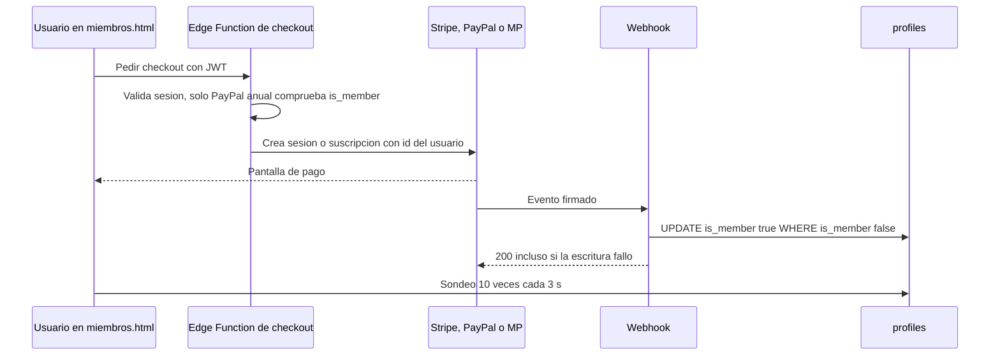
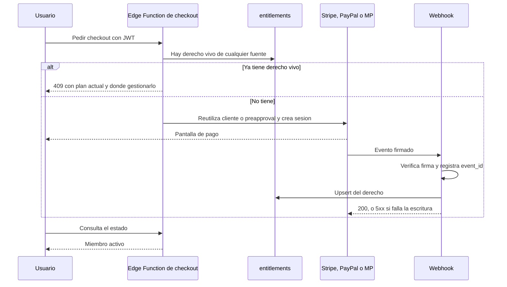
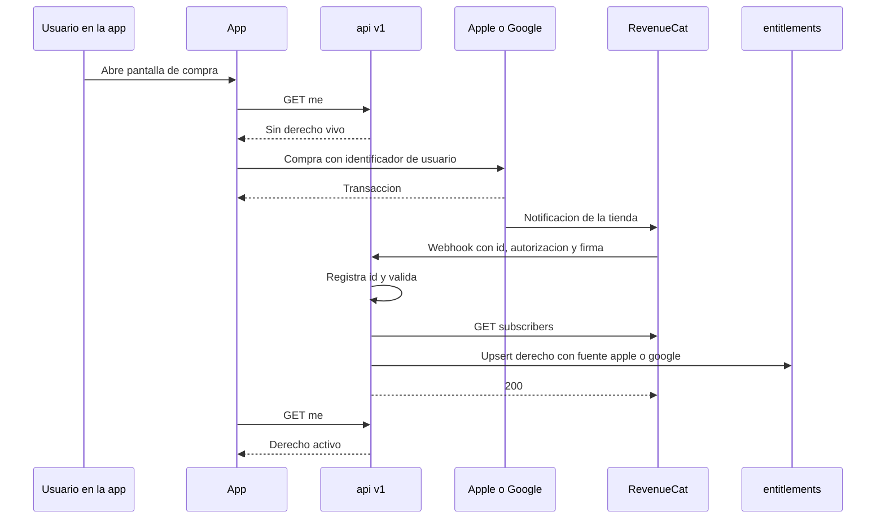
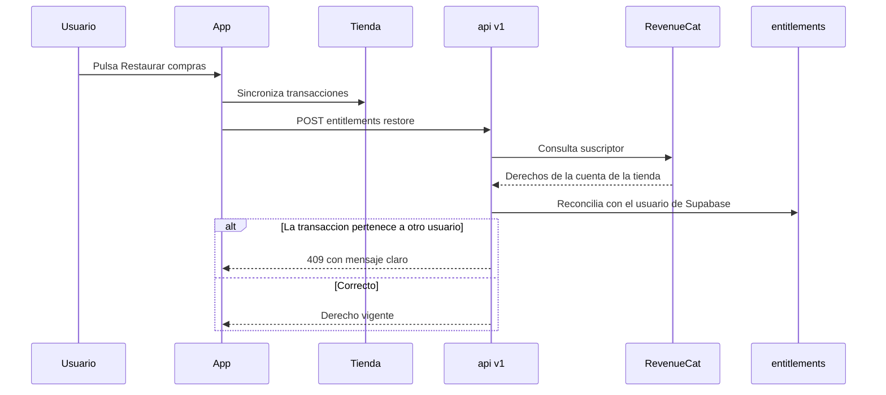
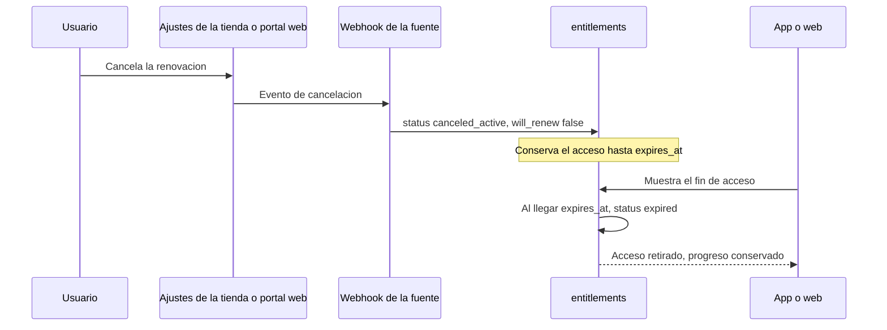
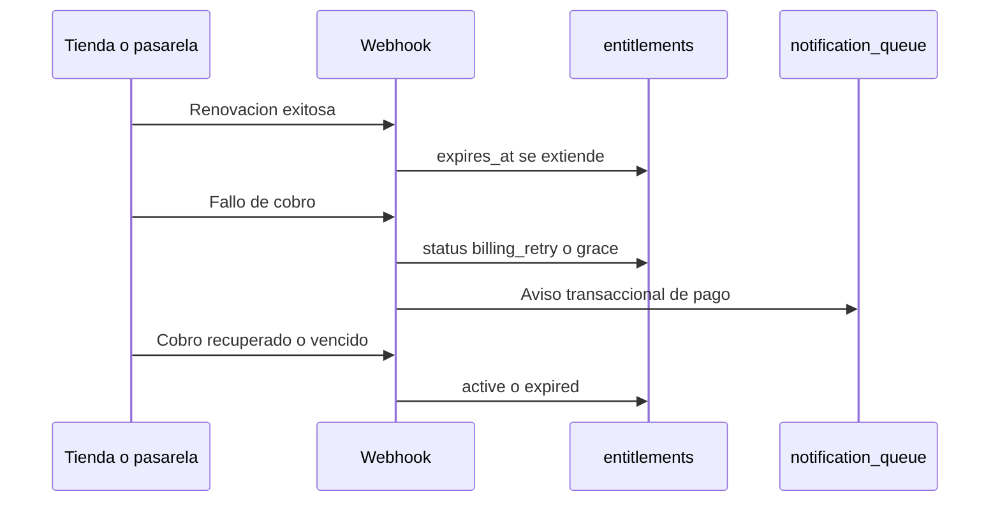
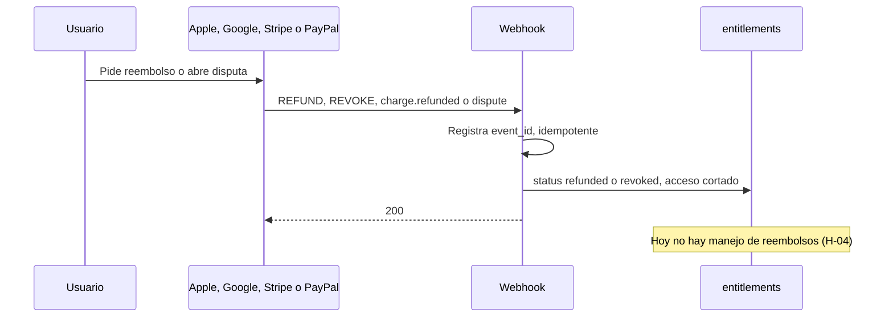
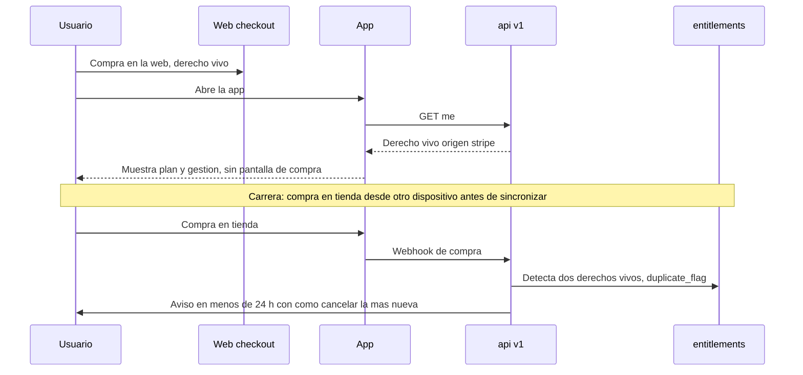

# Pagos y membresias: web y tiendas conviviendo

> Fecha: 2026-11-25 | Commit de referencia: 41d4d8e | Estado: Documento de planificacion, la app NO esta construida. No se crea ninguna migracion ni se toca ninguna configuracion de pagos.
>
> Etiquetas: [V] verificado en codigo o doc oficial, [R] recomendacion, [S] supuesto o estimacion propia, [P] pendiente de verificar. Confianza de datos de tiendas segun la tabla de fuentes con URL de la seccion 13: A alta (pagina oficial leida), M media, B baja. **Politicas y precios de tiendas son volatiles**: reverificar antes de lanzar. IDs H-xx, B-xx, AI-xx de las auditorias.
>
> Relacionados: [arquitectura](ARCHITECTURE_DECISION.md), [producto](MOBILE_PRODUCT_SPEC.md), [datos y API](DATA_AND_API_CONTRACTS.md).

## 1. Resumen para el dueno

- [V] Hoy se cobra en la web con Stripe (tarjeta, mensual y anual), PayPal (mensual; anual implementado y apagado en la interfaz) y Mercado Pago (40 MXN al mes). La membresia es un solo booleano `profiles.is_member`, sin fecha de vencimiento general.
- [V] Con tres proveedores y ese booleano ya hay riesgo de **doble cobro** (H-01, H-02), **reembolsos que no quitan acceso** (H-04) y **webhooks que no reintentan** (H-03). Con tiendas habria hasta cinco fuentes de cobro: sin corregir esto primero, el problema se multiplica.
- [V] En iOS, el contenido premium debe venderse con compra in-app (guia 3.1.1). Los botones o enlaces a Stripe, PayPal o Mercado Pago dentro de la app estan **prohibidos fuera de EEUU** sin una autorizacion especial de Apple.
- [R] Solucion: una tabla `entitlements` multi-fuente como unica fuente de verdad; la app vende con compras in-app mediante RevenueCat (o alternativa); la web sigue como esta; el servidor impide pagar dos veces.
- [S] Con el precio de 2 USD al mes, la tarifa fija de una pasarela de tarjeta pesa mas que la comision de la tienda; el plan anual es mucho mas rentable por cualquier canal (seccion 7).

## 2. Estado actual de los pagos [V]

Fuente principal: PLATFORM_AUDIT.md, seccion 2 (commit 41d4d8e). Marcas [P] cuando depende de produccion.

| Proveedor | Checkout (archivo, slug desplegado) | Webhook | Que maneja | Lo que NO maneja |
|---|---|---|---|---|
| Stripe | `supabase_functions/stripe-checkout.ts` (Embedded Checkout, precios `STRIPE_PRICE_ID` y `STRIPE_PRICE_ID_ANNUAL`) | `stripe-webhook.ts`, firma HMAC propia | `checkout.session.completed`, `customer.subscription.updated` y `deleted`; gracia de 72 h por `past_due`; orden por `stripe_event_at` | `invoice.payment_failed` y `paid`, `charge.refunded`, `charge.dispute.*`; sin tolerancia de tiempo en la firma (B-07, H-10) |
| PayPal | `paypal-checkout.ts` (mensual; anual con `PAYPAL_ANNUAL_CHECKOUT=on`) | `paypal-webhook.ts`, verificacion por API oficial | `BILLING.SUBSCRIPTION.ACTIVATED`, `CANCELLED`, `SUSPENDED`, `EXPIRED`, `RE-ACTIVATED`, `PAYMENT.SALE.COMPLETED`; anual con acceso hasta fecha pagada (`paypal_access_until`) [P desplegado] | `PAYMENT.FAILED`, `PAYMENT.SALE.REFUNDED` y `REVERSED`, disputas |
| Mercado Pago | `create-checkout.ts`, desplegada como `super-service` (preapproval de 40 MXN al mes, `PRICE_MXN` en la linea 39) | `mp-webhook.ts`, desplegada como `rapid-service`, **sin firma** (H-05) | `preapproval` autorizado, cancelado o pausado; re-consulta el recurso a la API de MP | Pagos individuales, reembolsos, contracargos, gracia |

Precios [V]: mensual 2 USD y anual 20 USD en `terminos.html:76-77` y `miembros.html`; en Stripe el importe local lo fija el Price (ejemplo Mexico: 37 MXN al mes y 370 MXN al ano segun terminos); Mercado Pago 40 MXN fijo. Los precios estan duplicados en HTML, funciones y paneles (H-15).

### 2.1 Flujo comun hoy

### 2.2 Cosas verificadas que condicionan el diseno

| Hecho | Referencia |
|---|---|
| `is_member` solo lo escriben Edge Functions con `service_role` y dos barridos de pg_cron; el cliente no puede autoactivarse | [V] supabase_schema.sql:289-290; PLATFORM_AUDIT.md, seccion 2 |
| Existen miembros manuales (sin proveedor) que nunca expiran | [V] `upgrade-nudge-emails.ts:2673` |
| Ningun checkout (salvo PayPal anual) bloquea a quien ya es miembro; cada clic crea cliente o preapproval nuevos | [V] H-01, H-02 |
| Cancelacion solo por correo: sin Customer Portal ni gestion en la app | [V] H-07 (`miembros.html:248,309`, `terminos.html:81-86`) |
| Terminos prometen acceso hasta fin del periodo pagado; MP y PayPal mensual lo cortan al instante | [V] H-06 |
| Gracia de 72 h solo existe para Stripe y no vence si hubo historial en PayPal o MP | [V] H-11 |
| Cron de recuperacion de cobros comentado en la migracion | [V] H-16 [P produccion] |
| Politica de reembolsos solo en terminos ("sin reembolso por decision personal"); cero codigo | [V] `terminos.html:83`, H-04 |
| Conversion medida en el cliente, no en el webhook | [V] AI-20 (`miembros.html:818`) |
| Versiones desplegadas de `stripe-webhook`, `stripe-checkout`, `paypal-checkout`, `create-checkout` por confirmar | [P] H-12, PLATFORM_AUDIT.md, seccion 10 |

## 3. Politicas vigentes de las tiendas (consulta 2026-11-25)

### 3.1 Apple App Store

| Regla | Detalle | Fuente | Conf. |
|---|---|---|---|
| 3.1.1 | Desbloquear funciones o contenido premium (suscripciones, acceso a contenido) exige compra in-app; prohibidas licencias propias, codigos QR y cripto | https://developer.apple.com/app-store/review/guidelines/ | A |
| 3.1.1(a) | Fuera de EEUU, la app y los metadatos no pueden incluir botones, enlaces ni llamadas a otros metodos de compra, salvo con el entitlement "StoreKit External Purchase Link" (destinos permitidos varian por region). En la tienda de EEUU la prohibicion no aplica y no hace falta entitlement | misma URL | A |
| 3.1.3(b) | Multiplataforma: se puede dar acceso en la app a lo comprado en la web **siempre que ese contenido tambien este disponible como compra in-app** | misma URL | A |
| 3.1.3(a) | "Reader apps": Leo no encaja claramente (es curso interactivo y practica); se asume que **no aplica** | misma URL | A texto, B aplicabilidad |
| 3.1.2 y suscripciones | Pantalla de alta con opcion de iniciar sesion o **restaurar compras** (`AppStore.sync()`); enlaces a terminos y privacidad en la app y en metadatos | https://developer.apple.com/app-store/subscriptions/ | A |
| 4.8 | Si hay login de terceros (Google), ofrecer opcion equivalente (Sign in with Apple) | guias | A |
| 5.1.1(v) | Si se permite crear cuenta, eliminar la cuenta dentro de la app | guias | A |
| 5.1.2(i) | ATT solo si hay seguimiento entre apps o webs de terceros; no condicionar funciones a permisos; pedir permiso antes de compartir datos personales con IA de terceros (relevante para Leo AI) | guias | A |
| 1.3 Kids | No entrar en Kids; usar Education con clasificacion de edad adecuada | guias | A |
| Comision | 30 % el primer ano de un suscriptor de pago y 15 % desde el segundo (por grupo de suscripcion, 60 dias de gracia para reanudar acumulacion) | https://developer.apple.com/app-store/subscriptions/ | A |
| Small Business Program | 15 % en todos los ciclos si los proceeds son 1 M USD o menos el ano previo y el actual; **hay que inscribirse**; cuentas asociadas suman juntas; si se supera 1 M en el ano en curso, comision estandar para ventas futuras. La pagina menciona tambien un 10 % para suscripciones tras el primer ano; no asumirlo | https://developer.apple.com/app-store/small-business-program/ | A (15 % y 1 M), M (10 %) |
| StoreKit 2 y servidor | `Transaction.currentEntitlements`, `Transaction.updates`, `showManageSubscriptions`; App Store Server API (estado de suscripciones, historial, extension de renovacion de 90 dias hasta 2 veces al ano); App Store Server Notifications (por ejemplo `DID_FAIL_TO_RENEW`); periodo de gracia de facturacion de 3, 16 o 28 dias. **El formato V2 del payload (JWS firmado) no se leyo**: verificar en la documentacion tecnica antes de implementar | https://developer.apple.com/app-store/subscriptions/ | A funciones, B payload |
| Requisitos de SDK | Desde 2026-04-28 compilar con Xcode 26 o superior y SDK de iOS 26; desde 2026-09-09 apuntar a iOS 13 o superior como minimo | https://developer.apple.com/news/upcoming-requirements/ | A |
| Actualizacion 2026-10-16 | 3.1.1(a) fusiona el Music Streaming Entitlement en StoreKit External Purchase Link Entitlements | https://developer.apple.com/news/ | M |
| Cuenta | 99 USD al ano (Enterprise 299). Individual: el nombre legal es el vendedor. Organizacion: entidad legal, D-U-N-S, sitio web publico y correo de dominio | https://developer.apple.com/support/enrollment/ | A |
| Etiquetas de privacidad | Obligatorias al subir apps y actualizaciones, incluidos los SDK | https://developer.apple.com/app-store/user-privacy-and-data-use/ | A |

### 3.2 Google Play

| Regla | Detalle | Fuente | Conf. |
|---|---|---|---|
| Pagos | Apps y compras de contenido digital deben usar Play Billing, salvo secciones 3, 8 (facturacion alternativa en paises elegibles, con inscripcion) y 9 (enlaces fuera de la app en paises elegibles). El precio en la app debe coincidir con el de Play | https://support.google.com/googleplay/android-developer/answer/9858738 | A |
| Tarifas | Regiones nuevas (EEE, Reino Unido y EEUU desde 2026-06-30; Australia y Japon desde 2026-09-30): suscripciones auto-renovables 10 % mas 5 % de cargo de facturacion usando Play Billing. Resto de mercados (incluye LatAm): 15 % del primer millon de USD anual y 30 % por encima; **suscripciones 15 % siempre**. Corea e India: facturacion alternativa con 4 puntos menos. La tabla de la pagina se extrajo de forma confusa: confirmar cifras por tier | https://support.google.com/googleplay/android-developer/answer/112622 | M |
| Contexto Epic v. Google | Acuerdo de marzo de 2026 (nuevo "service fee" de 20 % o 15 %, 10 % en suscripciones, 5 % de facturacion en EEUU, Reino Unido y EEE; opcion de facturacion propia o enlaces). Aprobacion judicial final no confirmada | https://techcrunch.com/2026/03/04/google-settles-with-epic-games-drops-its-play-store-commissions-to-20 y https://www.helpnetsecurity.com/2026/03/05/google-play-store-changes-android-app-distribution/ | M-B |
| Play Billing Library | v8 admitida para apps nuevas hasta 2027-08-31 y v9 hasta 2028-08-31; v7 vencio (extension del 2026-11-01 ya vencida). Usar v8 o v9 | https://developer.android.com/google/play/billing/deprecation-faq | A |
| Target API | Desde 2026-08-31 las apps nuevas y actualizaciones apuntan a Android 16 (API 36); extension hasta 2026-11-01 ya vencida | https://support.google.com/googleplay/android-developer/answer/11926878 | A |
| Cuenta personal nueva | Creada despues del 2023-11-13: **12 testers en prueba cerrada durante 14 dias consecutivos** antes de pedir produccion | https://support.google.com/googleplay/android-developer/answer/14151465 | A |
| Cuenta | Pago unico de 25 USD; puede exigir documento oficial y tarjeta a nombre legal | https://support.google.com/googleplay/android-developer/answer/6112435 | A |
| Eliminacion de cuenta y Data safety | Ruta dentro de la app mas URL web obligatoria; declarar en Data safety | https://support.google.com/googleplay/android-developer/answer/13327111 | A |
| RTDN y Play Developer API | Notificaciones por Cloud Pub/Sub, `purchases.subscriptionsv2`, acknowledge en 3 dias | **No verificado** (conocimiento previo) | B [P] |

### 3.3 Por region

| Region | Apple | Google | Conf. |
|---|---|---|---|
| EEUU | Botones y enlaces a pago externo permitidos sin entitlement; sigue siendo necesario ofrecer compra in-app; comision del enlace 0 % provisional mientras se fija la tasa (el Noveno Circuito, dic-2025, admite una comision razonable pero no la prohibicion total; certiorari concedido 2026-06-30 segun escrito judicial; argumento oral enero 2027, decision probable en 2027) | Regiones nuevas desde 2026-06-30; opcion de enlaces con tarifas reducidas segun acuerdo | M (Apple), M-B (Google); fuentes de prensa: https://www.fenwick.com/insights/publications/ninth-circuit-largely-upholds-ruling-in-epic-v-apple, https://www.macrumors.com/2026/04/29/epic-games-wins-reversal-app-store-fee-battle/ (no oficiales, verificar en el expediente) |
| UE | Terminos unificados desde 2026-10-01: compra in-app 26 % estandar o 15 % reducido (Small Business y suscripciones tras el ano 1); pago alternativo en la app 20 % o 10 %; enlace externo 15 % o 10 % solo ventas dentro de 7 dias del toque; CTC de 5 % para distribucion fuera de App Store; parental gate para 13 a 17 | Regiones nuevas (EEE) 10 % mas 5 % en suscripciones | A (Apple, https://developer.apple.com/support/dma-and-apps-in-the-eu/), M (Google) |
| Japon | Compra in-app 10 % (mayoria de desarrolladores, Small Business y subs ano 2 o mas) o 21 %; enlace externo 15 %; pago alternativo mas 5 % sobre in-app | Regiones nuevas desde 2026-09-30 | M (https://www.apple.com/newsroom/2025/12/apple-announces-changes-to-ios-in-japan/, nota de prensa, no reverificada en developer.apple.com) |
| Mexico y LatAm | No se encontro regla distinta de la estandar (30 % y 15 %, Small Business 15 %): se asume estandar. Compra in-app obligatoria | Resto de mercados: suscripciones 15 % | B |
| Brasil y Corea | **No verificado** | Corea e India: facturacion alternativa con 4 puntos menos | [P] |

## 4. Como conviven web y tiendas

### 4.1 Reglas de convivencia

1. [R] **En iOS fuera de EEUU, la app no muestra botones, enlaces ni precios de pago externo.** Se vende con compra in-app. En EEUU el enlace externo es legal, pero se descarta como estrategia por el riesgo juridico (seccion 8).
2. [V] Quien compro en la web con Stripe, PayPal o Mercado Pago **si puede entrar en la app** con su cuenta (3.1.3(b)), siempre que la app ofrezca tambien la compra in-app.
3. [R] La app consulta `entitlements` a traves de `/api/v1/me` ([contratos](DATA_AND_API_CONTRACTS.md), seccion 5). El cliente nunca decide el derecho.
4. [R] Antes de mostrar la pantalla de compra, la app verifica en servidor que no exista un derecho vivo de otra fuente. Si existe, muestra el plan actual y donde gestionarlo.
5. [R] La compra in-app requiere sesion iniciada: el usuario de Supabase se envia a la tienda como identificador (`appAccountToken` en Apple, `obfuscatedExternalAccountId` en Google; en RevenueCat, `app_user_id` igual al id de usuario).
6. [R] Gestionar y cancelar: miembros de Apple o Google se envian a los ajustes de la tienda; miembros web, a un portal (Customer Portal de Stripe y enlaces de gestion de PayPal y Mercado Pago), hoy inexistente (H-07).
7. [R] La web puede **seguir como esta** para el pago; la app no bloquea compras web a quien las hace en el navegador.

### 4.2 Gestor de suscripciones: RevenueCat (D4)

| Opcion | Dato | Fuente | Conf. |
|---|---|---|---|
| RevenueCat | Gratis hasta 2.500 USD de ingresos mensuales rastreados (MTR) y 1 % del MTR desde ahi (Pro); webhooks solo en Pro; Enterprise a medida | https://www.revenuecat.com/pricing/ | A |
| Webhooks de RevenueCat | HTTPS, cabecera de autorizacion opcional, firma HMAC opcional (`X-RevenueCat-Webhook-Signature`), 5 reintentos en unos 80 minutos, espera de 60 s, entrega "al menos una vez" (usar el `id` para idempotencia), llegan en 5 a 60 s (cancelaciones hasta unas 2 h); recomiendan consultar `GET /subscribers` tras cada webhook | https://www.revenuecat.com/docs/integrations/webhooks | A |
| Adapty | Pro gratis bajo 5.000 USD de MTR, luego 1 % del MTR mensual | https://adapty.io/pricing/ | A |
| Implementacion propia | StoreKit 2, App Store Server Notifications V2, RTDN de Play y Play Developer API hacia Edge Functions: mas trabajo y mantenimiento | juicio | B |
| Integracion RevenueCat con Stripe | Las URLs probadas dieron 404; PayPal y Mercado Pago no tienen soporte nativo [P] | | B |

[R] Patron: una Edge Function recibe el webhook de RevenueCat, valida cabecera y firma, registra el `id` en `webhook_events` y hace `upsert` en `entitlements`. El ciclo de vida de Stripe, PayPal y Mercado Pago **no pasa por RevenueCat**: sus webhooks ya existentes escriben directamente en `entitlements`. [P] Confirmar en la documentacion de RevenueCat si conviene registrar tambien las compras web en su panel.

## 5. Tabla `entitlements` multi-fuente [R]

Esquema completo en [contratos de datos, seccion 3.1](DATA_AND_API_CONTRACTS.md). No existe hoy (hoy: boolean en `profiles`, H-02).

| Fuente | `external_id` | Evento de alta | Evento de fin o cambio | Estado resultante |
|---|---|---|---|---|
| `stripe` | `subscription id` | `checkout.session.completed` | `customer.subscription.updated` y `deleted`; `invoice.payment_failed` (a incorporar) | `active`, `grace` (past_due), `canceled_active` (cancel al final de periodo), `expired`, `refunded` |
| `paypal` | `subscription id` | `BILLING.SUBSCRIPTION.ACTIVATED` | `CANCELLED`, `SUSPENDED`, `EXPIRED`, `PAYMENT.FAILED` (a incorporar), `PAYMENT.SALE.REFUNDED` (a incorporar) | igual; `canceled_active` hasta `next_renewal_at` en todos los planes (hoy solo el anual, H-06) |
| `mercadopago` | `preapproval id` | `preapproval` autorizado | cancelado, pausado; pagos individuales (a incorporar) | igual |
| `apple` | `originalTransactionId` | compra confirmada por la tienda | renovacion, `DID_FAIL_TO_RENEW`, `REFUND`, `REVOKE`, vencimiento | `active`, `billing_retry`, `grace`, `refunded`, `revoked`, `expired` |
| `google` | `purchaseToken` | compra | RTDN: renovada, cancelada, en gracia, en pausa, revocada [P formato] | igual |
| `manual` | n/a | alta manual | caducidad opcional | `active` sin vencimiento si `expires_at` es NULL |

Nombres de eventos de RevenueCat (compra inicial, renovacion, cancelacion, expiracion, problema de facturacion, reembolso) se tomaran de su documentacion al implementar [P: no se leyeron en la investigacion].

### 5.1 Regla de prioridad y de duplicados [R]

1. **Acceso efectivo**: la persona es miembro si existe **al menos un** derecho con estado vivo (`active`, `grace`, `billing_retry`, `canceled_active`) y `expires_at` futuro. El vencimiento efectivo es el **mayor** `expires_at` entre los vivos. `profiles.is_member` se deriva de esto.
2. **Un solo pagador recurrente**: solo puede haber una fuente de cobro recurrente viva. El servidor lo exige en cada checkout (Stripe, PayPal, MP) y en `/me` para la app (corrige H-01).
3. **Carrera inevitable**: si el usuario completa una compra en tienda mientras otro derecho esta vivo (por ejemplo, compro en dos dispositivos), el sistema marca `duplicate_flag`, avisa al usuario en menos de 24 h con instrucciones para cancelar la fuente mas nueva y, si es Stripe, PayPal o MP, el equipo puede reembolsar manualmente. **Apple y Google reembolsan ellos mismos**: solo se orienta al usuario a pedirlo en la tienda.
4. **Cambio de plan** (mensual a anual): el nuevo derecho no quita el anterior hasta que este expire o se cancele; el vencimiento efectivo es el mayor.
5. **Evento viejo no pisa evento nuevo**: se compara `last_event_at` por derecho (corrige H-10 y H-02).
6. **Derechos manuales** (hoy sin proveedor y sin vencimiento) se migran como `manual` y se revisan una vez; no se tocan sin decision del dueno.
7. **Caducidad coherente con los terminos**: toda cancelacion conserva el acceso hasta el fin del periodo pagado (H-06); la gracia se unifica entre fuentes (H-11).

## 6. Diagramas de secuencia

### 6.1 Compra en la web

### 6.2 Compra dentro de la app (iOS o Android)

### 6.3 Restauracion de compras

### 6.4 Cancelacion

### 6.5 Renovacion y fallo de cobro

### 6.6 Reembolso y disputa

### 6.7 Doble cobro entre canales

## 7. Comisiones y margenes con ejemplos

Todos los calculos son [S] con las tarifas del informe. Impuestos (IVA) excluidos. En compras de tienda, Apple y Google actuan como comerciantes de registro y gestionan el impuesto (conocimiento general, B); con pagos propios Leo debe gestionarlos. Los puntos de precio de las tiendas son escalones fijos, por lo que 2 y 20 USD pueden no existir exactamente [P: revisar en App Store Connect y Play Console].

Cargo de Stripe: **no se investigo en esta sesion** [P]. Se usa 2,9 % mas 0,30 USD como supuesto [S] (estructura habitual de tarifa de tarjeta con cargo fijo; verificar contra la cuenta real). PayPal y Mercado Pago tienen tarifas propias no investigadas [P].

### 7.1 Neto por usuario [S]

| Canal | Plan mensual 2 USD: neto | Margen | Plan anual 20 USD: neto | Margen |
|---|---|---|---|---|
| Web con Stripe (supuesto 2,9 % + 0,30) | 1,64 | 82,1 % | 19,12 | 95,6 % |
| Apple, ano 1 (30 %) | 1,40 | 70,0 % | 14,00 | 70,0 % |
| Apple, ano 2 o mas, o Small Business (15 %) | 1,70 | 85,0 % | 17,00 | 85,0 % |
| Google, suscripciones (15 %) | 1,70 | 85,0 % | 17,00 | 85,0 % |
| Apple Small Business mas RevenueCat sobre el umbral (15 % mas 1 %) | 1,68 | 84,0 % | 16,80 | 84,0 % |

Lectura [S]: con 2 USD al mes, el cargo fijo de la pasarela deja la web en 82 %, por debajo de las tiendas con 15 %. El plan anual es el mas rentable en todos los canales (95,6 % por web). Apple en el primer ano con 30 % es el canal mas caro. Inscribirse en el Small Business Program baja Apple a 15 % desde el primer ciclo mientras los proceeds sean 1 M USD o menos.

### 7.2 Ejemplo mensual con mezcla de canales [S]

Supuesto: 2.000 miembros de pago, plan mensual de 2 USD, 60 % por web (1.200), 20 % Apple (400), 20 % Google (400); Apple en 30 % para ese ejemplo (sin inscripcion) o 15 % (con inscripcion).

| Concepto | Calculo | Resultado |
|---|---|---|
| Ingreso bruto | 2.000 x 2 USD | 4.000 USD |
| Web neto | 1.200 x 1,642 | 1.970 USD |
| Google neto (15 %) | 400 x 1,70 | 680 USD |
| Apple neto sin inscripcion (30 %) | 400 x 1,40 | 560 USD |
| Apple neto con Small Business (15 %) | 400 x 1,70 | 680 USD |
| **Total sin inscripcion** | 1.970 + 680 + 560 | **3.210 USD (80,3 %)** |
| **Total con Small Business** | 1.970 + 680 + 680 | **3.330 USD (83,3 %)** |
| RevenueCat | MTR de tiendas 800 x 2 = 1.600 USD, menor que 2.500 | 0 USD (nivel gratis) |

Si el MTR superara el umbral, RevenueCat cobraria el 1 % del MTR segun el informe; si es 1 % del total o solo de la parte sobre 2.500 es ambiguo en la fuente [P]. Con 10.000 USD de MTR, el peor caso (1 % del total) son 100 USD al mes.

### 7.3 Costo fijo de cuentas y servicios [V]

Apple Developer 99 USD al ano; Google Play 25 USD unico; Supabase Pro desde 25 USD al mes; RevenueCat gratis hasta 2.500 USD de MTR. Expo EAS (solo si se elige la alternativa): plan gratuito de 15 builds por plataforma al mes, Starter 19 USD al mes (https://expo.dev/pricing, consultado 2026-11-25, conf. A).

## 8. Enlaces de pago externos y riesgo

| Tema | Estado | Riesgo |
|---|---|---|
| EEUU, Apple | Permitido sin entitlement; comision 0 % provisional, litigio abierto, decision probable en 2027 | Medio-alto: la regla o la tasa pueden cambiar; no basar el modelo de negocio en 0 % permanente [M] |
| EEUU, Google | Opcion de enlaces con tarifas reducidas segun el acuerdo de 2026 | Medio: aprobacion judicial final no confirmada [M-B] |
| UE, Apple | Enlace externo con 15 % o 10 % de comision de "store services", solo ventas dentro de 7 dias del toque; compromiso de mantener la opcion 12 meses | Medio: ahorro pequeno frente a la complejidad [A] |
| Japon | Enlace externo 15 % | Medio [M] |
| Resto del mundo, Apple | Prohibido sin entitlement (3.1.1(a)) | Alto: rechazo de la app o retiro [A] |
| Resto del mundo, Google | Solo en paises elegibles con inscripcion | Medio [A texto, B detalle] |

[R] Decision de este plan: **no depender del enlace externo en EEUU** (D4). Si en el futuro se evalua, hacerlo como experimento aislado por region, con bandera de configuracion y retirada inmediata posible.

## 9. Requisitos por region

| Region | Requisitos de pagos | Otros requisitos |
|---|---|---|
| Todas | Compra in-app en tiendas; restaurar compras; gestionar suscripcion; terminos y privacidad enlazados; eliminar cuenta en la app; precios de la tienda mostrados en moneda local | Etiquetas de privacidad de Apple y formulario Data safety de Google |
| EEUU | Enlace externo opcional (no recomendado como base) | Riesgo juridico abierto |
| UE | Elegir termino unificado de Apple y confirmar eleccion 12 meses si se usa pago alternativo; parental gate para 13 a 17 | RGPD, consentimiento (AI-03, AI-04) |
| Japon | Revisar termino de comision | [P] confirmar en developer.apple.com |
| Mexico y LatAm | Estandar de tiendas; MXN en Mercado Pago solo en la web | Verificacion de reglas locales [P] |
| Brasil, Corea | [P] sin verificar | Reverificar antes de lanzar ahi |

## 10. Checklist de cumplimiento (antes de enviar a revision)

Pagos y derechos
- [ ] `entitlements` con webhooks idempotentes (`webhook_events`) y 5xx ante fallo de escritura (H-03).
- [ ] Checkouts rechazan con 409 si hay derecho vivo de cualquier fuente; reutilizacion de cliente de Stripe y de preapproval pendiente (H-01, H-02).
- [ ] Reembolsos, disputas y pago fallido manejados en Stripe, PayPal y MP (H-04).
- [ ] Firma de Mercado Pago, tolerancia de tiempo y comparacion constante en Stripe (H-05, H-10).
- [ ] Acceso hasta fin de periodo en todas las fuentes (H-06) y gracia unificada (H-11).
- [ ] Cancelacion autoservicio y Customer Portal (H-07).
- [ ] Copias de funciones alineadas con lo desplegado; columnas de MP en migracion (H-12, H-13).

Tiendas
- [ ] Compra in-app con restaurar compras visible en la pantalla de alta.
- [ ] Terminos y privacidad en la app y en la ficha; informacion de renovacion visible.
- [ ] Sin botones ni enlaces de pago externo fuera de EEUU.
- [ ] Sign in with Apple si hay Google (4.8); eliminar cuenta dentro de la app (5.1.1(v)); URL web de eliminacion para Google.
- [ ] Inscripcion en Small Business Program de Apple.
- [ ] Notas de revision con cuenta de prueba y justificacion de funcionalidad (4.2).
- [ ] Play Billing v8 o v9; target API 36; Xcode 26 con SDK iOS 26.
- [ ] Prueba cerrada de Google Play: 12 testers durante 14 dias si la cuenta es personal nueva.
- [ ] Etiquetas de privacidad y Data safety declaradas, incluida IA de terceros (Cloudflare) (AI-05).
- [ ] Sin Kids; clasificacion de edad adecuada; age gate (AI-04).

## 11. Decisiones para el dueno

| # | Decision | Opciones | Recomendacion |
|---|---|---|---|
| 1 | Precio en tiendas | Mismo que web (2 y 20 USD, ajustado a escalones) o mas alto para absorber la comision | Revisar escalones reales; considerar anual como oferta principal [R] |
| 2 | Plan en tiendas | Mensual y anual, o solo anual | Ofrecer ambos al inicio, medir [R] |
| 3 | Gestor de compras | RevenueCat, Adapty o validacion propia | RevenueCat (D4) por menor trabajo; Adapty como respaldo |
| 4 | Regla ante doble pago | Conservar el mas antiguo y cancelar el nuevo, o conservar el de menor comision | Conservar el mas antiguo (seccion 5.1) [R] |
| 5 | Politica de reembolsos | La actual (sin reembolso por decision personal) frente a la que imponen Apple y Google | Aclarar en terminos que los reembolsos de tienda los decide la tienda [R] |
| 6 | Tipo de cuenta de desarrollador | Individual u organizacion (D-U-N-S, dominio, entidad legal) | Segun entidad legal real del negocio [P] |
| 7 | Enlace externo en EEUU | Si o no | No (riesgo juridico) [R] |
| 8 | Miembros manuales | Migrar con o sin vencimiento | Revisar caso a caso, sin tocar sin permiso |
| 9 | Regiones al lanzamiento | Todas, o solo LatAm y EEUU al inicio | Empezar con paises ya verificados; Brasil y Corea despues [R] |
| 10 | Analitica y consentimiento | Prompt ATT o solo analitica propia | Solo analitica propia, sin ATT [R] |

## 12. Pendiente de verificar [P]

Formato de App Store Server Notifications V2 y de RTDN de Google; nombres de eventos de RevenueCat y su integracion con Stripe; soporte de PayPal y Mercado Pago en RevenueCat; reglas de Apple y Google para Brasil y Corea; tasa final de Apple en EEUU y aprobacion judicial del acuerdo de Google; tarifas reales de Stripe, PayPal y Mercado Pago de la cuenta; puntos de precio disponibles en las tiendas; estado real en produccion de las funciones de pago desplegadas, crons y configuracion de proveedores (PLATFORM_AUDIT.md, seccion 10).

## 13. Fuentes (consultadas el 2026-11-25)

| Tema | URL | Conf. |
|---|---|---|
| Guias de revision de Apple | https://developer.apple.com/app-store/review/guidelines/ | A |
| Suscripciones de Apple y comision | https://developer.apple.com/app-store/subscriptions/ | A |
| Small Business Program | https://developer.apple.com/app-store/small-business-program/ | A |
| Privacidad y ATT | https://developer.apple.com/app-store/user-privacy-and-data-use/ | A |
| Requisitos proximos de Apple | https://developer.apple.com/news/upcoming-requirements/ | A |
| Inscripcion de desarrollador Apple | https://developer.apple.com/support/enrollment/ | A |
| DMA en la UE | https://developer.apple.com/support/dma-and-apps-in-the-eu/ | A |
| Japon | https://www.apple.com/newsroom/2025/12/apple-announces-changes-to-ios-in-japan/ | M |
| Epic v. Apple (prensa) | https://www.fenwick.com/insights/publications/ninth-circuit-largely-upholds-ruling-in-epic-v-apple ; https://www.macrumors.com/2026/04/29/epic-games-wins-reversal-app-store-fee-battle/ ; https://www.macobserver.com/news/apple-epic-link-out-commission-proposal-15-percent/ | M-B |
| Politica de pagos de Google Play | https://support.google.com/googleplay/android-developer/answer/9858738 | A |
| Tarifas de Google Play | https://support.google.com/googleplay/android-developer/answer/112622 | M |
| Epic v. Google (prensa) | https://techcrunch.com/2026/03/04/google-settles-with-epic-games-drops-its-play-store-commissions-to-20 ; https://www.helpnetsecurity.com/2026/03/05/google-play-store-changes-android-app-distribution/ | M-B |
| Play Billing Library | https://developer.android.com/google/play/billing/deprecation-faq | A |
| Target API | https://support.google.com/googleplay/android-developer/answer/11926878 | A |
| Testers de cuentas nuevas | https://support.google.com/googleplay/android-developer/answer/14151465 | A |
| Cuenta de Google Play | https://support.google.com/googleplay/android-developer/answer/6112435 | A |
| Eliminacion de cuenta en Google | https://support.google.com/googleplay/android-developer/answer/13327111 | A |
| RevenueCat precios | https://www.revenuecat.com/pricing/ | A |
| RevenueCat webhooks | https://www.revenuecat.com/docs/integrations/webhooks | A |
| Adapty precios | https://adapty.io/pricing/ | A |
| Expo EAS | https://expo.dev/pricing | A |
| Sign in with Apple en Supabase | https://supabase.com/docs/guides/auth/social-login/auth-apple | A |
