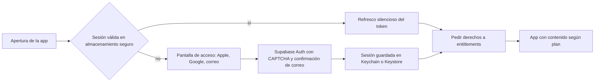
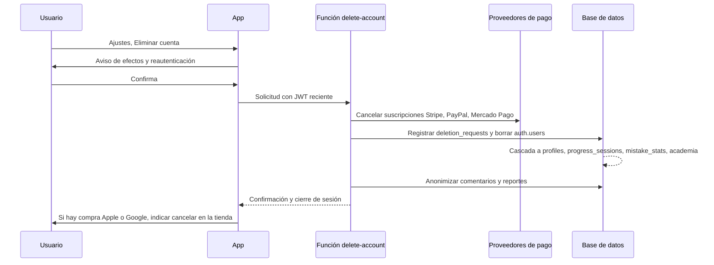

# Seguridad y privacidad de la app móvil

> Fecha: 2026-11-25 | Commit de referencia: 41d4d8e | Estado: Documento de planificación, la app NO está construida.
> Leyenda: [V] verificado en código o documentación oficial, [R] recomendación, [S] supuesto, [P] pendiente de verificar.
> Documentos hermanos: [SCALABILITY_AND_COSTS.md](SCALABILITY_AND_COSTS.md), [IMPLEMENTATION_ROADMAP.md](IMPLEMENTATION_ROADMAP.md), [TESTING_AND_RELEASE.md](TESTING_AND_RELEASE.md).

## 1. Resumen para el dueño

La base técnica de seguridad es sana en lo que más importa: las claves secretas no están en el repositorio, `profiles.is_member` solo lo escribe el servidor, los webhooks de PayPal y Resend validan firma y las tablas tienen RLS [V]. Pero hay seis puntos que impedirían publicar una app hoy, porque las tiendas o la ley los exigen, o porque la app los amplificaría:

1. No existe borrado de cuenta (H-18, AI-05). Apple 5.1.1(v) y Google lo exigen [V, informe de tiendas].
2. El contenido "de miembros" es público y se empaquetaría gratis dentro de la app (B-02, F-06, H-09).
3. Registro sin confirmar correo y sin CAPTCHA (B-01, AI-06).
4. Analítica y Meta Pixel sin consentimiento, y sin protección de menores (AI-03, AI-04, F-07).
5. Repositorio público con backend, DEVLOG y datos de clientes (AI-01, AI-02).
6. Sesión única que cierra el teléfono al entrar en la web (B-03).

Todo esto se documenta aquí y se ejecuta en la Fase 0 del [roadmap](IMPLEMENTATION_ROADMAP.md). Este documento no ejecuta nada.

Nota de privacidad: DEVLOG.txt contiene datos de clientes en las líneas indicadas por AI-02 (~4064 y ~4070) [V]. Aquí solo se citan como "datos de clientes en DEVLOG.txt (líneas indicadas)", sin copiar su contenido.

## 2. Modelo de amenazas

### 2.1 Activos

| Activo | Dónde vive hoy | Valor |
|---|---|---|
| Cuentas y credenciales | Supabase Auth (`auth.users`), `profiles` | Alto: correo, nombre, estado de pago |
| Derecho de acceso (membresía) | `profiles.is_member` [V] | Alto: es el dinero |
| Contenido premium (bancos, examen, audio) | `data.js`, `toefl-data.js`, `ielts-data.js`, `toeic-data.js`, `cambridge*-data.js`, `audio/`; cursos protegidos en `academia_content` y bucket `academia-audio` [V] | Alto |
| Progreso del alumno | `progress_sessions`, `mistake_stats`, `academia_progress` [V] | Medio: dato personal de aprendizaje |
| Cuota de IA | `leo_ai_config`, `ai_usage_daily` [V] | Medio: es coste directo |
| Reputación de correo | Resend, dominio inglesconleo.com | Medio |
| Claves de servicio y secretos | Secrets de Supabase, Vault `internal_functions_secret` [V] | Crítico |
| Datos de pago | Stripe, PayPal, Mercado Pago (no se guardan tarjetas en el sistema propio) [V] | Crítico, pero delegado |

### 2.2 Actores

| Actor | Motivación | Capacidad realista |
|---|---|---|
| Visitante curioso o copiador | Obtener contenido premium gratis | Alta: descomprime la app o lee el repo público |
| Usuario que abusa de cuotas | Más IA, más práctica gratis | Media: crea cuentas falsas (no hay CAPTCHA ni confirmación) |
| Fraude de pagos | Doble reembolso, contracargos, compartir cuenta | Media |
| Atacante automatizado | Spam de correos, enumeración, relleno de credenciales | Media: endpoints sin límite (B-04, B-05) |
| Competidor o investigador | Leer arquitectura del repo público | Alta (AI-01) |
| Cadena de suministro | CDN o plugin comprometido | Baja pero grave (F-08: supabase-js@2 sin versión fija ni SRI) |
| Persona con dispositivo robado o perdido | Acceder a la cuenta | Media |
| Error propio de despliegue | Revertir protecciones por redeploy | Alta (B-08, H-12) |

### 2.3 Amenazas principales y mitigaciones

| # | Amenaza | Estado actual | Mitigación requerida para la app | Hallazgos |
|---|---|---|---|---|
| T1 | Extracción del contenido premium del paquete de la app | Contenido público y en repo público [V] | Premium solo por RPC o Storage con URL firmada y derecho vigente; nada premium en el paquete | B-02, F-06, H-09 |
| T2 | Doble cobro o suscripción huérfana entre canales | Ningún checkout comprueba membresía activa [V] | Tabla `entitlements`, bloqueo en servidor antes de ofrecer compra, customer Stripe único | H-01, H-02 |
| T3 | Pago sin acceso o acceso sin pago | Webhooks responden 200 ante errores [V] | 5xx para reintento, tabla `webhook_events` idempotente | H-03 |
| T4 | Reembolso o contracargo sin revocar acceso | No hay manejo [V] | Procesar refund, dispute y REFUND/REVOKE de tiendas hacia `entitlements` | H-04 |
| T5 | Cuentas falsas masivas (abuso de IA, spam a terceros) | Confirm email apagado, sin CAPTCHA [V] | Confirm email + CAPTCHA + Sign in with Apple/Google | B-01, AI-06 |
| T6 | Spam de correo por endpoints abiertos | `send-password-reset` y `notify-new-comment` sin límite [V] | Rate limit por IP y destino, marca de notificado, escape HTML | B-04, B-05 |
| T7 | Robo de sesión en el teléfono | Sesión en localStorage del navegador [V] | Keychain/Keystore, cierre remoto | B-03 |
| T8 | Replay o suplantación de webhooks | Stripe sin tolerancia, MP sin firma [V] | Firmas con tolerancia y comparación constante; firma MP | B-07, H-05, H-10 |
| T9 | Abuso de IA como proxy gratis de LLM | Texto libre del cliente [V] | Enviar `itemId` y reconstruir el prompt en servidor; límites por plan; App Attest y Play Integrity | AI-10, AI-11 |
| T10 | Fuga de datos personales por repo público | DEVLOG con datos de clientes [V] | Repo privado, purga del historial, evaluar notificación | AI-01, AI-02, B-18 |
| T11 | Pérdida de datos | Backups manuales, sin PITR en Free [V] | Plan Pro con backups, PITR evaluado, prueba de restauración periódica | B-09 |
| T12 | Redeploy que revierte una protección | Dos copias divergentes de funciones [V] | Un solo árbol, `config.toml`, CI que compara repo y desplegado | B-08, H-12 |
| T13 | Manipulación del cliente móvil (root, hooks) | No aplica aún | Toda autorización en servidor; el cliente nunca decide cuotas ni derechos | B-10, H-08 |

## 3. Controles actuales frente a requeridos

| Control | Hoy [V] | Requerido para la app | Fase |
|---|---|---|---|
| Autenticación | Correo y contraseña, Google (`signInWithIdToken` con nonce), `backend.js:88,115,217` | Añadir Sign in with Apple (regla 4.8 de Apple si hay login social) y Google nativo con client id Android/iOS | 2 |
| Verificación de correo | Apagada (`backend.js:82`, DEVLOG:4020) | Encendida, con SMTP propio configurado (hoy el SMTP propio de Auth está apagado, `supabase/RESPALDO_CORREO.md`) | 0 |
| CAPTCHA | Ninguno (0 resultados de `captcha` y `turnstile` en `backend.js` y `miembros.html`) | Cloudflare Turnstile en registro y reset [R, P: confirmar integración con Supabase Auth] | 0 |
| Cliente Supabase | Clave publishable en `backend.js:21`, sin service_role en cliente | Igual; pedir columnas explícitas en vez de `select('*')` de `profiles` (`backend.js:242`) | 3 |
| RLS | Habilitada en todas las tablas `public` | Igual, con lista de comprobación para tablas nuevas (sección 4) | 2 |
| Membresía | `profiles.is_member` solo service_role | `entitlements` multi-fuente con vencimiento; `is_member` derivado | 0 y 2 |
| Cuotas gratis | Cliente y columnas `profiles.free_*` escribibles | Contador solo escribible por RPC de servidor | 0 |
| Contenido premium | Cursos de Academia protegidos (9 de 11); resto público | Todo premium por servidor | 0 |
| Webhooks | PayPal y Resend con firma; Stripe parcial; MP sin firma | Firma con tolerancia en todos; RevenueCat con firma HMAC e `id` idempotente | 0 y 2 |
| Observabilidad | `error-monitor.js` + `report-error` solo para el dominio web (B-11) | Aceptar orígenes nativos (`capacitor://localhost`, `https://localhost`) más clave de app | 0 |
| Respaldos | Manual con `tools/respaldo_supabase.sh` | Backups automáticos del plan Pro y prueba de restauración | 0 |
| Eliminación de cuenta | No existe | Función `delete-account` y botón en la app | 0 |
| Consentimiento de analítica | No existe | Banner en web y diálogo propio en la app | 0 y 3 |
| Cron interno | `x-internal-secret` con Vault, falla cerrado | Mantener | n/a |
| Kill switch de IA | Triple (`LEO_AI_ENABLED`, `leo_ai_config.enabled`, `public`) | Mantener y replicar el patrón (sección 14) | 2 |

## 4. RLS y aislamiento de datos

Estado verificado [V, auditoría de backend]: unas 28 tablas, todas con RLS; vistas con `security_invoker`; `anon` sin INSERT/UPDATE/DELETE en `profiles` (migración 20261014182848); `authenticated` solo puede actualizar columnas concedidas una a una (`supabase_schema.sql:289-290,504,554,608,829,970,1070`); `progress_sessions` con trigger `progress_sessions_guard` que fija `tier` y `created_at` en servidor; funciones de Academia `SECURITY DEFINER` que verifican `auth.uid()` y miembro en cada llamada.

Borrado en cascada confirmado leyendo el esquema: `profiles`, `progress_sessions`, `mistake_stats`, `member_feedback`, `leo_ai_trial`, tablas `academia_*` y otras usan `references auth.users(id) on delete cascade`, mientras `article_comments` y `leobot_reports` usan `on delete set null` (`supabase_schema.sql:366,775`) [V].

Brechas que la app hace más graves:

| Brecha | Detalle | Corrección propuesta [R] | ID |
|---|---|---|---|
| `mistake_stats` sin límites | Sin tope de filas ni longitud de `item_id` y `topic` | CHECK de longitud y tope de lote en `apply_mistake_results` | B-06, AI-18 |
| `profiles.display_name` sin CHECK | Solo el cliente corta a 40 | CHECK de longitud en BD | B-06 |
| `apply_mistake_results` ejecutable por anon | Inocuo sin uid, pero amplía la superficie | `revoke execute ... from public, anon` | B-13 |
| Policy de respuestas con tautología | `parent.article_slug = article_slug` siempre verdadero | Corregir el alias; solo afecta al admin | B-14 |
| `article_comments` con SELECT público | Expone `user_id` de miembros | Vista pública sin `user_id` | B-06 |
| Columnas `free_*` escribibles | Reset trivial de cuota | Quitar GRANT UPDATE y escribir por RPC | B-10, H-08 |
| UUID admin y correos del dueño en políticas y funciones | Facilita ataque dirigido | Mover a configuración; no publicar | B-18 |
| Columnas `mp_preapproval_*` sin migración | Un entorno nuevo falla | Migración idempotente | H-13 |

Reglas para tablas nuevas de la app [R]:

| Tabla propuesta | Lectura cliente | Escritura cliente | Notas |
|---|---|---|---|
| `entitlements` | SELECT solo filas propias | Ninguna (solo service_role vía webhooks) | Único por `(source, external_id)`, índice por `user_id` |
| `webhook_events` | Ninguna | Ninguna | Único por `(provider, event_id)`; retención 90 días [S] |
| `device_tokens` | SELECT propios | INSERT y DELETE propios vía RPC con tope por usuario | Plataforma, versión de app, zona horaria |
| `app_config` (flags y versión mínima) | SELECT de claves permitidas | Ninguna | Sin secretos |
| `deletion_requests` | SELECT propia | Solo vía función | Auditar plazos de borrado |

Lista de comprobación para cada migración nueva: RLS habilitada; ninguna policy con `using (true)` salvo lectura pública intencional; funciones `SECURITY DEFINER` con `search_path=''` y `revoke ... from public, anon, authenticated` si son internas; `TRUNCATE` revocado; consulta de comprobación en `supabase/verify/` y script en `supabase/rollback/` (ambas carpetas existen [V]).

## 5. Autenticación y sesiones multidispositivo

### 5.1 Estado actual [V]

- Contraseña y Google; Confirm email apagado; JWT de aproximadamente 1 hora; refresco por supabase-js; sesión en localStorage.
- Política de sesión única: tras el login `signOut({scope:'others'})` en `backend.js:117` (comentario "decisión a propósito", `backend.js:97-109`). Con teléfono y web, cada entrada cierra la otra (B-03).
- Los JWT revocados siguen válidos hasta caducar para RLS y para `leo-ai` (`getClaims`), mientras los checkouts usan `getUser` y sí rechazan sesiones cerradas.

### 5.2 Diseño recomendado [R]

| Decisión | Propuesta | Motivo |
|---|---|---|
| Sesión única | Retirar `scope:'others'`. Permitir varios dispositivos y ofrecer "Cerrar sesión en todos" (`signOut({scope:'global'})`) | App y web conviven por diseño; la sesión única generaría soporte constante |
| Límite de dispositivos | Opcional: tope de 3 a 5 sesiones activas [S]. Supabase ofrece límites de sesión en ciertos planes [P: confirmar en la documentación vigente] | El precio es bajo (USD 2 al mes); no justifica fricción alta |
| Rotación de refresh token | Activada con ventana de reutilización corta [P: revisar ajustes de Auth] | Detecta robo de token |
| iOS | Sign in with Apple nativo con `signInWithIdToken`; guardar el nombre en el primer login porque Apple lo envía una sola vez [V, informe de tiendas] | Regla 4.8 |
| Android | Google nativo con client id Android propio [P: no se leyó la página oficial de Google nativo] | B-11 |
| Deep links | Universal Links y App Links con `apple-app-site-association` y `assetlinks.json` (no existen hoy, AI-23) y alta en Redirect URLs de Supabase | B-04, AI-23 |
| Restablecer contraseña | `redirectTo` propio de la app en vez de `origin+pathname` (`backend.js:138-147`) | B-04, B-11 |
| Vinculación de identidades | Probar el caso "pre-hijacking" (cuenta creada con correo ajeno y luego login con Google) antes de lanzar | B-01 [P] |
| Contraseñas filtradas | Activar la protección si el plan lo permite | Auditoría 14-oct [P] |

## 6. Almacenamiento seguro en el teléfono

| Dato | Dónde guardarlo [R] | Por qué |
|---|---|---|
| Sesión Supabase (access y refresh token) | Plugin de almacenamiento seguro sobre Keychain (iOS) y Keystore (Android), como adaptador de almacenamiento de supabase-js | El localStorage del WebView no está cifrado y entra en copias de seguridad |
| Progreso local y cola de sincronización | Almacenamiento de la app (SQLite o Preferences); no es secreto pero sí dato personal | Habilita offline y resuelve F-02 |
| Audio offline | Directorio privado de la app, excluido de iCloud y de Auto Backup de Android | Reduce copia no autorizada |
| Caché de entitlement | Con marca de tiempo y margen offline de 7 días [S] | Evita bloqueo al viajar sin red y limita abuso |
| Secretos o claves de servicio | Nunca en la app | Solo la clave publishable (pública por diseño) |
| Logs | Sin tokens ni correos; reutilizar la limpieza de PII de `app_error_clean` [V] | Privacidad |

Otras reglas [R]: `allowBackup=false` en Android; sin `console.log` de sesiones en producción; biometría opcional para reabrir la app; detectar root o jailbreak solo como señal de riesgo, no para bloquear.

## 7. Protección del contenido premium

Principio: lo que se empaqueta en la app es público. Lo premium vive en el servidor.

| Capa | Hoy [V] | App [R] |
|---|---|---|
| Bancos de ejercicios | Públicos (`data.js` 1,06 MB y otros) | Parte gratuita empaquetada; parte premium por RPC paginada |
| Cursos de Academia | 9 de 11 protegidos con `academia_get_content` | Reutilizar; extender el patrón a los demás bancos (`supabase/migrations/20261028180000_academia_contenido_protegido.sql`) |
| Audio | 1642 mp3 públicos (57 MB); cursos protegidos con URL firmada de 15 minutos (`academia.js:298-325`) | Gratuito empaquetado o descargado; premium con URL firmada y verificación de derecho al descargar |
| Examen oficial | Banco solo en servidor (`academia_exam_items`) | Igual |
| Evaluación IA | Servidor | Igual |

Realismo: un usuario decidido puede extraer el audio descargado en su teléfono. El DRM no compensa un precio de USD 2 al mes. La defensa práctica es que el valor premium sea el servicio: examen en servidor, Leo AI, seguimiento y contenido nuevo [R]. `docs/proteccion-contenido-premium.md` ya reconoce esta decisión de producto [V].

Las URL firmadas de 15 minutos (F-13) impiden descarga offline sin rediseño: para offline se usará descarga explícita con URL firmada de vida corta y archivo guardado en el sandbox de la app, validando `entitlements` al iniciar la descarga [R].

## 8. Abuso, límites de tasa y CAPTCHA

Existen hoy límites en `progress_sessions` (40 y 300 por 24 h), `leobot_reports` (8 por hora por IP y usuario, 200 globales), `report-error` (30 por IP), `leo_ai_*` y examen (3 por día) [V]. Faltan en comentarios anónimos, `mistake_stats`, `send-password-reset`, `notify-new-comment`, `submit-survey`, `email-unsubscribe`, `libro-download` y registro [V].

| Punto | Límite propuesto [R, valores S] | Mecanismo |
|---|---|---|
| Registro | 5 cuentas por IP y hora; CAPTCHA siempre | Turnstile + confirmación de correo |
| Reset de contraseña | 3 por correo y hora, 10 por IP y hora | Reutilizar el patrón `err_rate_hit` [V que existe] |
| Comentarios anónimos | 5 por IP y hora | Trigger como `leobot_reports_limit` |
| `notify-new-comment` | Una notificación por comentario, firma interna | Columna `notified_at` como en `leobot-notify` |
| Leo AI | Límites por plan, usuario y dispositivo; presupuesto en USD | AI-07, AI-08, AI-10 |
| Compras | 5 intentos de checkout por hora | Edge Function |
| Endpoints sin sesión desde la app | App Attest (iOS) y Play Integrity (Android) además del origen | AI-11 [P: integración concreta] |

Los CHECK de `leo_ai_config` (`neuron_budget` y `global_daily_limit` hasta 10000) deben retirarse para escalar (AI-07; ver [SCALABILITY_AND_COSTS.md](SCALABILITY_AND_COSTS.md)).

## 9. Privacidad y cumplimiento

### 9.1 Menores, COPPA y GDPR-K

Hoy no se pide edad; la política dice "si eres menor de edad, usa Inglés con Leo con el permiso de tu madre, padre o tutor" (`privacidad.html:104-105`); se envían eventos a Meta y Google y más de diez correos de marketing por cuenta a cualquier edad [V, AI-04].

| Norma | Resumen | Estado |
|---|---|---|
| COPPA (EEUU, menores de 13) | Consentimiento parental verificable para recoger datos | [P: texto legal no verificado] |
| RGPD art. 8 (UE) | Edad de consentimiento digital entre 13 y 16 según país | [P] |
| Apple 1.3 y Kids Category | Sin PII ni analítica de terceros; el informe recomienda no entrar a Kids | [V, informe de tiendas] |
| Apple 5.1.2(i) | Permiso explícito antes de compartir datos con IA de terceros | [V, informe de tiendas] |

Decisión recomendada [R]: declarar la app como no dirigida a menores de 13, con pantalla de edad neutral al registrarse, bloqueo de registro bajo 13, y para 13 a 17 desactivar marketing, Pixel y personalización publicitaria. Clasificación de edad en tiendas coherente. Un asesor legal debe validar los umbrales por país antes de lanzar [P].

### 9.2 RGPD y leyes de América Latina

Público objetivo: hispanohablantes de México y América Latina, más España [S]. La lista siguiente es orientativa y NO está verificada [P]; requiere asesoría local:

| País o región | Norma probable | Puntos a revisar [P] |
|---|---|---|
| México | Ley de protección de datos en posesión de particulares | Aviso de privacidad, derechos ARCO |
| Brasil | LGPD | Base legal, transferencia internacional |
| Argentina | Ley 25.326 | Derechos, registro de bases |
| Colombia | Ley 1581 | Autorización previa y expresa |
| Chile y Perú | Normas recientes de protección de datos | Verificar vigencia |
| UE y España | RGPD y LOPDGDD | Base legal, transferencias a EEUU (Cloudflare, Supabase, Resend, Stripe, Google, Meta) |

Mejoras de política exigidas por los hallazgos [V, AI-05]: nombrar a Cloudflare (IA) y Brevo (reserva de correo), declarar la IA como tratamiento, base legal, retención, contacto y transferencias internacionales. Hoy la lista de encargados es Supabase, Resend, Stripe, PayPal, Mercado Pago, Google, Meta y GitHub (`privacidad.html:84-98`).

### 9.3 Consentimiento de analítica

- Web: GA4 y Meta Pixel cargan en cada página sin consentimiento (`index.html:70-105`, `meta-pixel.js`; F-07, AI-03) [V]. Solución [R]: gestor de consentimiento con Consent Mode y carga condicionada en cerca de 100 HTML (patrón repetido, automatizable con un script como `tools/aplicar_nav_alumno.js`).
- App: Firebase Analytics o equivalente, con recogida desactivada por defecto en UE y Reino Unido hasta aceptar [R]; el catálogo de unos 35 eventos de `trackLeoEvent` sirve de diccionario [V]. No incluir el SDK de Meta en la v1.
- ATT de Apple: solo si hay seguimiento entre apps o webs de terceros [V, informe de tiendas]. Si la v1 solo tiene analítica propia y no comparte identificadores con Meta, no se muestra el aviso ATT. Si se envía conversión a Meta, hacerlo desde el servidor con consentimiento y datos mínimos (AI-20) [R].
- La conversión de pago hoy se dispara en el cliente (`miembros.html:818`); pasarla al webhook [R].

### 9.4 Borrado de cuenta y exportación

Hoy no existe (H-18, AI-05); el único camino es un correo con plazo de 20 días hábiles [V].

Puntos finos: las suscripciones de Apple y Google no las cancela el desarrollador; la app debe avisar y enlazar a la gestión de la tienda (Apple `showManageSubscriptions`) [V, informe de tiendas]. Los registros fiscales de pagos pueden requerir conservación legal [P]. Google exige además una URL web para pedir el borrado, declarada en Data safety [V, informe de tiendas]. Exportación de datos (portabilidad): función `export-my-data` con JSON de `profiles`, sesiones y errores [R, Fase 6].

### 9.5 Etiquetas de privacidad de Apple y Data safety de Google

Borrador para completar con el inventario real al final de la Fase 3. Las categorías exactas deben confirmarse con los formularios vigentes de cada tienda [P].

| Dato | Se recoge | Vinculado a identidad | Uso | Compartido con terceros | Notas |
|---|---|---|---|---|---|
| Correo | Sí | Sí | Cuenta, comunicaciones | Resend (procesador) | Apple permite ocultarlo |
| Nombre visible | Sí | Sí | Cuenta | No | `display_name` |
| ID de usuario | Sí | Sí | Funcionamiento | Supabase (procesador) | |
| Compras | Sí | Sí | Derechos | Tiendas y RevenueCat | |
| Progreso y errores | Sí | Sí | Funcionalidad | No | `progress_sessions`, `mistake_stats` |
| Contenido del usuario (frases de Writing, respuestas) | Al pedir IA | No se guarda texto, solo cantidades [V, AI-24] | Funcionalidad | Cloudflare Workers AI | Permiso explícito (5.1.2(i)) |
| Audio de voz | Si se usa reconocimiento nativo | Depende del motor | Speaking | Apple o Google | [P] según implementación |
| Diagnóstico (errores) | Sí | Sin PII por limpieza | Estabilidad | No | `app_errors` |
| Analítica de uso | Solo con consentimiento | Seudónima | Mejora | Google (Firebase) | |
| Datos de pago | No (los maneja la tienda o el proveedor) | n/a | n/a | n/a | |
| Ubicación, contactos, fotos | No | n/a | n/a | n/a | |

Cada plugin (RevenueCat, Firebase, push) añade datos y debe incluir su privacy manifest; revisarlos antes de enviar [V, informe de tiendas].

### 9.6 Retención de datos

| Dato | Retención hoy [V] | Propuesta [R, plazos S] |
|---|---|---|
| `app_errors` | 60 días (cron semanal) | Mantener |
| `leo_ai_requests` | 24 h | Mantener |
| `leobot_reports` y capturas | Sin límite (AI-12) | 12 meses; hash de IP con HMAC secreto |
| `survey_responses` | Sin límite, guarda correo duplicado | 24 meses y sin correo |
| `webhook_events` (nueva) | n/a | 90 días |
| `mistake_stats` recuperados o dominados | Sin límite | Archivar tras 12 meses sin actividad |
| Cuentas inactivas | Sin política | Aviso y borrado tras 24 meses [P legal] |
| Datos de pago (facturas) | En proveedores | Según obligación fiscal [P] |

## 10. Recuperación ante fallos y backups

| Elemento | Hoy | Objetivo [R, valores S] |
|---|---|---|
| Base de datos | Plan Free sin backups; respaldo manual `tools/respaldo_supabase.sh` (pg_dump y restauración de prueba en Docker); fecha del último respaldo sin constar [V, NV] | Plan Pro con backups diarios; evaluar PITR [P: coste no verificado]; RPO 24 h o menos y RTO 4 h; restauración de prueba trimestral |
| Bancos de examen `private/` | Solo disco local y 7z cifrado en 2 ubicaciones (`docs/proteccion-contenido-premium.md`) | Mantener y añadir copia cifrada fuera de OneDrive |
| Funciones y esquema | Dos árboles divergentes, sin `config.toml`, migraciones de producción sin archivo | Un solo árbol, `config.toml`, CI de paridad (B-08, H-13) |
| Secretos | Solo en Supabase | Inventario de nombres y fecha de rotación (sin valores); separar `UNSUB_HMAC_SECRET` porque rotar `SUPABASE_SERVICE_ROLE_KEY` rompe enlaces de baja (AI-17, H-21) |
| Entitlements | n/a | Reconciliación diaria contra Stripe, PayPal, RevenueCat y tiendas para corregir webhooks perdidos |
| Web | GitHub Pages (push a `main`) | Rollback con `git revert` |
| App | n/a | Versión mínima forzada y retirada de versión (sección 14; roadmap) |

## 11. Monitoreo

| Señal | Herramienta | Estado |
|---|---|---|
| Errores web | `error-monitor.js` → `report-error` → `log_app_error` → `error-alert` (resumen diario 14:00 UTC) | [V] bien diseñado |
| Errores de la app | Ampliar `report-error` a orígenes nativos y versión de app; añadir crash reporter nativo (Sentry o Crashlytics) [P: elegir] | Por hacer (B-11) |
| Crashes y ANR | Xcode Organizer y Android vitals de Play Console | Tiendas |
| Pagos | Alertas `reportServerError('critical')`, estado en `webhook_events`, conciliación diaria | Parcial |
| Abuso | `ai_usage_daily`, altas por hora, rebotes (`resend-webhook`) | Parcial |
| Base de datos | Supabase advisors, CPU, conexiones | Por configurar |
| Coste | Alertas de gasto en Supabase, Cloudflare, RevenueCat | Por configurar |

## 12. Respuesta a incidentes

Roles (una persona hoy): responsable técnico, responsable de comunicación, asesor legal externo [S].

1. Detectar: alerta de monitoreo, reporte de usuario (LeoBot) o aviso de un investigador.
2. Contener: kill switches (sección 14), revocar claves comprometidas, pausar cron, cerrar registros.
3. Evaluar: qué datos, qué usuarios y qué ventana de tiempo, con los logs de Supabase.
4. Erradicar y recuperar: rotar secretos, corregir, restaurar desde backup si hubo corrupción.
5. Notificar: el RGPD suele exigir aviso a la autoridad en 72 horas y a los afectados si el riesgo es alto [P: confirmar con asesor]. Si hay pagos involucrados, avisar al proveedor.
6. Aprender: nota posmortem en `docs/mobile-app/DEVLOG.md`, sin datos personales.

Caso pendiente: los datos de clientes publicados en DEVLOG.txt (AI-02) pueden constituir una brecha que el dueño debe valorar con asesor legal antes del lanzamiento; purgar el historial git no elimina copias ya descargadas ni indexadas [R].

## 13. Tabla de hallazgos relacionados

| ID | Gravedad | Tema | Sección | Fase de corrección |
|---|---|---|---|---|
| B-01, AI-06 | Alta | Registro sin confirmar correo | 3, 5, 8 | 0 |
| B-02, F-06, H-09 | Alta | Contenido premium público | 7 | 0 |
| B-03 | Alta (móvil) | Sesión única | 5 | 0 |
| B-04 | Media | Reset de contraseña sin límite, Redirect URLs | 5, 8 | 0 |
| B-05 | Media | `notify-new-comment` sin auth y HTML sin escapar | 8 | 0 |
| B-06, AI-18 | Media | Escrituras abiertas sin cuota | 4, 8 | 0 |
| B-07, H-10 | Media | Firma Stripe sin tolerancia | 2 | 0 |
| B-08, H-12, H-24 | Media | Deriva entre repo y desplegado | 10 | 0 |
| B-09 | Media | Backups manuales | 10 | 0 |
| B-10, H-08, AI-16 | Media/Alta | Cuota gratis en cliente | 4 | 0 |
| B-11, AI-11 | Media (móvil) | CORS, origen y observabilidad nativa | 3, 11 | 0 |
| B-12 | Baja | `ACCESS_CODE` en código muerto | n/a | 0 (limpieza) |
| B-13, B-14, B-15, B-17, B-18, B-19 | Baja | Superficie y datos en repo público | 4, 12 | 0 |
| B-16, H-16 | Media/Baja | Cron de recuperación de cobros sin programar | n/a | 0 |
| H-01, H-02 | Alta | Doble cobro y suscripción huérfana | 2 | 0 |
| H-03 | Alta | Webhooks con 200 ante error | 2 | 0 |
| H-04 | Alta | Reembolsos y disputas | 2 | 0 |
| H-05 | Alta (mitigada) | `mp-webhook` sin firma | 2 | 0 |
| H-06, H-07 | Alta | Cancelación incoherente con términos y solo manual | 2 | 0 |
| H-11 | Media | Gracia solo en Stripe | n/a | 0 |
| H-13 | Media | Columnas MP sin migración | 4 | 0 |
| H-17 | Media | `checkout.session.completed` no valida monto | 2 | 0 |
| H-18, AI-05 | Media/Alta | Sin borrado de cuenta ni política completa | 9 | 0 |
| H-19 a H-25 | Baja | Fugas de detalle, tokens en query, CORS | 2 | 0 |
| F-01 | Alta (escala) | Lecturas sin paginar | ver escalabilidad | 0 |
| F-02 | Media | `pushSession` sin cola | 6 | 0 y 3 |
| F-07, AI-03 | Media/Alta | Sin consentimiento de analítica | 9 | 0 |
| F-08 | Media | supabase-js sin versión ni SRI | 2 | 1 |
| F-13, F-14 | Media | Audio protegido y voz no portables | 7 | 3 |
| AI-01, AI-02 | Alta | Repo público con backend y datos de clientes | 12 | 0 |
| AI-04 | Alta | Menores sin salvaguardas | 9 | 0 |
| AI-07, AI-08, AI-09, AI-10 | Alta/Media | Topes, caché y cuello de botella de IA | 8 | 0 |
| AI-12, AI-17 | Media | Hash de IP débil, clave de bajas | 9, 10 | 0 |
| AI-13, AI-14, AI-15 | Media | Push, recordatorios y nudges no escalan | 11 | 0 y 3 |
| AI-20 | Baja | Conversión solo en cliente | 9 | 3 |
| AI-22 | Baja | Archivos sin rastrear no ignorados | 12 | 0 |
| AI-23 | Baja | Sin Universal Links ni App Links | 5 | 2 |

## 14. Kill switches y recuperación operativa

Ya existe el triple interruptor de Leo AI (`LEO_AI_ENABLED`, `leo_ai_config.enabled`, `leo_ai_config.public`) [V]. Se propone el mismo patrón en una tabla `app_config` [R]:

| Interruptor | Efecto | Quién lo activa |
|---|---|---|
| `iap_enabled` | Oculta compras in-app | Dueño |
| `push_enabled` | Detiene envíos push | Dueño |
| `premium_content_enabled` | Sirve solo contenido gratuito | Dueño |
| `signup_enabled` | Cierra registros durante un ataque | Dueño |
| `min_app_version` | Obliga a actualizar versiones con fallo grave | Dueño |

## 15. Pendiente de verificar

Estado real en producción de `verify_jwt` por función, Redirect URLs de Auth, protección de contraseñas filtradas, políticas reales de Storage, programación de `inglesconleo-payment-recovery` y `brevo-check`, fecha del último respaldo, valor de `leo_ai_config.trial_enabled`, normas de privacidad por país, edad de consentimiento por país, plazos de notificación de brecha, integración de Turnstile con Auth, límites de sesión por plan en Supabase, integración de App Attest y Play Integrity, formularios vigentes de privacy labels y Data safety.
