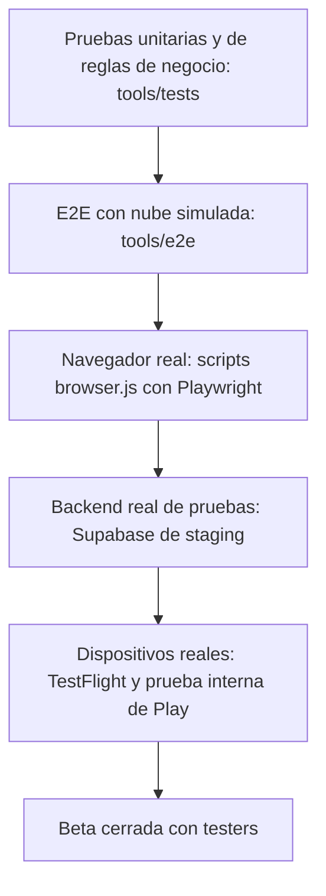

# Pruebas y publicación de la app móvil

> Fecha: 2026-11-25 | Commit de referencia: 41d4d8e | Estado: Documento de planificación, la app NO está construida.
> Leyenda: [V] verificado en código o documentación oficial, [R] recomendación, [S] supuesto, [P] pendiente de verificar.
> Requisitos de tiendas: consultados el 2026-11-25 segun las fuentes con URL de ARCHITECTURE_DECISION.md seccion 11 y PAYMENTS_AND_MEMBERSHIPS.md seccion 13 (confianza A alta, M media, B baja). Son volátiles: revalidar en la fecha de envío.
> Documentos hermanos: [SECURITY_AND_PRIVACY.md](SECURITY_AND_PRIVACY.md), [SCALABILITY_AND_COSTS.md](SCALABILITY_AND_COSTS.md), [IMPLEMENTATION_ROADMAP.md](IMPLEMENTATION_ROADMAP.md).

## 1. Resumen

El proyecto parte con una ventaja poco común: 120 archivos de prueba en `tools/tests` y un QA de extremo a extremo que ejecuta el `app.js`, `backend.js`, `data.js` y `temas.js` reales contra una nube simulada (`tools/e2e/README.md`) [V]. Tienen dos carencias: no corren en CI (0 menciones en `.github/workflows/`, F-10) y no hay `package.json` ni `npm test` [V, F-10]. La estrategia es poner lo existente en CI primero (tarea T0.21 del [roadmap](IMPLEMENTATION_ROADMAP.md)), y después añadir pruebas de pagos, dispositivos, accesibilidad, rendimiento y seguridad específicas de la app.

## 2. Estrategia de pruebas

### 2.1 Reaprovechar lo existente

| Activo | Contenido [V] | Uso en la app |
|---|---|---|
| `tools/tests/` | 120 archivos: 92 `*.test.js` y 28 de otros tipos (por ejemplo `academia-articulos.e2e.js`) | Especificación de reglas de negocio; correr en CI sobre el núcleo modularizado |
| `tools/e2e/run-all.js` | Microtemas activos, regresiones y la suite del repo, sin red y sin dependencias | Pruebas del motor adaptativo antes y después de modularizar (Fase 1) |
| `tools/e2e/*.browser.js` | `free-cap`, `free-sessions`, `leo-ai-trial`, `nav-practicar`, `reto-diario` | Requieren `npm i -D playwright` y descarga de navegadores (pedir aprobación según el README) |
| `tools/tests/leo-ai-server.test.js` | 61 pruebas de la función de IA según la auditoría | Mantener al cambiar topes y caché (AI-07, AI-08) |
| `supabase/verify/*.sql` | Consultas de verificación de solo lectura | Comprobar migraciones nuevas en staging |
| `supabase/rollback/*.sql` | Scripts de reversión manual | Ensayar reversión antes de producción |
| `.github/workflows/site-health.yml` | Lighthouse diario de la web | Seguir midiendo la web que convive con la app |

Hallazgos que condicionan las pruebas [V, F-10]: la suite pide jsdom "instalado fuera del proyecto"; dos suites rojas conocidas por entorno (`academia-articulos` y `academia-piloto`, por falta de contenido privado y de ffprobe). La suite no se ejecutó en esta auditoría [NV].

### 2.2 Puesta en CI (tarea T0.21)

Esquema propuesto [R], sin crear archivos ahora:

| Paso | Detalle |
|---|---|
| Disparo | En cada pull request y push a `main` |
| Instalación | `package.json` en la raíz con jsdom y Playwright como dependencias de desarrollo, lockfile |
| Trabajo 1 | `node tools/e2e/run-all.js` y ejecución de `tools/tests/*.test.js` |
| Trabajo 2 | Pruebas de navegador con Playwright sobre un servidor estático local |
| Trabajo 3 | Comprobación de paridad de funciones: diff entre `supabase_functions/` y `supabase/functions/` (B-08) |
| Trabajo 4 | Análisis de secretos y de dependencias |
| Contenido privado | Las dos suites rojas se marcan como "omitidas con motivo" en CI hasta contar con fixtures públicos; no subir `private/` al CI |
| Puerta | Un PR no se fusiona con pruebas rojas |

### 2.3 Pirámide para la app

| Nivel | Qué se prueba | Herramienta [R] | Cuándo |
|---|---|---|---|
| Unitario | Motor de práctica, diagnóstico (`computeDiagnosis`), sincronización (`academia-nube.js`, `mergeStates`) | Node y jsdom, suite actual | Cada PR |
| Contrato de API | RPC y Edge Functions: forma de respuesta, códigos 4xx y 5xx | Pruebas contra Supabase de staging | Cada PR que toque `supabase/` |
| RLS y permisos | Dos usuarios no se ven entre sí; `authenticated` no escribe `is_member` ni `entitlements` | Pruebas con dos sesiones reales en staging | Cada migración |
| Integración de pagos | Webhooks de Stripe, PayPal, Mercado Pago, RevenueCat | Sandboxes (sección 3) | Fases 2 y 4 |
| E2E de la app | Registro, práctica, sincronización, compra, borrado de cuenta | Playwright para la capa web; pruebas manuales guiadas en dispositivos; herramienta E2E móvil a elegir [P] | Fases 3 y 4 |
| Beta | Uso real | TestFlight y prueba cerrada de Google | Fase 4 |

Entorno de staging: hoy no existe para Supabase [V, auditoría de backend, sección de despliegue: sin ambientes de staging]. Crear un proyecto Supabase separado es requisito para probar pagos y migraciones sin tocar producción [R].

## 3. Pruebas de pagos en sandbox

Principios: nunca probar con dinero real ni con cuentas de clientes; cada proveedor tiene su modo de pruebas; los resultados se comprueban en la tabla `entitlements` y en la web.

| Canal | Entorno de pruebas | Qué cubrir |
|---|---|---|
| Apple IAP | Sandbox de App Store y StoreKit Testing en Xcode; testers de sandbox en App Store Connect [P: pasos exactos a confirmar en la documentación de Apple] | Compra, renovación acelerada, cancelación, reembolso, reintento por fallo de cobro, restaurar compras |
| Google Play Billing | Testers de licencia y pista de pruebas internas en Play Console [P: pasos exactos a confirmar] | Compra, renovación de prueba, pausa, cancelación, reembolso, restaurar |
| RevenueCat | Modo sandbox de RevenueCat con las dos tiendas; eventos por webhook | Firma HMAC, reintentos (5 veces en unos 80 minutos), entrega "al menos una vez" e idempotencia por `id` [V, informe]; llamar a `GET /subscribers` tras cada webhook como recomienda RevenueCat |
| Stripe (web) | Modo de pruebas con tarjetas de prueba publicadas por Stripe | Alta, renovación, pago fallido, reembolso, disputa, Customer Portal |
| PayPal (web) | Sandbox de PayPal, incluido el anual si se activa (pendiente de pruebas según `docs/paypal-anual-despliegue.md` [V]) | Alta, cancelación mensual y anual, reembolso |
| Mercado Pago (web) | Cuentas de prueba de Mercado Pago [P: procedimiento no verificado] | Alta, cancelación, pausa |

Casos obligatorios (cada uno con resultado esperado en `entitlements`):

| # | Caso | Resultado esperado |
|---|---|---|
| P1 | Compra nueva en iOS | Derecho activo con vencimiento, en menos de 2 minutos [S] |
| P2 | Compra nueva en Android | Igual |
| P3 | Compra en la web (Stripe) y apertura de sesión en la app | La app reconoce el derecho (regla 3.1.3(b) de Apple, que además exige ofrecer IAP [V, informe]) |
| P4 | Intento de segunda compra con derecho vivo en otro canal | Bloqueado en servidor con 409 (H-01) |
| P5 | Webhook repetido o fuera de orden | Sin efectos duplicados; el estado final es correcto |
| P6 | Fallo transitorio de BD en el webhook | El proveedor reintenta y el derecho queda activo (H-03) |
| P7 | Reembolso | Derecho revocado (H-04) |
| P8 | Cancelación | Acceso hasta el fin del periodo pagado en todas las fuentes (H-06) |
| P9 | Fallo de cobro y periodo de gracia | Acceso durante la gracia; revocación al vencer (H-11) |
| P10 | Restaurar compras en un teléfono nuevo | Derecho recuperado |
| P11 | Borrado de cuenta con suscripción web activa | Suscripción externa cancelada y datos eliminados |
| P12 | Borrado de cuenta con suscripción de tienda activa | La app indica cancelar en la tienda y ofrece el enlace |
| P13 | Sin red al abrir la app | Se usa el derecho en caché dentro del margen offline [S: 7 días] |
| P14 | Mercado Pago: cancelación de una preapproval antigua con otra autorizada | No apaga al miembro vigente (H-02) |
| P15 | Cuenta manual (miembro sin proveedor) tras la migración a `entitlements` | Conserva acceso |

## 4. Pruebas en dispositivos

Matriz mínima [S, ajustable con datos de GA4 tras la beta]:

| Categoría | Dispositivos | Motivo |
|---|---|---|
| iPhone reciente | Último iPhone con la última iOS | Revisión de Apple |
| iPhone pequeño | Pantalla pequeña (clase SE) | Textos y botones |
| iOS mínimo | iOS 15 como mínimo técnico de Capacitor 8 [V, informe]; Apple exige objetivo iOS 13 o superior desde 2026-09-09 [V, informe] | Compatibilidad |
| Android reciente | Android 16 (API 36) | Requisito de Google |
| Android gama media | Android 10 a 13 con 3 a 4 GB de RAM | Mayoría del público LatAm [S] |
| Android gama baja | 2 GB de RAM, minSdk 24 (Android 7) [V, informe] | Rendimiento del WebView |
| Tableta | iPad y tableta Android | Diseño adaptable |

Escenarios por dispositivo: primer arranque, sin red, red lenta, cambio de red, segundo plano y regreso, interrupción por llamada, audio con auriculares y pantalla bloqueada, rotación, permisos denegados (micrófono, notificaciones), actualización de versión con datos locales, cierre forzado durante una sesión de práctica (reanudación, F-03).

Herramientas [R, P: elegir]: dispositivos físicos para audio, voz y pagos; granjas de dispositivos en la nube para ampliar cobertura de Android.

## 5. Accesibilidad

Hoy: `lang="es"` y viewport presentes en todos los HTML, uso moderado de `aria-*`, `prefers-reduced-motion` parcial, sin auditoría de contraste ni de tamaños táctiles [V, F]. Tema de la PWA (`#030b1a`) distinto de la paleta (`--paper #FBF8F2`) [V, F-12].

| Verificación | Criterio [R] |
|---|---|
| Lector de pantalla | VoiceOver en iOS y TalkBack en Android recorren práctica, Academia, pago y ajustes sin bloqueos |
| Tamaño de texto | Interfaz usable con texto del sistema al 200 por ciento |
| Contraste | Texto con relación de contraste mínima de 4,5 a 1 (comprobar los tokens `--ink` sobre `--paper` y los botones azules) |
| Áreas táctiles | Mínimo de 44 por 44 puntos en iOS y 48 dp en Android |
| Movimiento | Respetar "reducir movimiento" en la mascota y transiciones |
| Audio | Todo contenido de audio con texto equivalente; control de volumen y velocidad |
| Opciones múltiples | Orden aleatorio con `shuffleOptions()` (regla del proyecto) sin romper la navegación con lector [V, reglas del dueño] |
| Modo oscuro | Variante oscura de tokens (F-15) si se incluye |

## 6. Pruebas de rendimiento

| Métrica | Umbral inicial [S] | Cómo medir |
|---|---|---|
| Arranque en frío en Android de gama media | Menos de 3 s hasta pantalla interactiva | Dispositivo real, 10 repeticiones |
| Tamaño del paquete sin audio | Menos de 30 MB | Informe del compilador |
| Memoria en una sesión de práctica | Sin crecimiento sostenido en 20 minutos | Perfilador |
| Consumo de batería en 30 minutos de audio | Comparable a un reproductor | Perfilador de energía |
| Peso de `app.js` y `data.js` (602 KB y 1,06 MB hoy [V, F-11]) | Dividir y minificar antes de la beta | Informe del empaquetador |
| Carga del backend | Mantener p95 de API menor de 500 ms con la carga de [SCALABILITY_AND_COSTS.md](SCALABILITY_AND_COSTS.md) del escenario de 10.000 usuarios | Prueba de carga en staging con 40 consultas por segundo de pico [S] |
| Lecturas paginadas | Alumno de 5.000 sesiones sincroniza completo sin perder las más recientes | Prueba de regresión de F-01 |
| Peticiones HEAD de audio | Reemplazadas por manifiesto (F-16) | Registro de red |

## 7. Pruebas de seguridad

| Prueba | Detalle | Hallazgos relacionados |
|---|---|---|
| RLS con dos usuarios | El usuario A no lee ni escribe filas del B; no escribe `is_member`, `entitlements`, `free_*` | B-10, H-08 |
| Contenido premium | Con y sin sesión de miembro: sin sesión no hay acceso a datos ni audio premium; inspección del `.ipa` y `.aab` para confirmar que no incluyen contenido premium | B-02, F-06, H-09 |
| Webhooks | Firma inválida rechazada; repetición con marca vieja rechazada; MP con firma | B-07, H-05, H-10 |
| Registro y reset | CAPTCHA obligatorio; límites de tasa; correo sin confirmar no concede sesión | B-01, B-04 |
| IA | Entrada libre inválida rechazada; `itemId` inexistente rechazado; presupuesto agotado devuelve mensaje controlado | AI-07, AI-10 |
| Almacenamiento seguro | Sesión no legible desde copias de seguridad ni desde el sistema de archivos del WebView | sección 6 de seguridad |
| Dependencias y secretos | Escaneo de secretos en el repo y de dependencias de plugins | F-08 |
| Análisis de la app móvil | Revisión con una guía de seguridad móvil reconocida [P: elegir herramienta, por ejemplo OWASP MASVS] | n/a |
| Borrado de cuenta | Tras borrar, el usuario no puede iniciar sesión y sus datos no aparecen (comprobar cascada) | H-18 |
| Robo de dispositivo | "Cerrar sesión en todos" invalida refresh tokens; el JWT caduca en aproximadamente 1 hora | B-03 |

## 8. Proceso de publicación

### 8.1 Requisitos vigentes de las tiendas (consultados 2026-11-25)

| Requisito | Valor | Fuente y confianza |
|---|---|---|
| Apple: compilar con Xcode 26 y SDK iOS 26 | Desde 2026-04-28 | developer.apple.com/news/upcoming-requirements (A) |
| Apple: objetivo mínimo de despliegue | iOS 13 o superior desde 2026-09-09 | misma fuente (A) |
| Apple: cuenta de desarrollador | USD 99 al año; como organización exige D-U-N-S, sitio web público y correo de dominio | developer.apple.com/support/enrollment (A) |
| Apple: IAP obligatorio para contenido digital | Regla 3.1.1; botones y enlaces a otros métodos de compra prohibidos fuera de EEUU salvo entitlement | App Review Guidelines (A) |
| Apple: acceso multiplataforma | Regla 3.1.3(b): se puede dar acceso a lo comprado en web si el contenido también está como IAP en la app | App Review Guidelines (A) |
| Apple: funcionalidad mínima | Regla 4.2: más que un sitio web reempaquetado | App Review Guidelines (A) |
| Apple: Sign in with Apple | Regla 4.8 si hay login de terceros | App Review Guidelines (A) |
| Apple: borrado de cuenta | Regla 5.1.1(v), dentro de la app | App Review Guidelines (A) |
| Apple: ATT | Solo si hay seguimiento entre apps o webs de terceros | user-privacy-and-data-use (A) |
| Apple: IA de terceros | Permiso explícito antes de compartir datos personales (5.1.2(i)) | App Review Guidelines (A) |
| Apple: restaurar compras y enlaces | Opción de "iniciar sesión o restaurar compras", enlaces a términos y privacidad en la app y en metadatos | developer.apple.com/app-store/subscriptions (A) |
| Apple: etiquetas de privacidad | Obligatorias, incluyen lo que recogen los SDK (privacy manifests) | user-privacy-and-data-use (A) |
| Google: cuenta | USD 25 pago único; puede pedir ID oficial y verificación de dispositivo Android | support.google.com answer 6112435 (A) |
| Google: nivel de API objetivo | Android 16 (API 36) para nuevas apps y actualizaciones desde 2026-08-31; la prórroga a 2026-11-01 ya venció | answer 11926878 (A) |
| Google: Play Billing Library | Versión 8 (soporte hasta 2027-08-31) o 9; la 7 ya no vale para nuevas apps y actualizaciones | developer.android.com deprecation-faq (A) |
| Google: prueba cerrada | 12 testers durante 14 días consecutivos para cuentas personales creadas después del 2023-11-13 | answer 14151465 (A) |
| Google: Data safety | Formulario obligatorio en Play Console, con declaración de eliminación de datos | answer 13327111 (A) |
| Google: borrado de cuenta | Ruta en la app más URL web | answer 13327111 (A) |
| Google: pagos | Play Billing para contenido digital, salvo programas de facturación alternativa en países elegibles | answer 9858738 (A) |

Comisiones y litigios (Epic frente a Apple y frente a Google) siguen en movimiento: revisar antes de fijar precios [V, informe, confianza M].

### 8.2 App Store, paso a paso

1. Inscribir la cuenta de Apple Developer (individual u organización). Para organización: D-U-N-S, sitio web y correo de dominio. Hacerlo en la Fase 0, tarda.
2. Crear el identificador de app (bundle ID), capacidades (Sign in with Apple, Push Notifications, In-App Purchase) y claves APNs.
3. En App Store Connect crear la app, grupo de suscripción y productos (mensual y anual); fijar precios por territorio.
4. Compilar con Xcode 26 y SDK iOS 26; versión y número de compilación; icono, pantalla de lanzamiento, privacy manifest de la app y de los SDK.
5. Subir la compilación a TestFlight; prueba interna y externa.
6. Rellenar la ficha: nombre, subtítulo, descripción, palabras clave, capturas por tamaño de pantalla, categoría Educación, clasificación de edad, URL de soporte y de política de privacidad, términos de uso.
7. Completar las etiquetas de privacidad (sección 9.5 de [SECURITY_AND_PRIVACY.md](SECURITY_AND_PRIVACY.md)).
8. Notas para revisión: cuenta de demostración con acceso de miembro, explicación de Leo AI, de la compra y de la restauración, y de la función nativa que supera la regla 4.2.
9. Programa Small Business (15 por ciento) si procede: inscribirse antes de cobrar [V, informe].
10. Enviar a revisión; atender rechazos con una respuesta concreta y, si hace falta, apelar.
11. Publicar con lanzamiento por fases (sección 10).

### 8.3 Google Play, paso a paso

1. Crear la cuenta de Play Console (USD 25), verificar identidad y dispositivo.
2. Crear la app; declarar categoría, contacto y política de privacidad.
3. Configurar firma de la app (Play App Signing) y generar el paquete `.aab` con API objetivo 36 y Play Billing Library 8 o 9.
4. Crear productos de suscripción y planes base; configurar RTDN con Cloud Pub/Sub si se valida con servidor propio [P: no se verificó la documentación de RTDN; RevenueCat la cubre].
5. Subir a prueba interna; después prueba cerrada con 12 testers durante 14 días consecutivos (cuenta personal nueva). Reclutarlos durante la Fase 3.
6. Completar Contenido de la app: Data safety, clasificación de contenido, público objetivo, anuncios, declaración de IA y eliminación de datos con URL web.
7. Ficha de Play: título, descripciones, capturas por tipo de dispositivo, gráfico destacado, icono.
8. Solicitar acceso a producción tras cumplir la prueba cerrada.
9. Lanzamiento por etapas (sección 10).

## 9. Lista de comprobación de revisión de tiendas

| Ítem | Apple | Google | Estado |
|---|---|---|---|
| Compras con IAP o Play Billing, sin botones externos de pago | 3.1.1 | Pagos | Pendiente |
| Restaurar compras visible | Sí | Recomendado | Pendiente |
| Gestionar suscripción (enlace a la tienda) | 3.1.2 | Sí | Pendiente |
| Eliminación de cuenta dentro de la app y URL web | 5.1.1(v) | Sí, más URL web | Pendiente (H-18) |
| Sign in with Apple si hay login social | 4.8 | n/a | Pendiente |
| Política de privacidad y términos enlazados en la app y la ficha | Sí | Sí | Pendiente (AI-05) |
| Privacy labels y Data safety coherentes con los SDK | Sí | Sí | Pendiente |
| Consentimiento de analítica y ATT si procede | Sí | n/a | Pendiente (AI-03) |
| Permiso explícito para IA de terceros | 5.1.2(i) | Política de IA de Google [P] | Pendiente |
| Funcionalidad nativa más allá de la web | 4.2 | Contenido mínimo | Pendiente |
| Sin contenido premium dentro del paquete | n/a | n/a | Pendiente (B-02) |
| Cuenta de demostración para revisores | Sí | Si la app tiene login | Pendiente |
| Clasificación de edad coherente con la política (13 o más) | Sí | Sí | Pendiente (AI-04) |
| API objetivo, SDK y Billing Library vigentes | Xcode 26, iOS 13 | API 36, Billing 8 o 9 | Pendiente |
| Capturas, descripciones y precios sin promesas falsas | Sí | Sí | Pendiente |
| Texto de la ficha sin rayas largas y con la identidad de Leo | Estilo del proyecto | Igual | Pendiente |
| Rendimiento: sin cierres en pruebas de revisión | Sí | Android vitals | Pendiente |

## 10. Despliegue por etapas, reversión y salud

### 10.1 Etapas

| Etapa | Alcance | Duración mínima [S] | Condición para avanzar |
|---|---|---|---|
| Interna | Equipo y TestFlight | 1 semana | Sin fallos críticos |
| Beta cerrada | 12 testers o más, 14 días en Google | 14 días | Criterios de la puerta G4 del roadmap |
| 1 por ciento | Primeros usuarios reales | 48 a 72 h | Salud dentro de umbral |
| 5 por ciento | | 48 a 72 h | Igual |
| 20 por ciento | | 72 h | Igual |
| 50 por ciento | | 72 h | Igual |
| 100 por ciento | | n/a | Igual |

Google permite elegir el porcentaje de la etapa [P]. Apple ofrece un lanzamiento por fases con porcentajes automáticos en 7 días, pausable [P: confirmar en App Store Connect]. Por eso las etapas de 1, 5, 20 y 50 por ciento en iOS se emulan con los interruptores de `app_config` (feature flags) y la limitación de visibilidad por región o cohorte [R].

### 10.2 Reversión

| Situación | Acción |
|---|---|
| Fallo grave en Android | Detener el despliegue en Play Console, publicar versión corregida; los usuarios que ya actualizaron no vuelven atrás [P] |
| Fallo grave en iOS | Pausar el lanzamiento por fases, solicitar revisión acelerada de la corrección, o retirar de la venta; no existe retroceso de binario [P] |
| Fallo de servidor o de pagos | Kill switch (`iap_enabled`, `premium_content_enabled`), reversión de la función o de la migración |
| Versiones antiguas con riesgo | `min_app_version` para exigir actualización |
| Datos dañados | Restauración desde backup o PITR (ver [SECURITY_AND_PRIVACY.md](SECURITY_AND_PRIVACY.md), sección 10) |

### 10.3 Métricas de salud

| Métrica | Umbral [S, salvo indicación] | Fuente |
|---|---|---|
| Sesiones sin cierres inesperados | 99,5 por ciento o más | Xcode Organizer, Android vitals |
| ANR en Android | Por debajo del umbral "malo" de Google [P: cifra vigente] | Play Console |
| Errores de compra | Menos de 2 por ciento de los intentos | RevenueCat, webhooks |
| Tiempo desde compra hasta acceso | Menos de 2 minutos | `entitlements` |
| Diferencias en la conciliación diaria | 0 | Función de conciliación |
| Errores 5xx del backend | Menos de 1 por ciento | Supabase |
| Errores nativos reportados | Sin nuevas huellas críticas | `report-error`, `error-alert` [V que existe para web] |
| Retención al día 1, 7 y 30 | Referencia propia tras la beta | Analítica con consentimiento |
| Uso de IA y gasto | Dentro de presupuesto | `ai_usage_daily`, panel de Cloudflare |
| Valoración y reseñas | Revisión semanal | Tiendas |
| Tiempo de respuesta de soporte | 24 h [S] | LeoBot y correo |

## 11. Pendiente de verificar

Pasos exactos de sandbox de Apple, Google y Mercado Pago; porcentajes y reglas actuales del lanzamiento por fases de Apple y por etapas de Google; umbrales vigentes de Android vitals; política de IA de Google Play; formato de App Store Server Notifications V2 y de RTDN de Play (no leídos en el informe); resultado de la suite de `tools/tests` en CI (no se ejecutó); herramienta de pruebas E2E móviles; cobertura real de dispositivos del público objetivo.
